# Uvodni dio

## 1.1 Taktičke oznake u vježbovniku

| Taktička oznaka | Podloga | Simbol u skicama | Funkcija | Datoteke |
|:---:|---|:---:|---|---|
| 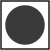 | Podloga bijele boje |  | Zapovjednik | `oznaka-zapovjednik`, `zapovjednik` |
| 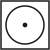 | Podloga bijele boje |  | Teklić | `oznaka-teklic`, `teklic` |
| 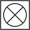 | Podloga bijele boje |  | Strojar | `oznaka-strojar`, `strojar` |
|  | Podloga crvene boje | 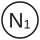 | Vođa navalne grupe | `oznaka-n1`, `n1` |
|  | Podloga crvene boje | 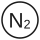 | Član navalne grupe | `oznaka-n2`, `n2` |
|  | Podloga plave boje | 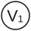 | Vođa vodne grupe | `oznaka-v1`, `v1` |
|  | Podloga plave boje | 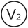 | Član vodne grupe | `oznaka-v2`, `v2` |
|  | Podloga žute boje | 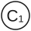 | Vođa cijevne grupe | `oznaka-c1`, `c1` |
|  | Podloga žute boje |  | Član cijevne grupe | `oznaka-c2`, `c2` |

Krug s polovicom ispunjenom crnom bojom označava **vođu** grupe, a prazan krug **člana** grupe.

## 1.2 Simboli korišteni u skicama

| Simbol | Naziv | Datoteka |
|:---:|---|---|
|  | Usisna cijev | `usisna-cijev` |
|  | Tlačna „B” cijev | `tlacna-b-cijev` |
|  | Tlačna „C” cijev | `tlacna-c-cijev` |
|  | Tlačna „B” cijev u kolutu | `tlacna-b-cijev-kolut` |
|  | Tlačna „C” cijev u kolutu | `tlacna-c-cijev-kolut` |
| 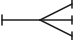 | Trodijelna razdjelnica | `trodijelna-razdjelnica` |
|  | Dvodijelna razdjelnica | `dvodijelna-razdjelnica` |
|  | Obična „B” mlaznica | `obicna-b-mlaznica` |
|  | Obična „C” mlaznica | `obicna-c-mlaznica` |
|  | Mlaznica za pjenu | `mlaznica-za-pjenu` |
|  | Međumješalica | `medumjesalica` |
| 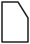 | Posuda za pjenilo | `posuda-za-pjenilo` |
| 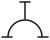 | Sabirnica | `sabirnica` |
| 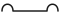 | Ključ za spojnice | `kljuc-za-spojnice` |
| 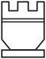 | Usisna sitka | `usisna-sitka` |
|  | Prijenosna vatrogasna pumpa (MP) | `prijenosna-pumpa` |
|  | Prijelazna spojnica B/C | `prijelazna-spojnica-bc` |
| 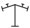 | Dvodijelni hidrantski nastavak | `dvodijelni-hidrantski-nastavak` |
|  | Cijevni držač | `cijevni-drzac` |
|  | Ključ za podzemni hidrant | `kljuc-podzemni-hidrant` |
| 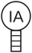 | Izolacijski aparat | `izolacijski-aparat` |
|  | Uže s torbicom za usisnu sitku | `uze-s-torbicom` |
|  | Podzemni hidrant | `podzemni-hidrant` |
| 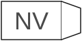 | Navalno vozilo (NV) | `navalno-vozilo` |
| 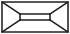 | Torbica s povezicama za cijevi | `torbica-s-povezicama` |
| 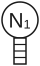 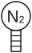 | Navalna grupa opremljena sa izolacijskim aparatima | `n1-ia`, `n2-ia` |
| 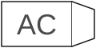 | Autocisterna (AC) – dodano, koristi se u vježbama 7 i 8 | `autocisterna` |

### Dodatni simboli (iz skica u poglavlju 1.3)

| Simbol | Značenje | Datoteka |
|:---:|---|---|
| 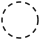 | Položaj zapovjednika pri izdavanju zapovijedi (iscrtkano) | `zapovjednik-polozaj` |
|  | Crtica uz krug – smjer u kojem je vatrogasac okrenut (zakreće se u skici) | `smjer` |
|   | Spojnica na „B” odnosno „C” cijevnom vodu | `spojnica-b`, `spojnica-c` |
|  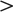 | „B” odnosno „C” mlaznica na kraju položenog voda | `vrh-mlaznice-b`, `vrh-mlaznice-c` |
|  | Strelica kote (mjere) | `strelica-kote` |
|  | Izolacijski aparat na leđima vatrogasca (crta se uz krug osobe, `ia=True`) | `ia-ljestve` |
|  | Spojnica na savijenom usisnom vodu | `spojnica-usisna` |
|  | Priključak (usisni ili tlačni otvor) motorne pumpe ili vozila | `prikljucak-pumpe` |

---

### Korištenje simbola u drugim dijelovima priručnika

Svi simboli nalaze se u mapi `simboli/`, svaki kao zasebna SVG datoteka (ime datoteke = oznaka iz stupca *Datoteka*).

**U markdownu:**

```markdown

```

**U HTML-u (sprite – svi simboli u jednoj datoteci `simboli/simboli.svg`):**

```html
<svg width="40" height="40"><use href="simboli/simboli.svg#n1"/></svg>
```

**Nove skice** se crtaju skriptama u mapi `alati/`, tako da sve skice koriste iste simbole:

- `vatrogasni_simboli.py` – svi simboli i alati za crtanje (klasa `Skica`): `osoba()` (s crticom smjera, i pod kutom), `simbol()` (s rotacijom), `vod()` (B ili C cijevni vod s krivuljama, spojnicama i mlaznicom), `mlaz()` (položeni C mlaz s lukom), `hidrant_s_nastavkom()`, `usisni_vod()` (savijeni usisni vod sa spojnicama i sitkom), `put()` (uže i druge tanke linije), `kota_h()`, `kota_v()`; `osoba(..., ia=True)` crta izolacijski aparat na leđima, a `dodaj_simbol()` registrira dodatni simbol iz skripte pojedine vježbe. Pokretanjem se osvježavaju simboli i skice iz poglavlja 1.3.
- `skice_vjezbe_01_02.py` – skice 11–19 (vježbe 1 i 2)
- `skice_vjezbe_03.py`, `skice_vjezbe_04.py` – skice 20–36 (vježbe 3 i 4)
- `skice_vjezbe_05_08.py` – skice 37–53 (vježbe 5–8)
- `skice_vjezbe_09_12.py` – skice 54–67 (vježbe 9–12)
- `skice_vjezbe_13_15.py` – skice 68–77 (vježbe 13–15)

Skice u mapi `skice/` simbole **povezuju** iz mape `simboli/` (`<image href="../simboli/….svg">`), pa izmjena simbola odmah vrijedi u svim skicama. Pri spremanju skripta provjerava postoji li svaki korišteni simbol u `simboli/` i dodaje one koji nedostaju.

Preglednici markdowna prikazuju SVG kao sliku i pritom ne učitavaju povezane datoteke, zato skripta uz svaku skicu sprema i samostalnu kopiju u `skice/ugradjeno/` (simboli ugrađeni u datoteku). Markdown datoteke koriste te kopije. Kopije se ne uređuju ručno – generiraju se iz skripti.

Promjena simbola ili boje u `vatrogasni_simboli.py` i ponovno pokretanje skripti osvježava sve datoteke.
