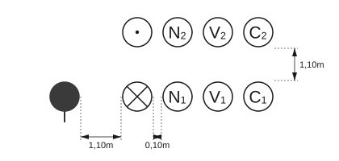
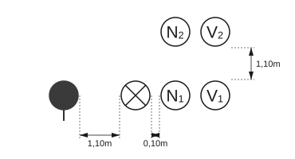
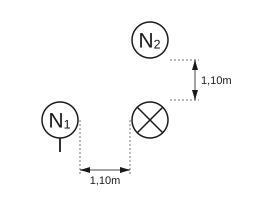
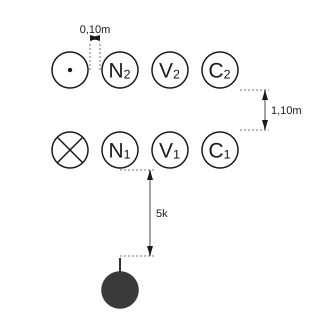
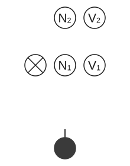
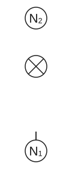
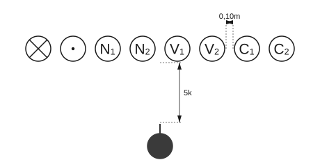
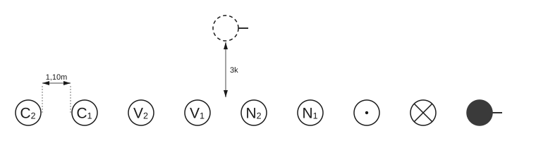
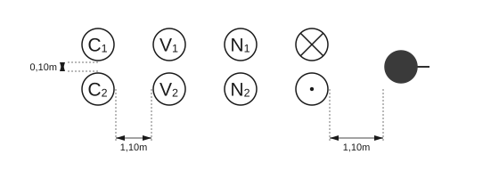

# Uvodni dio – Vježbovne radnje i postupci

## 1.3 Vježbovne radnje i postupci

### 1.3.1 Postrojavanje vatrogasnog odjeljenja

Postrojavanje vatrogasnog odjeljenja za izvođenje vježbe obavlja se na zapovijed zapovjednika: **„Odjeljenje u dvije (jednu) vrste – zbor!”**

Na izdanu zapovijed, vatrogasno odjeljenje (9, 6 ili 3 vatrogasca) postrojava se u dvovrsni (jednovrsni) stroj.

Na skicama 1, 2 i 3 prikazano je postrojavanje vatrogasnog odjeljenja za izvođenje vježbe od 9, 6 i 3 vatrogasca u dvovrsnom stroju.

**Skica 1** – *Postrojavanje vatrogasnog odjeljenja od 9 vatrogasaca u dvovrsnom stroju*

**Skica 2** – *Postrojavanje vatrogasnog odjeljenja od 6 vatrogasaca u dvovrsnom stroju*

**Skica 3** – *Postrojavanje vatrogasnog odjeljenja od 3 vatrogasca u dvovrsnom stroju*

**Dvovrsni stroj** je stroj u kojemu su vatrogasci raspoređeni u dvije vrste tako da se vatrogascima prve vrste nalaze u zatiljak vatrogasci druge vrste na rastojanju 0,10 m i odstojanju 1,10 m.

**Rastojanje** je razmak između vatrogasaca u vrsti s lijeve, odnosno desne strane.

**Odstojanje** je razmak između vatrogasaca u dvovrsnom stroju ispred, odnosno iza (vatrogasci druge vrste stoje u zatiljak vatrogascima prve vrste).

Na skicama 4, 5 i 6 prikazane su pozicije članova odjeljenja pri izdavanju zapovijedi zapovjednika za izvođenje vježbe.

**Skica 4** – *Pozicije članova odjeljenja od 9 vatrogasaca pri izdavanju zapovijedi*

|  |  |
|:---:|:---:|
| **Skica 5** – *Pozicije članova odjeljenja od 6 vatrogasaca pri izdavanju zapovijedi* | **Skica 6** – *Pozicije članova odjeljenja od 3 vatrogasca pri izdavanju zapovijedi* |

**Jednovrsni stroj** je stroj u kojem vatrogasci stoje jedan pored drugog na rastojanju 0,10 m. U jednovrsni stroj postrojavaju se odjeljenja i veće formacijske jedinice.

Na skici 7 prikazano je postrojavanje vatrogasnog odjeljenja u jednovrsnom stroju.

**Skica 7** – *Postrojavanje odjeljenja u jednovrsnom stroju*

Postrojavanje vatrogasnog odjeljenja može se uraditi i putem kolone na izdanu zapovijed zapovjednika: **„Odjeljenje u dvije (jednu) kolone – zbor!”** (skica 8 i 9)

**Skica 8** – *Postrojavanje vatrogasnog odjeljenja u kolonu po jedan*

**Skica 9** – *Postrojavanje vatrogasnog odjeljenja u kolonu po dva*

**Kolona** je stroj vatrogasaca (odjeljenja i većih formacija) u kojem su vatrogasci postrojeni jedni za drugim u zatiljak na odstojanju 1,10 m i rastojanju 0,10 m.

Kolone mogu biti po jedan i po dva za vatrogasna odjeljenja, a za veće vatrogasne formacije kolone po dva, tri i četiri.

> *Oznaka „5k” / „3k” na skicama znači 5, odnosno 3 koraka.*
