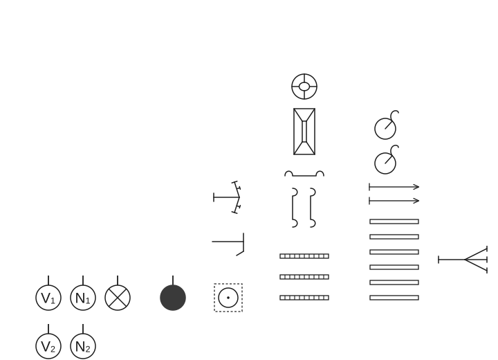
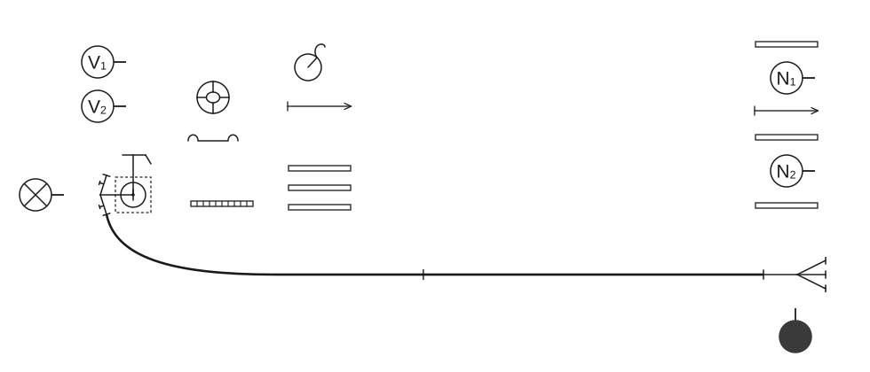
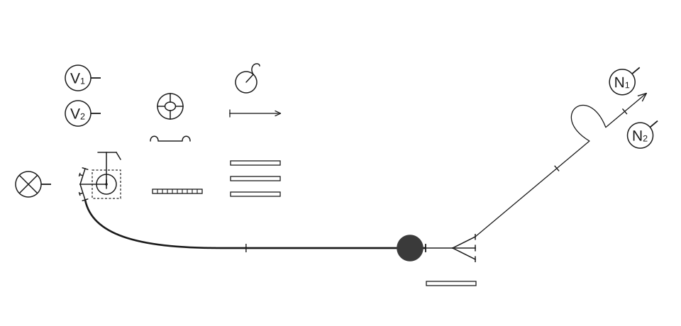
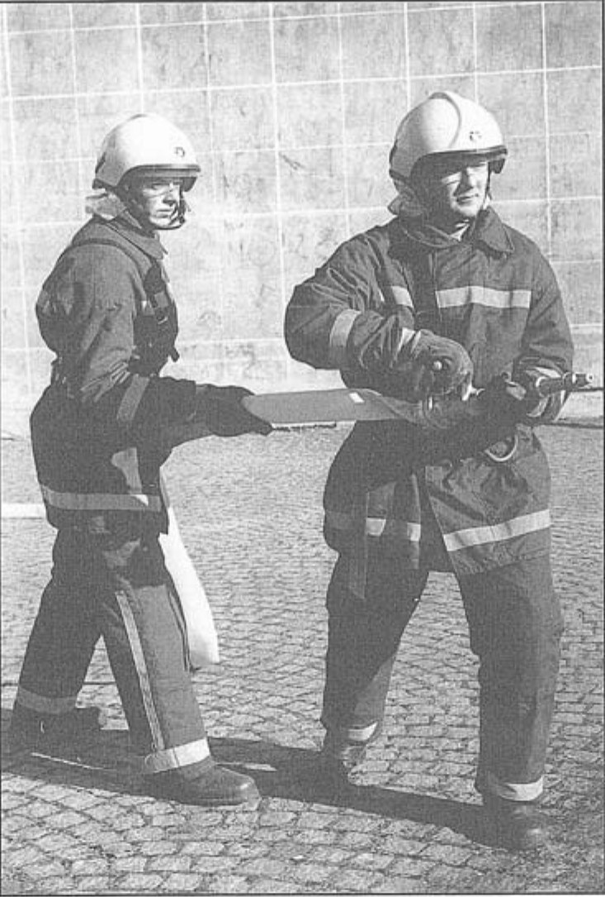
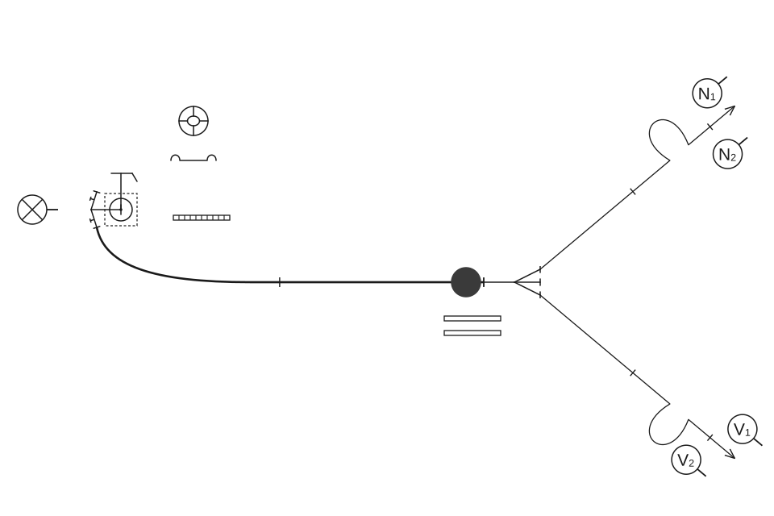
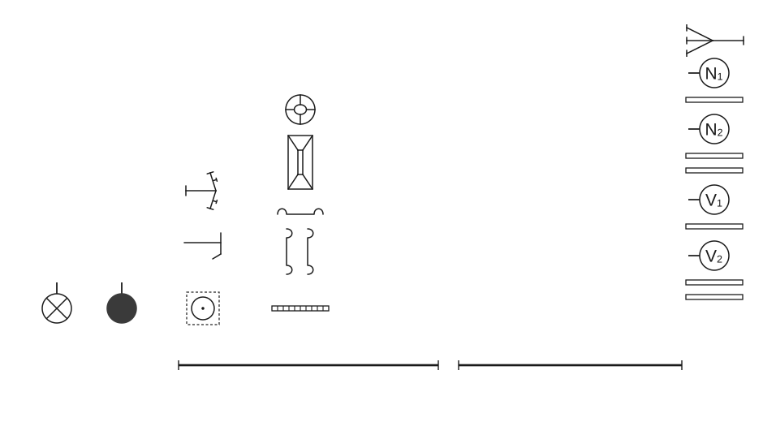

# Poligonske vježbe

## 2.3 Vježbe s hidrantom

### 2.3.1 Vježba 1 – Vježba s dva „C” mlaza vode (šest vatrogasaca)

Ovu vježbu izvodi odjeljenje od šest vatrogasaca:

- zapovjednik (Z),
- strojar (S),
- vođa navalne grupe (N₁),
- član navalne grupe (N₂),
- vođa vodne grupe (V₁),
- član vodne grupe (V₂).

Za izvođenje vježbe potrebna je sljedeća vatrogasna oprema:

- 1 hidrantski nastavak,
- 1 ključ za hidrant,
- 3 „B” tlačne cijevi,
- 6 „C” tlačnih cijevi,
- 2 „C” mlaznice,
- 1 trodijelna razdjelnica,
- 1 prijelaznica B/C,
- 1 torbica s povezicama za cijevi,
- 2 držača za cijevi,
- 3 univerzalna ključa za spojnice.

Kada je oprema postavljena na određeno mjesto, zapovjednik stane na dva koraka iza hidranta, podiže lijevu ruku i zapovijeda: **„Odjeljenje zbor!”** Na tu zapovijed vatrogasci se postrojavaju u dvije vrste (skica 11).

**Skica 11** – *Postavljanje sprava, opreme i postrojavanje odjeljenja za vježbu*

Kada je odjeljenje postrojeno, zapovjednik istupa pet koraka naprijed, okreće se (čelom nazad) prema odjeljenju, a zatim izdaje zapovijed koja glasi: **„Požar pravac …… voda – hidrant, s dvije „B” cijevi do razdjelnice, za navalu pripremi!”**

Nakon izdane zapovijedi obavljaju se sljedeće radnje:

#### Postavljanje hidrantskog nastavka

Nakon izdane zapovijedi, strojar uzima u desnu ruku hidrantski nastavak, a u lijevu ključ za hidrant, zatim otvara ključem poklopac hidranta, priključuje hidrantski nastavak na hidrant te stavlja ključ. Kada je to obavio, strojar stane kod hidranta okrenut prema razdjelnici s rukama na ručicama ključa.

#### Polaganje „B” cijevnog voda u cijevnom sektoru rada

Nakon izdane zapovijedi, vođa vodne grupe (V₁) uzima jedan ključ za spojnice i stavlja ga za opasač, a zatim uzima u lijevu ruku kolut „B” cijevi. Član vodne grupe (V₂) uzima torbicu s povezicama, stavlja je preko lijevog ramena, ključ stavlja za opasač, a zatim uzima u desnu ruku kolut „B” cijevi.

Kada su se članovi vodne grupe (V₁, V₂) opremili potrebnom opremom, obavljaju polaganje „B” cijevnog sektora rada.

Član vodne grupe (V₂) skida nosač sa svog koluta „B” cijevi, donju spojnicu priključuje na izlazni otvor hidrantskog nastavka, a gornju spojnicu predaje vođi vodne grupe (V₁) koji povlači cijev prema požaru.

Kada je vođa vodne grupe razvukao prvi kolut „B” cijevi, on polaže svoju „B” cijev, skida nosač, spaja donju spojnicu na spojnicu već razvučene cijevi. Desnom nogom stane na prvu „B” cijev, a lijevom na drugu „B” cijev. Član vodne grupe (V₂), koji je u međuvremenu stigao lijevom stranom, prihvaća slobodni kraj druge „B” cijevi desnom rukom i povlači je u smjeru požara, sve dok ona ne bude ravno položena.

Članovi navalne grupe (N₁, N₂) opremaju se za polaganje prvog cijevnog voda za gašenje.

Vođa navalne grupe (N₁) uzima mlaznicu i držač koje stavlja za opasač, zatim u desnu ruku uzima razdjelnicu, a u lijevu jedan kolut „C” tlačnih cijevi.

Član navalne grupe (N₂) uzima u svaku ruku po jedan kolut „C” tlačnih cijevi i staje s desne strane vođe navalne grupe.

Tako opremljeni zajedno odlaze prema požaru, krećući se lijevom stranom „B” cijevnog voda sve do njegova kraja. Tada vođa navalne grupe (N₁) stavlja pored sebe na zemlju kolut „C” tlačnih cijevi iz lijeve ruke, a razdjelnicu iz desne ruke postavlja na kraju „B” cijevnog voda. Član navalne grupe (N₂) stavlja oba koluta „C” tlačnih cijevi pored sebe na zemlju, zatim priključuje „B” cijevni vod s razdjelnicom, uspravlja se, desnom nogom stane na razdjelnicu i okreće se prema hidrantu. Nakon toga diže desnu ruku dajući znak za vodu i zapovijeda: **„Vodu daj!”**.

Kada od strojara dobije znak da je zapovijed primio, odlazi na svoje mjesto i čeka na sljedeću zapovijed zapovjednika. Strojar na izdanu zapovijed otvara vodu na hidrantu (prvo s hidrantskim ključem otvara ventil, a nakon toga otvara ventil na hidrantskom nastavku).

Nakon izdane zapovijedi, zapovjednik odlazi do kraja „B” cijevnog voda i staje tri koraka desno od razdjelnice, okrenut prema razdjelnici.

Pošto je obavljeno spajanje „B” cijevnog voda, vodna grupa prelazi na lijevu stranu „B” voda i vraća se nazad do mjesta gdje je postavljena oprema.

Staju iza opreme okrenuti u pravcu požara i ostaju sve do zapovijedi zapovjednika za drugi mlaz (skica 12).

**Skica 12** – *Položaj odjeljenja, sprava i opreme nakon izdane zapovijedi „…za navalu pripremi!”*

#### Polaganje prvog mlaza u navalnom sektoru

Kada je „B” cijevni vod spojen na razdjelnicu i puštena voda do razdjelnice, zapovjednik zapovijeda: **„Za prvi mlaz s dvije „C” cijevi pravac …… naprijed!”**. Nakon izdane zapovijedi, zapovjednik (Z) preuzima nadzor nad razdjelnicom tako da desnom nogom staje na razdjelnicu, lijevu nogu postavlja s lijeve strane razdjelnice, a članovi navalne grupe (N₁ i N₂) polažu prvi cijevni vod u navalnom sektoru za gašenje. Član navalne grupe (N₂) odlaže rezervnu „C” cijev s desne strane razdjelnice, a s druge „C” cijevi skida nosač, lijevom rukom predaje gornju spojnicu vođi navalne grupe (N₁), lijevom nogom staje na cijev i spaja donju spojnicu na lijevi otvor razdjelnice.

**Skica 13** – *Položaj odjeljenja, sprava i opreme nakon izdane zapovijedi za prvi mlaz*

Vođa navalne grupe (N₁) uzima u desnu ruku gornju spojnicu „C” cijevi i povlači je prema požaru, stavlja spojnicu razvučene cijevi na zemlju i skida nosač svoje „C” cijevi i spaja obje cijevi. Polaže drugu „C” cijev u smjeru požara, ali samo toliko koliko je potrebno da taj kolut „C” cijevi, prilikom izbacivanja u lijevu stranu, dobije veći luk. Nakon što je ostavio dovoljnu duljinu cijevi za izvođenje luka, vođa navalne grupe (N₁) lijevom rukom uzima mlaznicu iz opasača i spaja je na spojnicu „C” cijevi pri čemu zauzima položaj za gašenje požara. Diže desnu ruku – okreće se u desnu stranu prema poslužitelju na razdjelnici i zapovijeda: **„Za prvi mlaz – vodu daj!”** Kada je od poslužitelja, koji se nalazi na razdjelnici (Z), dobio znak o primljenoj zapovijedi, okreće se prema požaru i iskorači lijevom nogom. Član navalne grupe (N₂), nakon spojene prve „C” cijevi na razdjelnicu, dolazi do druge „C” cijevi i izbacuje ju u pravilnom luku u lijevu stranu, prelazi na desnu stranu položene „C” cijevi i staje korak iza vođe navalne grupe (N₁). Okreće se prema požaru i pomaže u držanju cijevi lijevom i desnom rukom, prilikom čega desnom nogom iskoračuje naprijed (slika 17). Poslužitelj na razdjelnici (Z), nakon danog znaka o primljenoj zapovijedi, otvara ventil na lijevom otvoru razdjelnice (skica 13).

**Slika 17** – *Držanje mlaznice i cijevi u navalnom sektoru rada*

#### Polaganje drugog mlaza u navalnom sektoru

Kada je položen prvi cijevni vod za prvi mlaz, zapovjednik zapovijeda: **„Za drugi mlaz s dvije „C” cijevi pravac …. naprijed!”**. Na tu zapovijed vodna se grupa (V₁, V₂) oprema za drugi mlaz.

Vođa vodne grupe (V₁) uzima mlaznicu i držač koje stavlja za opasač, a u lijevu ruku uzima jedan kolut „C” tlačnih cijevi.

Član vodne grupe (V₂) uzima u svaku ruku po jedan kolut „C” tlačnih cijevi i staje s desne strane vođe vodne grupe. Zatim, tako opremljeni, zajedno odlaze prema požaru i iza prve spojnice „B” cijevnog voda u cijevnom sektoru prelaze na njegovu desnu stranu. Kada su stigli do razdjelnice, član vodne grupe stavlja jedan kolut „C” cijevi s desne strane razdjelnice, predaje poslužitelju na razdjelnici (Z) ključ i torbicu s povezicama, a V₁ predaje ključ. Nakon toga V₂ skida nosač sa cijevi koju je donio u desnoj ruci i lijevom rukom predaje gornju spojnicu vođi vodne grupe. Zatim stane lijevom nogom na cijev i spaja donju spojnicu na desni otvor razdjelnice. Vođa vodne grupe (V₁) prima u desnu ruku gornju spojnicu „C” cijevi, koju mu je predao član vodne grupe, i polaže cijev u smjeru požara. Pritom u lijevoj ruci nosi svoj kolut „C” cijevi. Kada je kolut primljene „C” cijevi položio, skida nosač svog koluta „C” cijevi i spaja prvu i drugu cijev.

Vođa vodne grupe polaže drugu „C” cijev u smjeru požara, ali samo toliko, koliko je potrebno da taj kolut „C” cijevi, prilikom izbacivanja u desnu stranu, dobije veći luk. Nakon toga lijevom rukom uzima mlaznicu iz opasača i priključuje je na spojnicu cijevi, pri čemu zauzima položaj za gašenje požara i iskoračuje lijevom nogom naprijed.

Nakon što je spojio prvu „C” cijev na desni otvor razdjelnice, član vodne grupe poravnava drugu cijev i pravi luk u desnu stranu, prelazi na desnu stranu položene „C” cijevi i staje korak iza vođe grupe (V₁), okreće se prema požaru i pomaže u držanju cijevi lijevom i desnom rukom, prilikom čega desnom nogom iskoračuje naprijed.

Vođa vodne grupe (V₁) okreće se u desnu stranu prema poslužitelju koji se nalazi na razdjelnici (Z), diže desnu ruku i zapovijeda: **„Za drugi mlaz vodu daj!”** (skica 14)

Kada je od poslužitelja na razdjelnici dobio znak o primljenoj zapovijedi, okreće se prema požaru.

**Skica 14** – *Položaj odjeljenja, sprava i opreme nakon izdane zapovijedi za drugi mlaz*

#### Pospremanje opreme

Nakon vježbe zapovjednik zapovijeda: **„Prvi i drugi mlaz – vodom stoj!”**

Na tu zapovijed, vođa navalne grupe (N₁) i vođa vodne grupe (V₁) okreće se na desnu stranu prema razdjelnici i dizanjem desne ruke daju znak za obustavu vode i zapovijedaju: **„Prvi, odnosno drugi mlaz – vodom stoj!”**

Ta se zapovijed izdaje istim redoslijedom kao što je obavljeno polaganje cijevnog voda za gašenje. Na tu zapovijed zapovjednik, koji se nalazi na razdjelnici, dizanjem desne ruke daje znak da je primio zapovijed, a potom zatvara ventile na razdjelnici po redoslijedu primanja zapovijedi. Nakon toga zapovjednik se okreće prema hidrantu i dizanjem desne ruke daje znak strojaru za obustavu vode i zapovijeda: **„Vodom stoj!”** Na tu zapovijed strojar dizanjem desne ruke daje znak da je primio zapovijed, a zatim zatvara hidrant i ventil na hidrantskom nastavku.

Nakon tih radnji slijedi zapovijed zapovjednika: **„Posprema!”** Na tu zapovijed članovi odjeljenja obavljaju sljedeće radnje:

Strojar (S) rastavlja „B” cijev s otvora hidrantskog nastavka, skida hidrantski ključ i hidrantski nastavak, te na kraju zatvara poklopac hidranta.

Vođe grupa rastavljaju mlaznice i stavljaju ih za opasače, članovi grupa odlaze do spojnica koje spajaju prvu i drugu cijev, okreću se prema spojnicama i rastavljaju cijevi.

Zapovjednik najprije rastavlja „B” cijevni vod na razdjelnici, a zatim prvi i drugi „C” cijevni vod na razdjelnici, tako da „C” cijevi prvog i drugog cijevnog voda odbacuje pola metra ulijevo, odnosno udesno. Zatim s torbicom za povezice i dva ključa za spojnice, koji se nalaze za opasačem, odlazi do prve spojnice „B” cijevnog voda, okreće se nadesno i rastavlja prvu i drugu „B” cijev. Nakon toga odlazi do mjesta gdje se prije početka vježbe nalazila oprema, odlaže torbicu s povezicama i dva ključa za spojnice i odlazi na svoje mjesto u stroj.

**Skica 15** – *Položaj odjeljenja, sprava i opreme nakon izdane zapovijedi: „Posprema!”*

Kada je završeno rastavljanje cijevi i mlaznica, vođe i članovi grupa okreću se prema razdjelnici i uzimaju u desnu ruku spojnice cijevi koje su rastavili i savijaju cijevi tako da gornji kraj cijevi prebacuju 20 – 30 cm preko donjeg dijela. Te se radnje obavljaju istovremeno.

Vođe i članovi grupe istovremeno se usprave i okreću čelom unazad, iskoračuju u lijevu stranu, odlaze lijevom stranom do kraja savijenih cijevi, iskoračuju u desnu stranu te se okreću nalijevo i motaju cijevi.

Kada je motanje „C” cijevi završeno, svaki član veže nosač na cijev, uzima opremu koju je donio prilikom polaganja prvog i drugog cijevnog voda za gašenje:

- vođa navalne grupe (N₁) uzima u desnu ruku razdjelnicu, a u lijevu jedan kolut „C” cijevi,
- član navalne grupe (N₂) uzima u obje ruke po jedan kolut „C” cijevi,
- vođa vodne grupe (V₁) uzima u lijevu ruku jedan kolut „C” cijevi,
- član vodne grupe (V₂) uzima u svaku ruku po jedan kolut „C” cijevi.

Svi članovi opremu stavljaju na tlo i zauzimaju poziciju kao na skici 15.

Na zapovijed vođe navalne grupe (N₁): **„Opremu uzmi!”**, uzimaju opremu, a na zapovijed **„S opremom naprijed!”**, kreću se prema hidrantu. Kada dođu na mjesto gdje je oprema stajala prije izvođenja vježbe, vođa navalne grupe (N₁) zapovijeda:

**„Stoj!” „Čelom nazad!”**

Svi se okreću čelom nazad i slijedi zapovijed: **„Opremu odloži!”**

Članovi odjeljenja odlažu opremu na mjesto gdje je stajala prije početka izvođenja vježbe.

Kada navalna i vodna grupa krene prema hidrantu, članovi grupa idu s lijeve strane svojih vođa grupe.

Nakon što je oprema odložena na mjesto gdje je stajala prije početka izvođenja vježbe, vođa i član vodne grupe (V₁, V₂) odlaze i namotavaju „B” cijevni vod. Vođa vodne grupe (V₁) odlazi do kraja druge „B” cijevi, a član vodne grupe (V₂) do kraja prve „B” cijevi. Oni istovremeno uzimaju u desnu ruku spojnice i savijaju cijevi tako da gornji kraj cijevi prebace 20 – 30 cm preko donjeg dijela. Ta se radnja obavlja istovremeno.

Kada su cijevi tako savijene, vođa i član vodne grupe (V₁, V₂) istovremeno se uspravljaju i okreću čelom nazad, prave iskorak u lijevu stranu, odlaze lijevom stranom do kraja savijenih cijevi, iskoračuju u desnu stranu, okreću se na lijevo i motaju cijev. Kada je završeno motanje cijevi, svaki član veže nosač na cijev, uzima opremu i odnosi je na mjesto gdje je stajala prije početka izvođenja vježbe. Kada odlože „B” cijevi na njihova mjesta, odlaze u stroj.

Kada je sva oprema odložena na svoje mjesto i odjeljenje postrojeno na isti način kao prije početka izvođenja vježbe, vođa navalne grupe (N₁) izlazi iz stroja i pregledava opremu, a zatim odlazi do zapovjednika i predaje prijavak:

**„Gospodine zapovjedniče, vježba je izvršena, oprema je na svome mjestu!”**

Kada je zapovjednik primio prijavak, izdaje zapovijed: **„Na svoje mjesto!”**

Na to vođa navalne grupe (N₁) pozdravlja i odgovara: **„Na zapovijed!”** i okreće se čelom nazad te odlazi u stroj. Nakon toga zapovjednik izdaje zapovijed: **„Na mjestu odmor!”** ili zapovijed **„Otpust!”**
