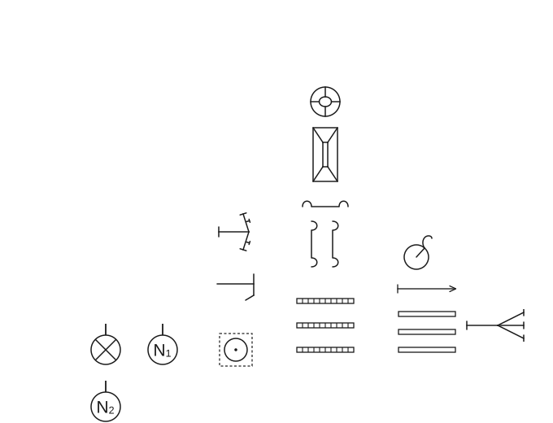
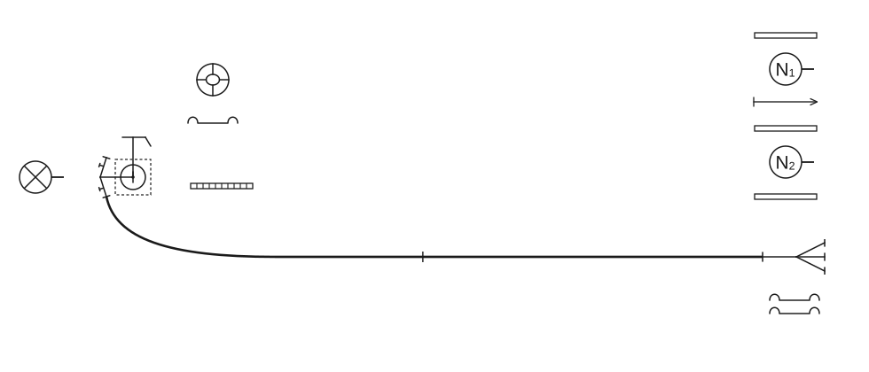
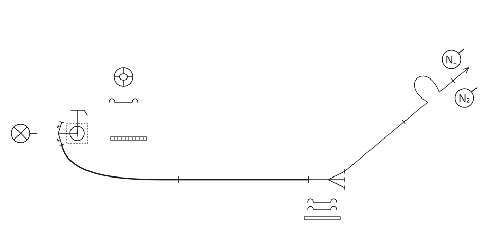
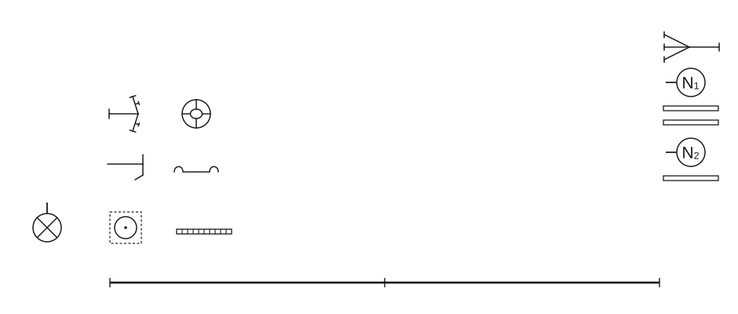

# Poligonske vježbe

### 2.3.2 Vježba 2 – Vježba s jednim „C” mlazom vode (tri vatrogasca)

*Vježbu izvodi odjeljenje od 3 člana u sastavu:*

- vođa navalne grupe (N₁),
- strojar (S),
- član navalne grupe (N₂).

*Za izvođenje vježbe potrebna je sljedeća vatrogasna oprema:*

- 1 hidrantski nastavak,
- 1 ključ za hidrant,
- 3 „B” tlačne cijevi,
- 3 „C” tlačne cijevi,
- 1 „C” mlaznica,
- 1 trodijelna razdjelnica,
- 1 prijelaznica B/C,
- 1 torbica s povezicama za cijevi,
- 1 držač cijevi,
- 3 univerzalna ključa za spojnice.

Kada je oprema postavljena na svoje mjesto kod hidranta, vođa navalne grupe (N₁) postrojava vatrogasce (skica 16).

**Skica 16** – *Postavljanje sprava, opreme i postrojavanje odjeljenja za vježbu*

Nakon što su vatrogasci postrojeni, vođa navalne grupe (N₁) istupa pet koraka, okreće se čelom nazad i zapovijeda: **„Požar pravac …. voda – hidrant s dvije „B” cijevi do razdjelnice za navalu pripremi!”**

Nakon izdane zapovijedi slijede radnje:

#### Postavljanje hidrantskog nastavka

Nakon izdane zapovijedi, strojar (S) postupa kao u [vježbi 1](01-Vjezba-1.md#postavljanje-hidrantskog-nastavka).

#### Polaganje „B” cijevnog voda u cijevnom sektoru rada

Na zapovijed vođe navalne grupe (N₁), „B” cijevni vod od hidrantskog nastavka do razdjelnice polaže navalna grupa (N₁, N₂) kao što to polaže vodna grupa (V₁, V₂) u vježbi 1 (skica 17).

**Skica 17** – *Položaj odjeljenja, sprava i opreme nakon izdane zapovijedi „…za navalu pripremi!”*

#### Polaganje prvog mlaza u navalnom sektoru

Kad je „B” cijevni vod položen, navalna grupa lijevom se stranom vraća po opremu za polaganje prvog cijevnog voda. Uzimaju opremu kao u vježbi 1, te se kreću lijevom stranom „B” cijevnog voda do kraja druge „B” cijevi. Vođa i član grupe odlažu cijev, vođa grupe (N₁) odlaže razdjelnicu u produžetku „B” cijevi i univerzalni ključ za spojnice s desne strane razdjelnice i vraća se na mjesto, član grupe (N₂) spaja razdjelnicu s „B” cijevnim vodom i odlaže svoj ključ s desne strane razdjelnice. Na zapovijed vođe grupe (N₁) koja glasi: **„Za prvi mlaz s dvije „C” cijevi, pravac …. naprijed!”**, navalna grupa polaže prvi cijevni vod za gašenje kao u vježbi 1, s time što član navalne grupe (N₂) (pošto priključi „C” cijev na lijevi otvor razdjelnice) otvara ventil za prvi mlaz na razdjelnici.

Kada član navalne grupe stigne do vođe, koji se nalazi uz mlaznicu, vođa grupe (N₁) okrenut prema strojaru daje zapovijed: **„Za prvi mlaz vodu daj!”**

Čim primi zapovijed i znak za vodu, dizanjem desne ruke strojar daje znak da je zapovijed primio, pa otvara hidrant i izlazni ventil na hidrantskom nastavku (skica 18).

**Skica 18** – *Položaj odjeljenja, sprava i opreme nakon izdane zapovijedi za prvi mlaz*

#### Pospremanje opreme

Poslije vježbe, vođa navalne grupe (N₁) zapovijeda: **„Za prvi mlaz vodom – stoj!”**

Na tu zapovijed strojar zatvara hidrant, kao i ventil na hidrantskom nastavku. Slijedi zapovijed vođe navalne grupe (N₁): **„Posprema!”** (skica 19).

**Skica 19** – *Položaj odjeljenja, sprava i opreme nakon izdane zapovijedi: „Posprema!”*

Na tu zapovijed, navalna grupa (N₁, N₂) posprema prvi mlaz kao u vježbi 1, s tom razlikom što član navalne grupe (N₂), kada je presavio „C” cijev, rastavlja „B” i „C” cijev s razdjelnice. Isto je i kod pospreme „B” cijevnog voda, tj. N₂ rastavlja spoj prve i druge „B” cijevi i pospremaju „B” cijevni vod kao vodna grupa (V₁, V₂) u vježbi 1. Strojar posprema hidrantski nastavak i ključ za hidrant kao u vježbi 1.

Kada odlože opremu, vatrogasci odlaze u stroj i postupaju kao u vježbi 1, s tom razlikom da strojar predaje prijavak vođi navalne grupe (N₁).
