# Poligonske vježbe

## 2.4 Vježbe s usisnim cijevima

### 2.4.1 Vježba 3 – Vježba s usisnim cijevima (5 vatrogasaca)

*Vježbu izvodi odjeljenje od 5 vatrogasaca:*

- strojar (S),
- vođa vodne grupe (V₁),
- vođa cijevne grupe (C₁),
- član vodne grupe (V₂),
- član cijevne grupe (C₂).

*Za izvođenje vježbe potrebna je sljedeća vatrogasna oprema:*

- prijenosna motorna vatrogasna pumpa (MVP),
- 4 „A” usisne cijevi,
- 1 usisna sitka,
- 1 uže s torbicom za vezanje usisnih cijevi,
- 1 uže s torbicom za vezanje ventila na usisnoj sitki,
- 3 univerzalna ključa za spojnice.

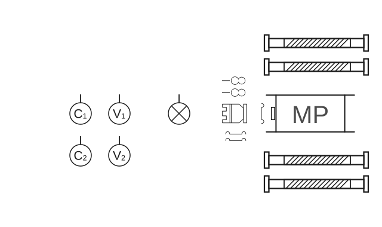

**Skica 20** – *Postavljanje sprava, opreme i postrojavanje.*

#### Polaganje usisnog voda

##### Polaganje usisnih cijevi (skica 21, slika 18 i 19)

Strojar (S) zapovijeda: **„Četiri usisne cijevi”** i istovremeno uzima dvije torbice s užadima pod lijevu ruku, dva ključa koja leže kraj usisne sitke u lijevu ruku i usisnu sitku u desnu ruku. Tako opremljen kreće prema mjestu gdje će se spajati usisna sitka s usisnim cijevima.

Vodna grupa (V₁ i V₂) uzima usisne cijevi koje leže s desne strane MVP gledano u smjeru požara. Pri uzimanju usisnih cijevi oba su okrenuta prema crpilištu vode i stoje između usisnih cijevi tako da je V₁ ispred V₂.

Polaganje usisnih cijevi obavlja se prema crpilištu vode jedna iza druge. Pritom V₁ ide naprijed, a V₂ iza njega i svaki od njih drži po jednu spojnicu usisne cijevi u svakoj ruci. Polažu cijevi u produžetku usisne cijevi, koja je ostala na zemlji pokraj motorne pumpe s lijeve strane. Prvo odlažu usisnu cijev, koju nose u lijevoj ruci, zatim odlažu drugu usisnu cijev, koju nose u desnoj ruci, iza prethodno odložene cijevi krećući se prema crpilištu.

Cijevna grupa (C₁, C₂) diže samo onu usisnu cijev koja leži bliže MVP s lijeve strane i polaže je u produžetku usisne cijevi, koja je ostala na zemlji, prema požaru. Pritom se C₂ natraške povlači za duljinu cijevi, a C₁ ga slijedi licem u lice. C₁ svoj kraj cijevi drži desnom rukom, a C₂ može nositi cijev lijevom ili desnom rukom.

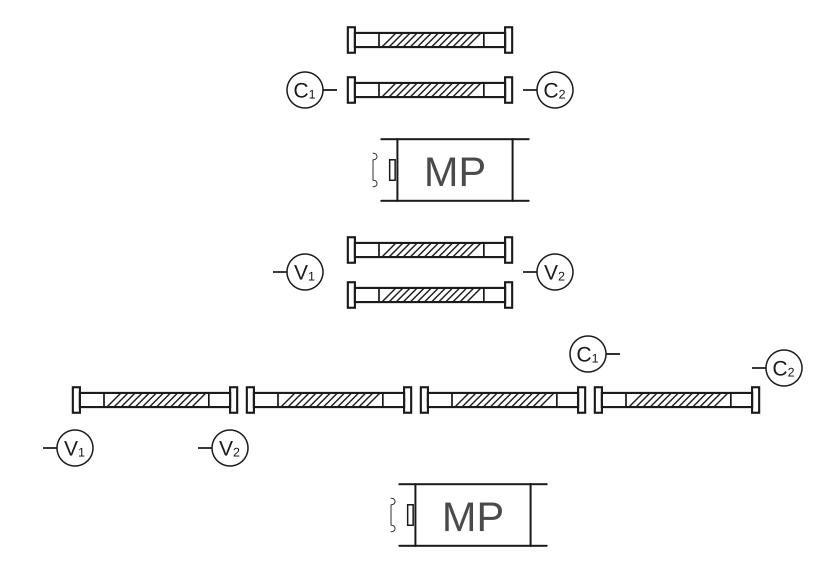

**Skica 21** – *Položaj grupa tijekom polaganja usisnih cijevi.*

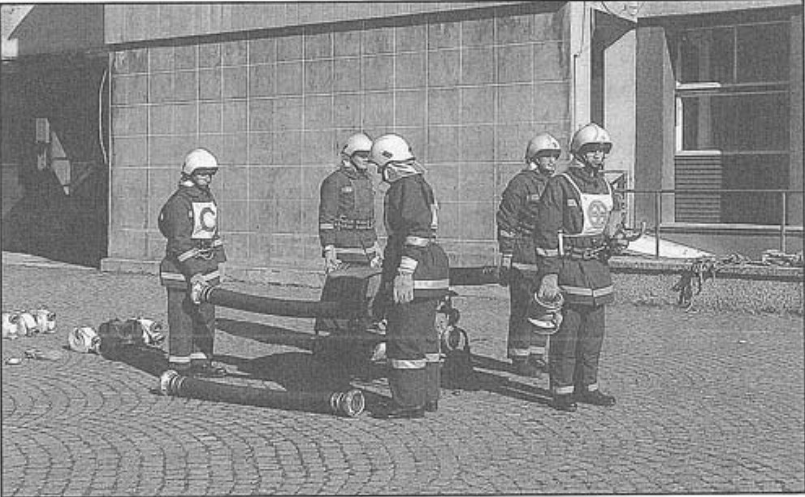

**Slika 18** – *Položaj grupa prije polaganja usisnih cijevi*

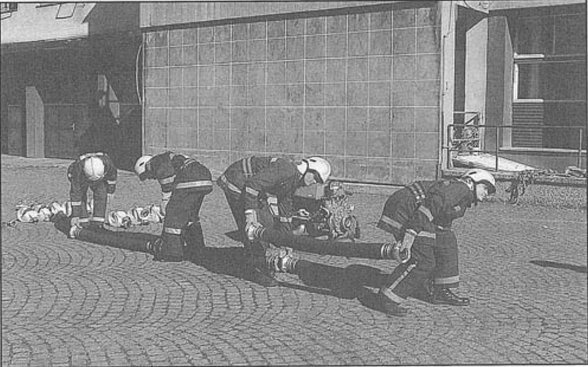

**Slika 19** – *Položaj grupa za vrijeme polaganja usisnih cijevi*

#### Spajanje usisnog voda

Spajanje usisnih cijevi obavlja vodna i cijevna grupa počevši od usisne sitke. V₁ i C₁ spajaju spojnice usisne cijevi, a V₂ i C₂ pridržavaju usisne cijevi koje se spajaju. Spajanje usisnih cijevi smije se obavljati na bilo kojoj visini iznad tla, ali tako da cijevi koje se spajaju, niti jednim dijelom ne smiju dodirivati tlo. Cijevi se moraju najprije podići, zatim uzubiti – spojiti i zategnuti ključevima. Niti jedna od tih radnji ne smije se uraditi na zemlji.

Kada su sve usisne cijevi položene, spajanje se obavlja na sljedeći način: C₁ i C₂ odlaze do prve usisne cijevi najbliže crpilištu. Istovremeno prekorače usisnu cijev, gledajući prema crpilištu, pri čemu C₁ stoji bliže, a C₂ dalje od crpilišta i, tako postavljeni, podignu usisnu cijev.

Istovremeno V₁ uzima od strojara usisnu sitku i postavi se nasuprot C₁, gledajući prema požaru.

V₁ i C₁ tako postavljeni spajaju usisnu sitku i usisnu cijev rukama. Tada strojar (S) predaje V₁ i C₁ po jedan ključ. Strojar stoji s desne strane prve cijevi, gledajući prema usisnim cijevima. Spojenu usisnu sitku i prvu cijev odlažu na tlo, a ključeve zadržavaju kod sebe.

V₂ u međuvremenu preuzima torbice s užetima od strojara (S) i odlaže ih lijevo i desno, nedaleko od usisne sitke, te se postavi iza V₁ (slika 20, skica 22).

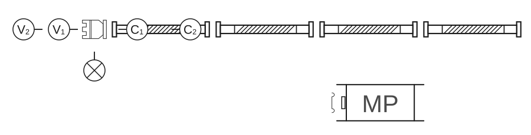

**Skica 22** – *Položaj grupa na početku spajanja usisnih cijevi*

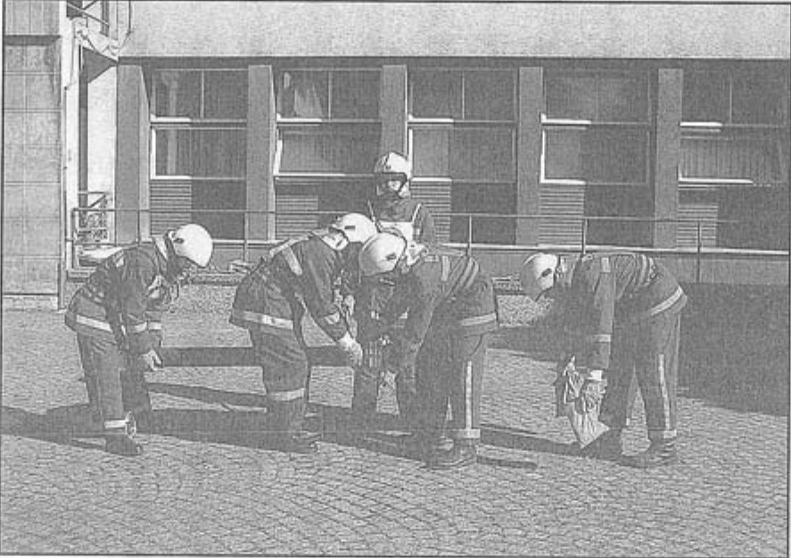

**Slika 20** – *Položaj grupa na početku spajanja usisnih cijevi.*

Nakon prvog spajanja i odlaganja cijevi na tlo, cijevna grupa iskoračuje korak u lijevo i na lijevoj nozi čine okret čelom nazad. Vodna grupa iskorači u desno od usisnog voda, i obje grupe kreću do sljedećih spojnica. Potom vodna grupa načini korak u lijevo i lijevom nogom prekorači cijev, a cijevna grupa, okrećući se na lijevoj nozi, okrene se čelom nazad i desnom nogom prekorači drugu usisnu cijev.

Tako postavljena vodna i cijevna grupa, jedna nasuprot druge, podižu usisne cijevi do visine na kojoj ih spajaju. V₁ i C₁ ponove radnju spajanja, a V₂ i C₂ za to vrijeme pridržavaju samo one cijevi koje se spajaju. Prilikom spajanja usisnih cijevi vodna i cijevna grupa mora biti u raskoraku iznad usisnih cijevi.

- C₂ prilikom pridržavanja mora barem jednom nogom stajati u ravnini spojnice usisne cijevi koja se spaja.
- C₂ je dopušteno namještati spojnicu na cijevi koja se spaja.
- C₂ ne smije dirati niti privlačiti sljedeću usisnu cijev.

Tijekom spajanja, zatezanje spojnice obavlja se ključem u desnoj ruci.

Strojar nadzire rad članova grupa a, radi postizanja ujednačenosti rada, strojar stoji s desne strane usisne cijevi i zapovijeda: **„Diži – spusti”**, sve dok se usisne cijevi ne spoje (skica 23, slika 21).

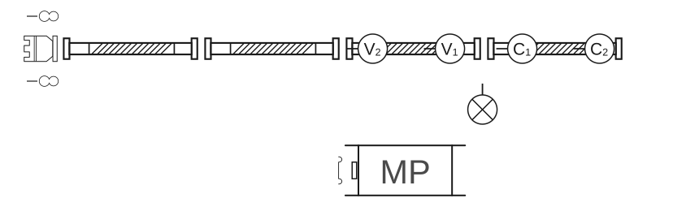

**Skica 23** – *Položaj grupa kod spajanja zadnje usisne cijevi.*

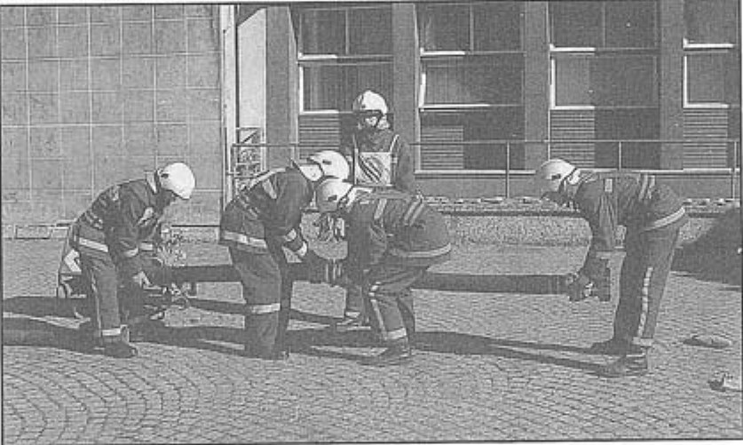

**Slika 21** – *Položaj grupa kod spajanja prve i druge usisne cijevi*

Ako se jedna od spojnica usisnog voda rastavi, strojar zapovijeda: **„Usisni vod, ponovo spajati!”**.

Kada su sve spojnice usisnog voda spojene, V₁ predaje ključ C₂. Pri tome nije dopušteno dobacivanje ili ispuštanje ključa na tlo. C₁ nakon završetka spajanja usisnog voda zadržava ključ kod sebe (i C₁ i C₂ ključeve stavljaju za opasač).

#### Vezivanje usisnog voda

Kada je usisni vod potpuno spojen, strojar izdaje zapovijed: **„Užetom veži!”**

C₁ odlazi do usisne sitke i uzima torbicu s užetom koju zakvači na kariku nepovratnog ventila.

C₁ može već kod kvačenja užeta podići usisnu sitku.

V₂ prelazi na lijevu stranu usisnog voda i umjereno podigne na sredini drugu cijev usisnog voda, gledajući prema crpilištu.

Strojar uhvati za zadnju spojnicu na četvrtoj usisnoj cijevi i umjereno je podigne.

V₁ odlazi po desnoj strani usisnog voda do usisne sitke, uzima torbicu s užetom za vezanje usisnog voda i stavlja karabin na kariku usisne sitke, a zatim pravi omču ispred (oko 10 cm) svake spojnice tako da usisni vod stvara blagu liniju u obliku slova „S”. Tijekom vezanja usisnog voda C₂ ne obavlja nikakve radnje stojeći između C₁ i V₂ s lijeve strane usisnog voda (skica 24, slika 22).

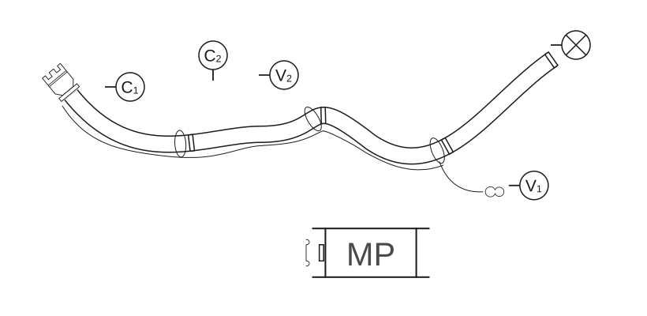

**Skica 24** – *Položaj grupa tijekom vezanja usisnog voda.*

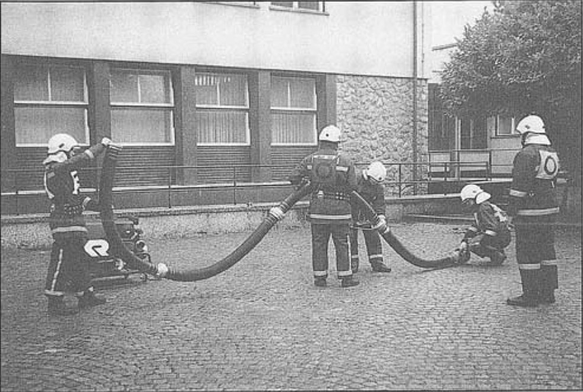

**Slika 22** – *Položaj grupa pri vezivanju usisnog voda na spoju prve i druge usisne cijevi.*

#### Prenošenje usisnog voda

Nakon što je V₁ vezao omču kod zadnjeg spoja usisnog voda, strojar izdaje zapovijed: **„Usisni vod u vodu!”**

Pri prenošenju usisnog voda strojar ostaje na kraju zadnje, četvrte usisne cijevi i drži najmanje jednom rukom za spojnicu.

V₁ prima spojnicu između treće i četvrte usisne cijevi, barem jednom rukom, i drži uže kojim je vezao usisni vod.

V₂ s obje ruke prima spoj između druge i treće usisne cijevi, C₂ s obje ruke prima spoj između prve i druge usisne cijevi, a C₁ s obje ruke prima za spoj usisne sitke i prve cijevi.

Tako strojar, vodna i cijevna grupa prenose spojeni usisni vod u vodu, odnosno do ravnine usisnog otvora MVP (skica 25, slika 23).

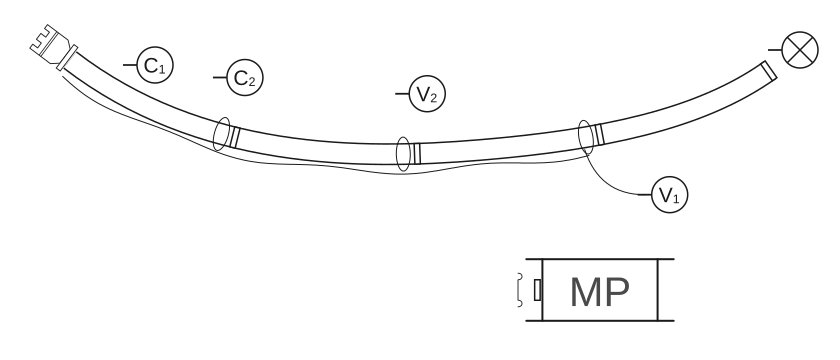

**Skica 25** – *Položaj grupa za prenošenje usisnog voda.*

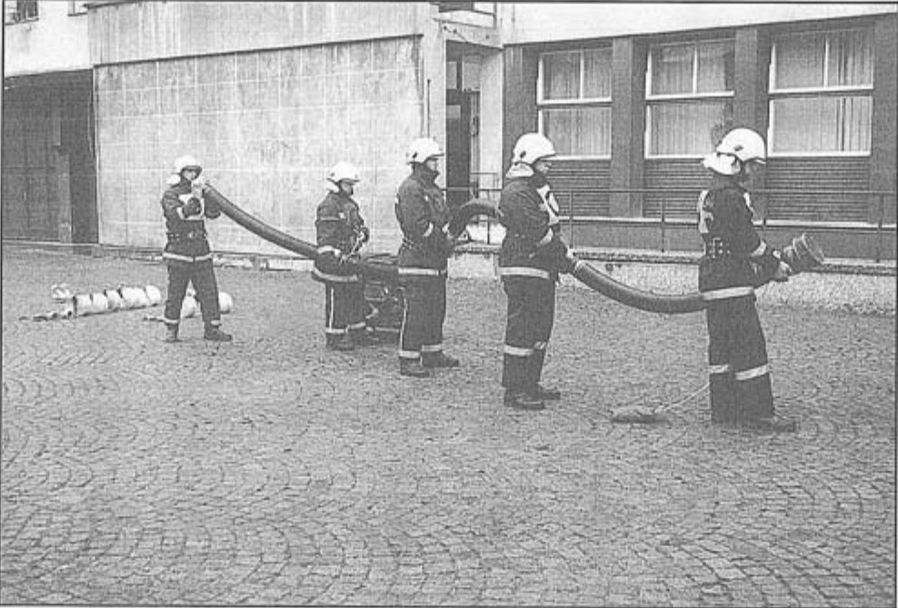

**Slika 23** – *Položaj grupa za prenošenje usisnog voda*

Pri spajanju usisnog voda na MVP, strojaru pomaže V₂. Strojar mora desnom nogom prekoračiti preko usisnog voda. V₂ mora prekoračiti preko treće usisne cijevi. V₂, prilikom pridržavanja usisnog voda, strojaru mora primiti za cijev koju strojar spaja ili za četvrti par spojnica usisnog voda.

Strojar spaja usisni vod na usisni otvor MVP rukama, upotrijebivši nakon toga treći ključ koji je ležao ispod usisnog otvora.

V₁, istovremeno sa spajanjem usisnog voda na MVP, postavlja uže ispod „B” tlačnog cijevnog voda i veže ga za prvu desnu ručicu MVP.

C₁, pošto je zakvačio uže za kariku nepovratnog ventila i položio usisnu sitku, uže vuče iz torbice do ravnine MVP (skica 26, slika 24).

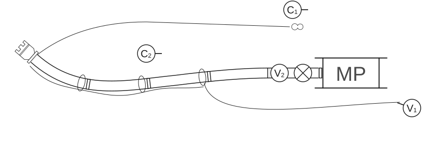

**Skica 26** – *Položaj grupa pri spajanju usisnog voda na motornu pumpu.*

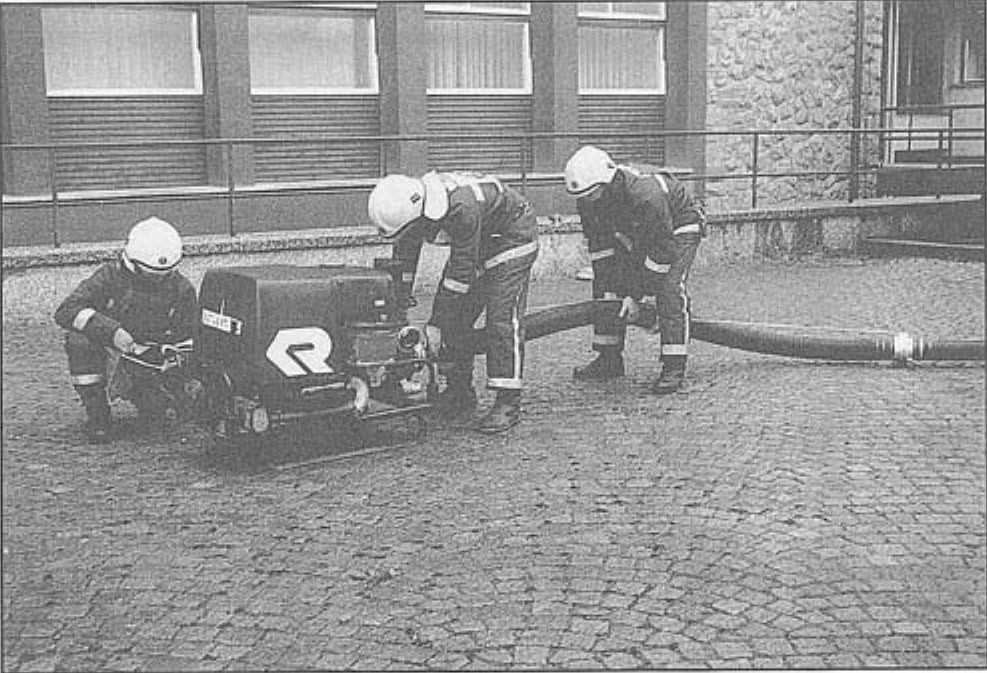

**Slika 24** – *Položaj grupa pri spajanju usisnog voda na motornu pumpu*

Čim je strojar usisni vod spojio na MVP i stavio ključ na spojnicu, zapovijeda: **„Gotovo!”**

Strojar može ključ nakon zapovijedi zadržati kod sebe ili odložiti na tlo. Usisni vod treba postaviti tako da uže usisnog voda bude zategnuto, a ne smije u ravnini izlaznog otvora MVP dodirivati tlo.

#### Pospremanje opreme

Usisni vod rastavlja vodna i cijevna grupa uz pomoć strojara.

Na zapovijed strojara: **„Usisni vod iz vode!”**, vođa vodne grupe (V₁) razvezuje uže usisnog voda s prve desne ručice MVP, vođa cijevne grupe (C₁) uzima kraj užeta za vezanje povratnog ventila i stavlja ga u torbicu odlazeći do usisne sitke, dok strojar uzima jedan ključ za spojnice i u raskoračnom stavu rastavlja usisni vod kod MVP. Iza njega, u raskoračnom stavu, nalazi se član vodne grupe (V₂), koji pridržava usisni vod. Strojar, poslije rastavljanja usisnog voda, ostavlja ključ za spojnice na zemlju. Kada je usisni vod rastavljen od motorne pumpe, strojar uhvati njegovu slobodnu spojnicu.

Vođa vodne grupe (V₁), s užetom u ruci, odlazi do prvog spoja kod strojara i hvata usisni vod s desne strane, gledajući prema usisnoj sitki.

V₂ prilazi usisnom vodu i hvata ga kod drugog spoja.

C₂ prilazi usisnom vodu i hvata ga kod trećeg spoja.

C₁ odlazi i hvata usisnu sitku.

Članovi V₂, C₂ i C₁ nalaze se s lijeve strane usisnog voda i okrenuti su u pravcu crpilišta vode. Nakon toga svi zajedno odnose usisni vod do mjesta odakle je donesen do vode, tj. treća usisna cijev mora doći u ravninu s MVP. Prije spuštanja usisnog voda na zemlju, vođa vodne grupe skida uže s usisnog voda. Kada je to završio, skida karabin užeta usisnog voda s karike usisne sitke i ostavlja ga na zemlji.

C₁ skida karabin užeta s karike nepovratnog ventila na usisnoj sitki i stavlja torbicu na zemlju.

Kada je užad skinuta, usisni se vod spušta na zemlju. Nakon toga, članovi vodne i cijevne grupe postavljaju se u položaj za rastavljanje usisnog voda, i to:

- C₁ staje u raskoračnom stavu kod prvog spoja od slobodne spojnice, gledajući prema usisnoj sitki,
- V₁ staje u raskoračni stav kod istog spoja, licem okrenut prema vođi cijevne grupe,
- V₂, C₂ stoje u raskoračnom stavu iza svojih vođa grupa,
- Strojar stoji na istom mjestu gdje je stajao prilikom spajanja usisnog voda.

Usisni vod rastavlja se obrnutim redoslijedom od spajanja. Na zapovijed strojara: **„Diži – spusti!”** članovi vodne i cijevne grupe rastavljaju usisni vod ključevima za spojnice i to desnom rukom, tako da je ključ na suprotnim spojnicama. Prilikom prelaženja od spoja do spoja usisnog voda, vodna grupa se okreće čelom nazad, onako kako je to radila cijevna grupa prilikom spajanja usisnog voda, a cijevna grupa (C₁, C₂) iskoračuju desnom nogom u desnu stranu kako je to radila vodna grupa prilikom spajanja cijevnog voda.

U tijeku rastavljanja usisne sitke od usisnog voda, strojar prilazi mjestu gdje se obavlja rastavljanje usisne sitke, preuzima lijevom rukom od vođe cijevne grupe (C₁) jedan, a od vođe vodne grupe (V₁) drugi ključ za spojnice i oba ključa drži u lijevoj ruci.

V₁ zatim predaje strojaru usisnu sitku u desnu ruku (slika 25). Strojar odlazi s primljenom opremom na mjesto odakle je počelo s izvođenjem vježbe, a zatim na svoje mjesto u stroj.

Prenošenje usisnih cijevi rastavljenog usisnog voda obavlja se tako da članovi vodne grupe uzimaju sa zemlje prvu usisnu cijev u lijevu, a drugu u desnu ruku i odnose ih s desne strane MVP. Pri nošenju usisnih cijevi, član vodne grupe ide ispred vođe svoje grupe.

Članovi cijevne grupe prenose četvrtu usisnu cijev tako da član te grupe (C₂) drži usisnu cijev u desnoj, a vođa u lijevoj ruci, te je stavljaju s unutarnje strane usisne cijevi koja je ostala na zemlji. Pritom su okrenuti licem jedan prema drugom i vođa grupe stoji bliže izvoru.

Nakon što su prenijeli usisne cijevi do MVP, vođa vodne grupe (V₁) i vođa cijevne grupe (C₂) motaju i stavljaju svaki svoje uže u torbicu koju zatvaraju i stavljaju na mjesto prije izvođenja vježbe.

Nakon toga odlaze na svoja mjesta u stroj.

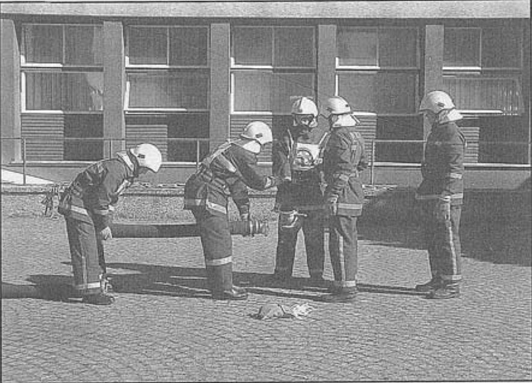

**Slika 25** – *Predaja ključeva i usisne sitke strojaru po završetku otpajanja usisnih cijevi*
