# Poligonske vježbe

### 2.4.2 Vježba 4 – Vježba s usisnim cijevima (3 vatrogasca)

*Vježbu izvodi odjeljenje od 3 vatrogasca:*

- strojar (S),
- vođa grupe (N₁),
- član grupe (N₂).

*Za izvođenje vježbe potrebna je sljedeća vatrogasna oprema:*

- prijenosna motorna vatrogasna pumpa,
- 4 „A” usisne cijevi,
- 1 usisna sitka,
- 1 uže s torbicom za vezanje usisnih cijevi,
- 1 uže s torbicom za vezanje ventila na usisnoj sitki,
- 3 univerzalna ključa za spojnice.

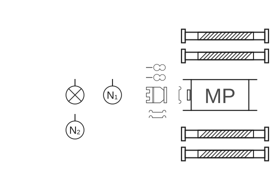

**Skica 27** – *Postavljanje sprava, opreme i postrojavanje odjeljenja.*

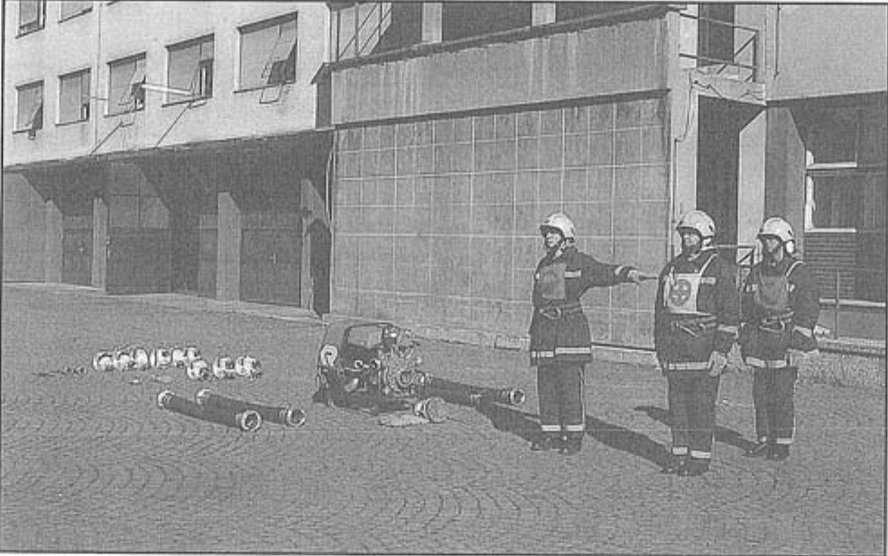

**Slika 26** – *Postavljanje sprava, opreme i postrojavanje odjeljenja*

#### Polaganje usisnog voda

##### Polaganje usisnih cijevi

Strojar (S) zapovijeda: **„Četiri usisne cijevi!”** i istovremeno uzima dvije torbice s užadima pod lijevu ruku, dva ključa koja leže kraj usisne sitke u lijevu ruku i usisnu sitku u desnu ruku.

Tako opremljen kreće prema mjestu gdje će se spajati usisna sitka s usisnim cijevima.

Navalna grupa (N₁, N₂) polaže usisne cijevi tako da najprije polažu onu usisnu cijev koja leži s lijeve strane MVP i polože je u produžetku usisne cijevi, koja je ostala na zemlji prema požaru, na isti način kao što je to učinila cijevna grupa (C₁, C₂) u [vježbi 3](03-Vjezba-3.md#polaganje-usisnih-cijevi-skica-21-slika-18-i-19) (skica 28 i 29, slika 27).

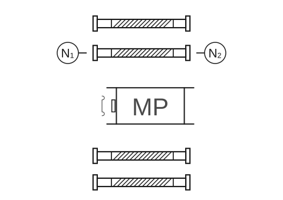

**Skica 28** – *Položaj grupe tijekom polaganja prve usisne cijevi.*

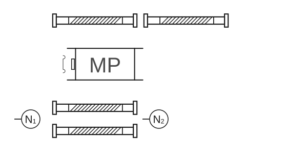

**Skica 29** – *Položaj grupe tijekom polaganja usisnih cijevi.*

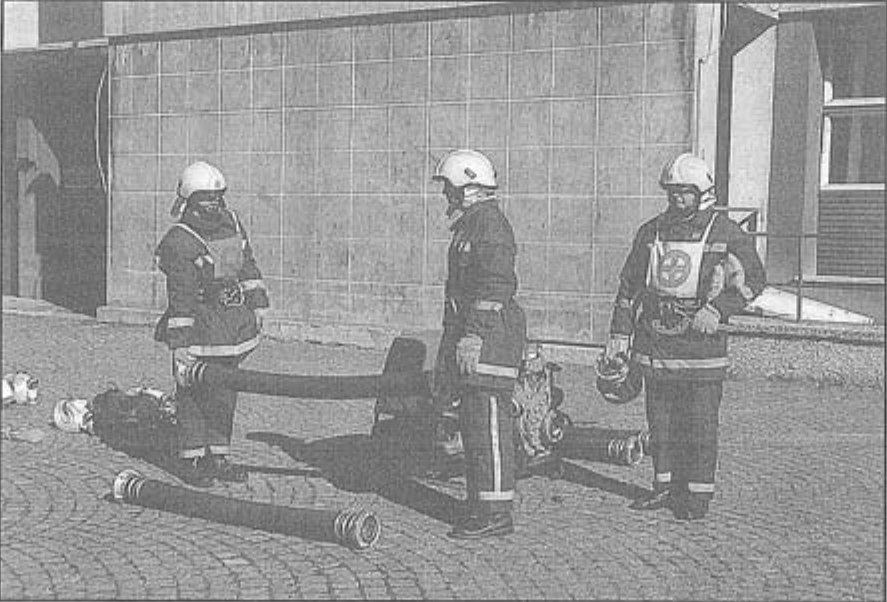

**Slika 27** – *Položaj grupe tijekom polaganja prve usisne cijevi*

Nakon toga navalna grupa (N₁, N₂) uzima usisne cijevi koje leže s desne strane MVP gledano prema požaru i polažu ih u produžetku usisne cijevi, koja je ostala na zemlji pokraj MVP s lijeve strane prema crpilištu, na isti način kao što je to činila vodna grupa (V₁, V₂) u [vježbi 3](03-Vjezba-3.md#polaganje-usisnih-cijevi-skica-21-slika-18-i-19) (skica 30, slika 28).

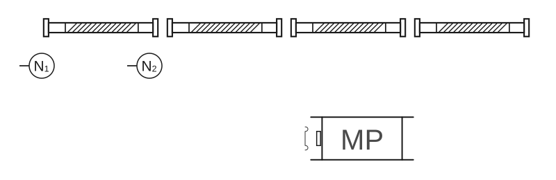

**Skica 30** – *Položaj grupe tijekom polaganja usisnih cijevi.*

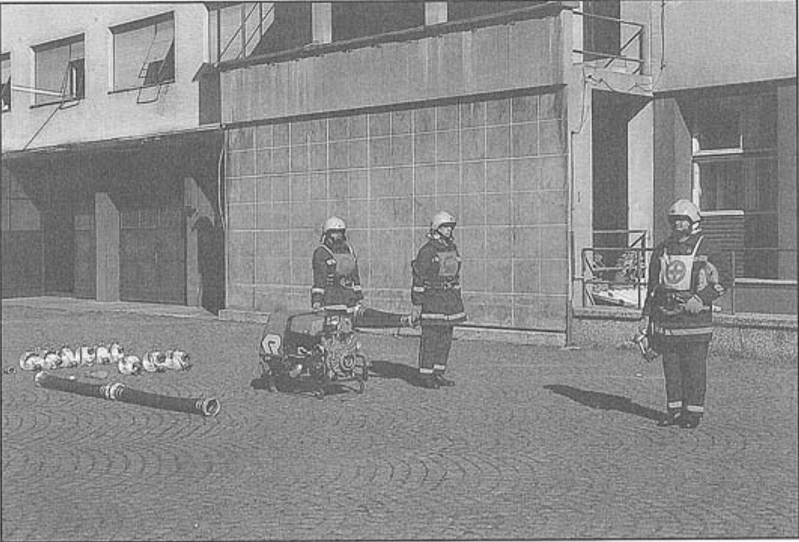

**Slika 28** – *Položaj grupe tijekom polaganja usisnih cijevi.*

#### Spajanje usisnog voda

Spajanje usisnih cijevi obavlja navalna grupa (N₁, N₂) i strojar (S), počevši od usisne sitke. N₁ stoji kod prve spojnice i gleda prema požaru, a N₂ stoji u raskoračnom stavu na drugoj spojnici i gleda prema crpilištu (skica 31, slika 29).

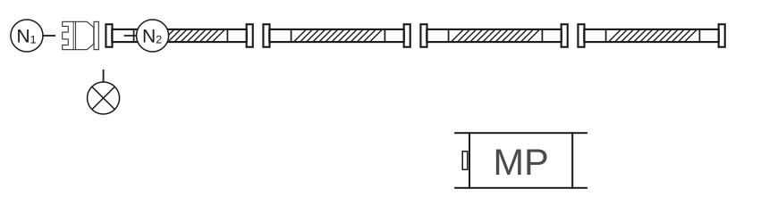

**Skica 31** – *Položaj odjeljenja na početku spajanja usisnog voda.*

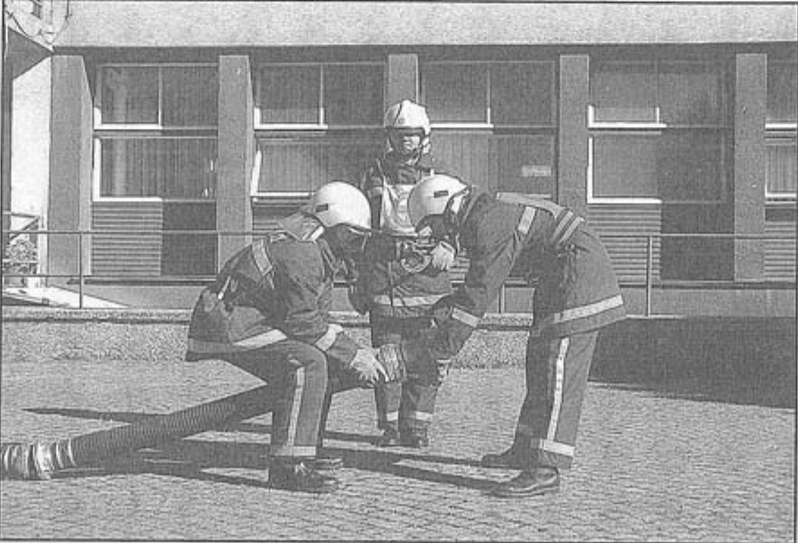

**Slika 29** – *Položaj odjeljenja na početku spajanja usisne sitke i prve usisne cijevi.*

Prilikom spajanja usisnog voda strojar, radi ujednačenosti rada, zapovijeda **„Diži!”** odnosno **„Spusti!”**, sve dok se usisne cijevi ne spoje. Na zapovijed **„Diži!”**, N₁ uzima od strojara usisnu sitku i zajedno s N₂ spaja usisnu cijev rukama. Strojar predaje N₁ i N₂ po jedan ključ i za to vrijeme stoji s desne strane prve cijevi, gledajući prema usisnim cijevima. Nakon toga strojar staje iza N₁, te odlaže torbice s užetima lijevo i desno nedaleko od usisne sitke (slika 30). Spojenu usisnu sitku i prvu cijev navalna grupa odlaže na zapovijed **„Spusti”**, a ključeve zadržavaju kod sebe.

Nakon prvog spajanja i odlaganja cijevi na tlo, N₂ iskoračuje korak u lijevo, na lijevoj nozi čini okret čelom nazad. N₁ i S iskorače u desno od usisnog voda i svi zajedno se kreću do sljedećih spojnica. Potom N₁ i S načine korak u lijevo i prekorače cijev, a N₂ okrećući se na lijevoj nozi okrene se čelom nazad i prekorači desnom nogom drugu usisnu cijev. Tako postavljeni N₁ i N₂ podižu spojnice usisne cijevi do visine na kojoj ih spajaju, a S za to vrijeme pridržava samo onu cijev bliže crpilištu, tj. iza N₁, dok druga spojnica cijevi iza N₂ ostaje na tlu (skica 32, slika 31). Spajanje i zatezanje spojnica usisnih cijevi obavlja se do kraja na isti način kao u [vježbi 3](03-Vjezba-3.md#spajanje-usisnog-voda).

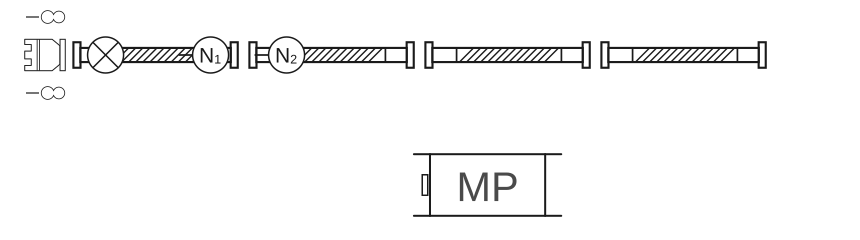

**Skica 32** – *Položaj odjeljenja tijekom spajanja usisnog voda.*

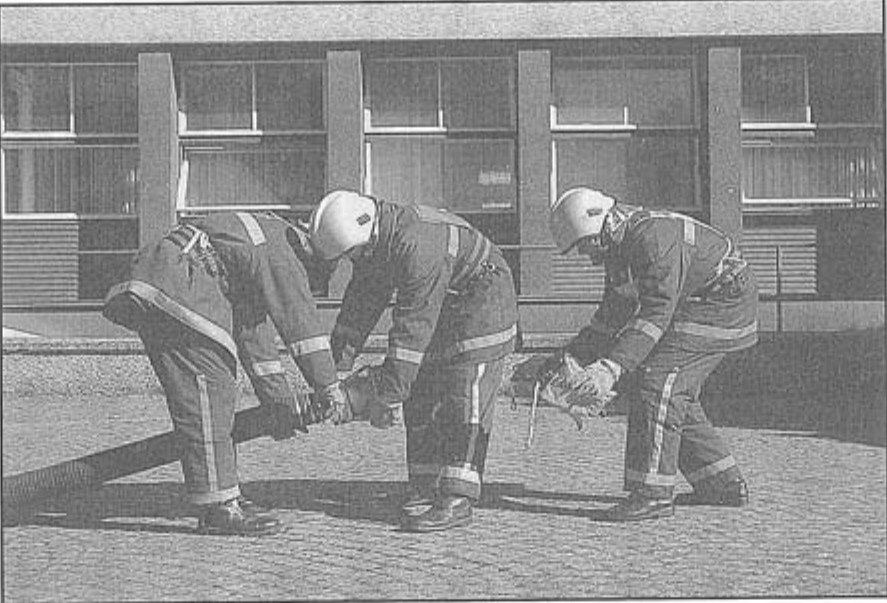

**Slika 30** – *Položaj odjeljenja nakon spojene usisne sitke i prve usisne cijevi.*

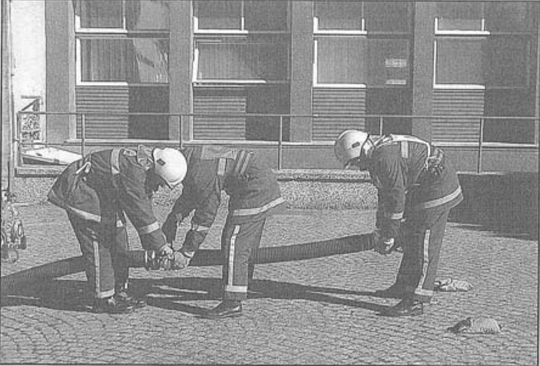

**Slika 31** – *Položaj odjeljenja tijekom spajanja usisnih cijevi.*

Kada su sve spojnice usisnog voda spojene, N₁ i N₂ zadržavaju ključeve kod sebe stavljajući ih za opasač.

#### Vezanje usisnog voda

Kada je usisni vod spojen, strojar izdaje zapovijed: **„Užetom veži!”**. N₂ odlazi do usisne sitke i uzima torbicu s užetom koju zakvači na kariku nepovratnog ventila.

Strojar uhvati za zadnju spojnicu na četvrtoj usisnoj cijevi i umjereno je podigne.

N₁ odlazi po desnoj strani usisnog voda do usisne sitke, uzima torbicu s užetom za vezanje usisnog voda i stavlja karabin na kariku usisne sitke, a zatim pravi omču ispred (oko 10 cm) svake spojnice tako da usisni vod stvara blagu liniju u obliku slova „S” (skica 33).

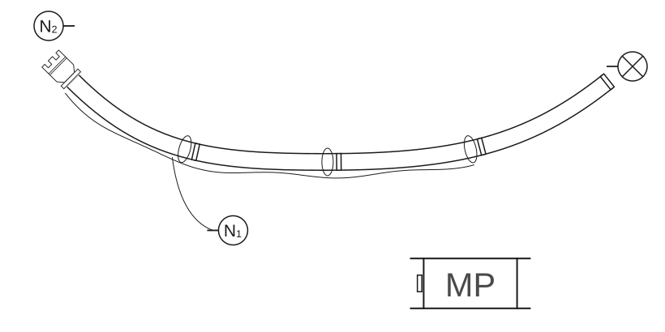

**Skica 33** – *Položaj grupe tijekom vezivanja prve usisne cijevi.*

N₂, pošto je zakvačio uže na ušicu nepovratnog ventila i položio usisnu sitku, podiže drugu cijev u sredini kako bi olakšao vezivanje (skica 34, slika 32).

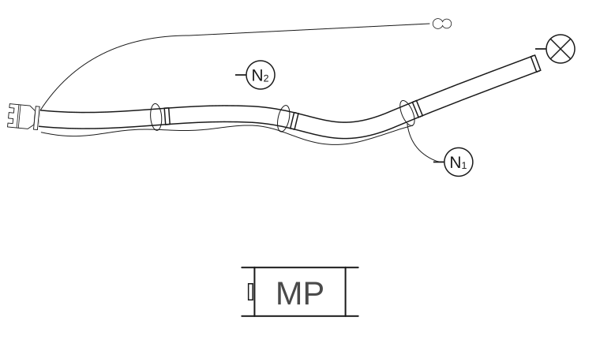

**Skica 34** – *Položaj odjeljenja tijekom vezanja usisnog voda.*

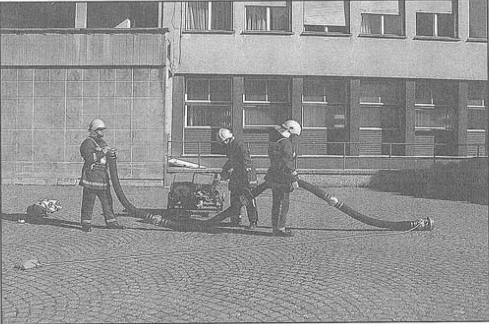

**Slika 32** – *Položaj odjeljenja tijekom vezivanja usisnog voda.*

#### Prenošenje usisnog voda

Nakon što je N₁ vezao omču kod zadnjeg para spojnica, strojar izdaje zapovijed: **„Usisni vod u vodu!”**

Prilikom prenošenja usisnog voda, strojar ostaje na kraju zadnje, četvrte usisne cijevi i drži najmanje jednom rukom za spojnicu.

N₁ prima spojnice između treće i četvrte usisne cijevi.

N₂ s lijevom rukom prima spoj između prve i druge usisne cijevi, a desnom za uže nepovratnog ventila (skica 35, slika 33).

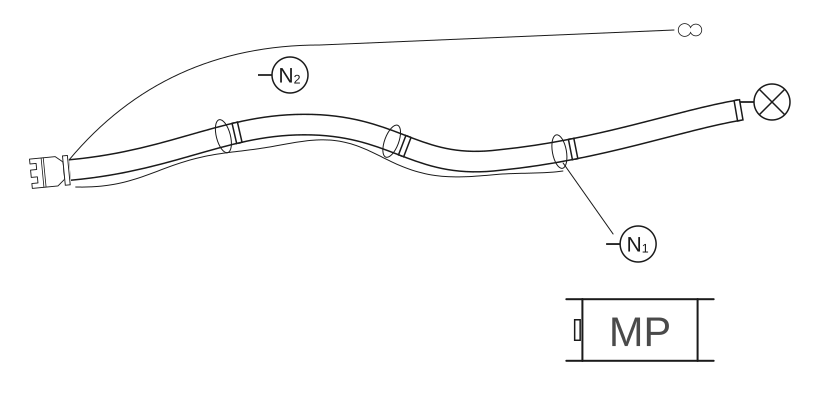

**Skica 35** – *Položaj odjeljenja tijekom prenošenja usisnog voda.*

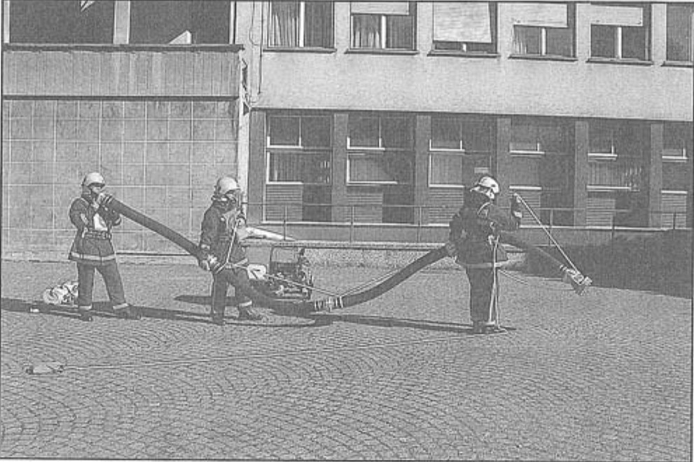

**Slika 33** – *Položaj odjeljenja tijekom prenošenja usisnog voda.*

Tako strojar, N₁ i N₂ nose spojeni usisni vod u vodu, odnosno do ravnine usisnog otvora MVP.

Kada je usisni vod stavljen u vodu, N₂ vuče uže iz torbice do ravnine MVP, strojar spaja usisni vod s usisnim otvorom pumpe. Pri tome mu pomaže N₂ koji stoji neposredno iza njega u raskoračnom stavu i postupa kao V₂ u [vježbi 3](03-Vjezba-3.md#prenošenje-usisnog-voda).

N₁ postupa kao V₁ u [vježbi 3](03-Vjezba-3.md#prenošenje-usisnog-voda) (skica 36, slika 34).

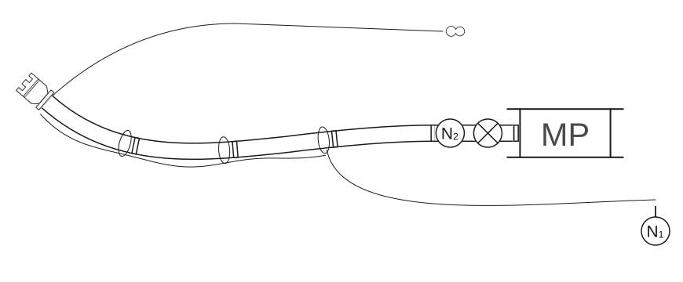

**Skica 36** – *Položaj odjeljenja tijekom spajanja usisnog voda na motornu pumpu.*

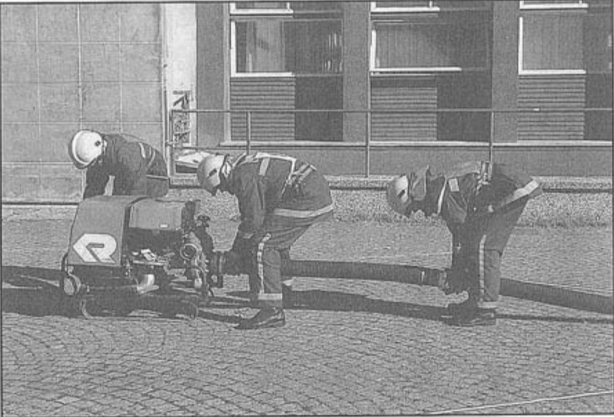

**Slika 34** – *Položaj odjeljenja prilikom spajanja usisnog voda na motornu pumpu.*

Čim je strojar usisni vod spojio na MVP i stavio ključ na spojnicu, zapovijeda: **„Gotovo!”** Strojar može ključ nakon zapovijedi zadržati kod sebe ili odložiti na tlo. Usisni vod treba postaviti tako da uže usisnog voda bude zategnuto, a ne smije u ravnini izlaznog otvora MVP dodirivati tlo.

#### Pospremanje opreme

Usisni vod rastavlja navalna grupa uz pomoć strojara.

Na zapovijed strojara: **„Usisni vod iz vode!”**, N₁ razvezuje uže usisnog voda s prve desne ručice MVP. Strojar uzima jedan ključ za spojnice i u raskoračnom stavu rastavlja usisni vod kod MVP. Iza njega u raskoračnom stavu nalazi se N₂ koji pridržava usisni vod. Strojar poslije rastavljanja usisnog voda ostavlja ključ za spojnice na zemlju. Kada je usisni vod rastavljen od MVP, strojar hvata njegovu slobodnu spojnicu.

N₁ s užetom u ruci odlazi do prvog spoja kod strojara i hvata usisni vod s lijeve strane, gledajući prema usisnoj sitki.

N₂ lijevom rukom prima spoj između prve i druge usisne cijevi, a desnom za uže nepovratnog ventila.

Nakon toga svi zajedno odnose usisni vod do mjesta odakle je donesen do vode. Prije spuštanja usisnog voda na zemlju, N₁ skida uže usisnog voda i kod toga mu pomaže N₂, tako da podiže drugu cijev u sredini, kako bi N₁ lakše skinuo uže, te skida karabin s karike usisne sitke. N₂ skida karabin s karike nepovratnog ventila.

Kada je užad odložena N₁, N₂ i S postavljaju se u položaj za rastavljanje usisnog voda. Usisni vod rastavlja se obrnutim redoslijedom od spajanja i istim postupkom kao u [vježbi 3](03-Vjezba-3.md#pospremanje-opreme). N₁ i N₂ kreću se obrnutim redoslijedom od spajanja.

Tijekom rastavljanja usisne sitke od usisnog voda, strojar prilazi mjestu gdje se obavlja rastavljanje usisne sitke i preuzima lijevom rukom ključeve od N₁ i N₂.

N₁ zatim predaje strojaru usisnu sitku u desnu ruku. Strojar odlazi s primljenom opremom na mjesto odakle je počelo izvođenje vježbe, a zatim na svoje mjesto u stroj.

Prenošenje usisnih cijevi rastavljenog usisnog voda obavlja se tako da N₁ i N₂ uzimaju sa zemlje prvu usisnu cijev u lijevu, a drugu u desnu ruku i odnose ih s desne strane MVP. Pri nošenju usisnih cijevi N₂ ide ispred N₁.

N₁ i N₂ prenose četvrtu usisnu cijev tako da N₂ drži usisnu cijev u desnoj, a vođa u lijevoj ruci te je stavljaju s unutarnje strane usisne cijevi koja je ostala na zemlji. Pritom su okrenuti licem jedan prema drugom. N₁ i N₂, nakon što su prenijeli usisne cijevi do MVP, motaju i stavljaju svaki svoje uže u torbicu koju zatvaraju i ostavljaju na mjestu prije izvođenja vježbe.

Nakon toga odlaze na svoje mjesto u stroj.
