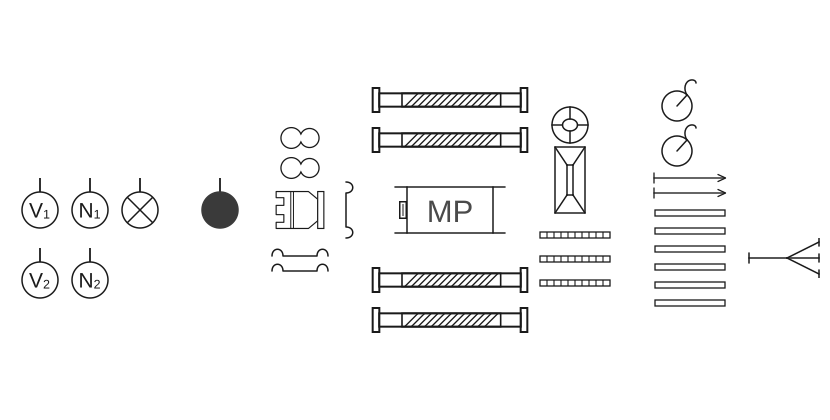
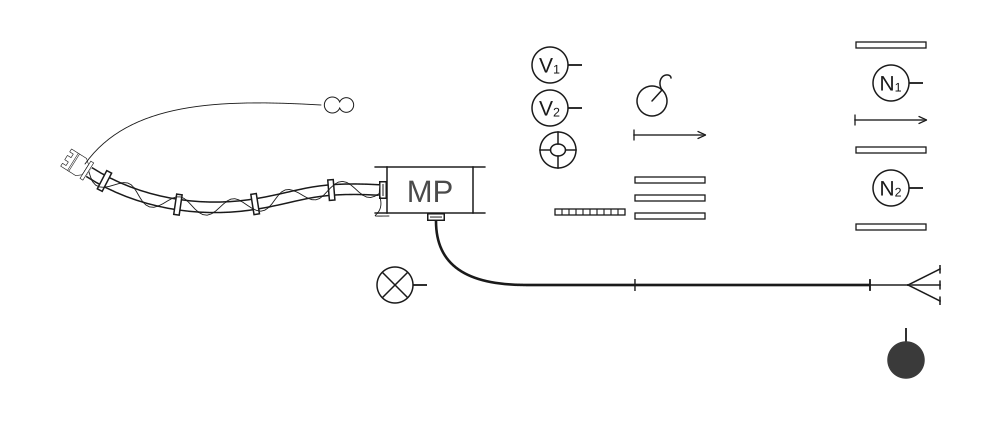
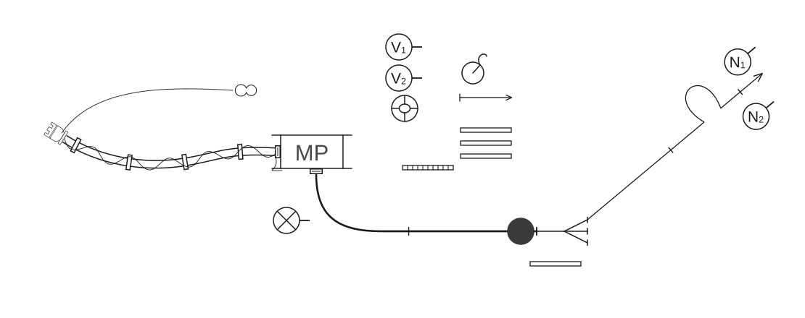
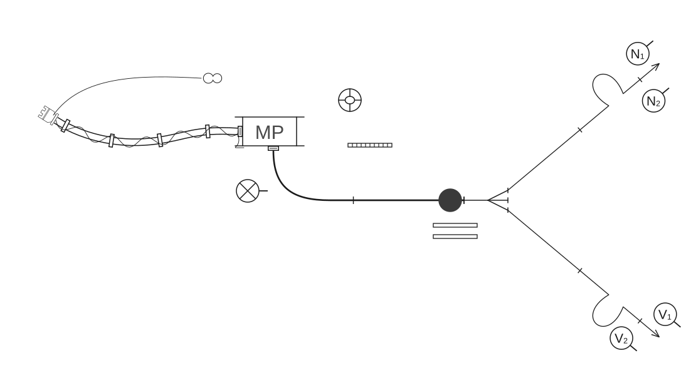
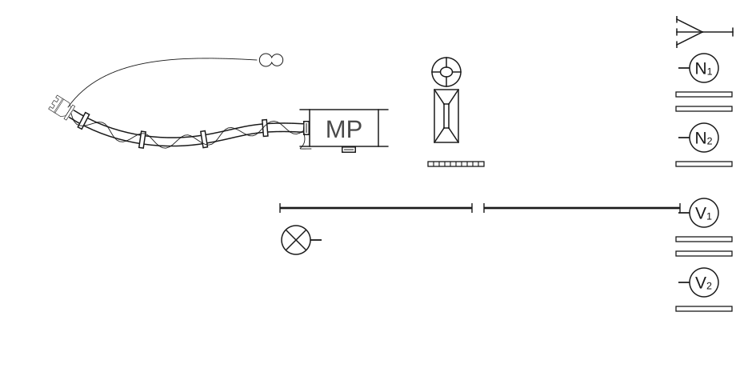

# Poligonske vježbe

## 2.5 Vježbe s prijenosnom motornom vatrogasnom pumpom

### 2.5.1 Vježba 5 – Vježba s 2 „C” mlaza vode, opskrba vodom iz otvorenog nalazišta (6 vatrogasaca)

*Vježbu izvodi odjeljenje od 6 vatrogasaca:*

- zapovjednik (Z),
- strojar (S),
- vođa navalne grupe (N₁),
- član navalne grupe (N₂),
- vođa vodne grupe (V₁),
- član vodne grupe (V₂).

*Za izvođenje vježbe potrebna je sljedeća vatrogasna oprema:*

- prijenosna motorna vatrogasna pumpa,
- 4 usisne cijevi,
- 1 usisna sitka,
- 3 „B” tlačne cijevi,
- 6 „C” tlačnih cijevi,
- 1 trodjelna razdjelnica,
- 2 „C” mlaznice,
- 1 prijelaznica B/C,
- 1 uže sa torbicom za vezivanje usisnog voda,
- 1 uže sa torbicom za vezivanje ventila na usisnoj sitki,
- 1 torbica s povezicama za cijevi,
- 2 držača za cijevi,
- 3 univerzalna ključa za spojnice.

**Skica 37** – *Postavljanje sprava, opreme i postrojavanje odjeljenja*

Kada je oprema postavljena na svoje mjesto, zapovjednik staje na dva koraka od usisnog otvora motorne pumpe, podiže lijevu ruku i zapovijeda: **„Odjeljenje – zbor!”**. Na tu zapovijed vatrogasci se postrojavaju u dvije vrste (skica 37).

Kada je odjeljenje postrojeno, zapovjednik istupa ispred odjeljenja kao u [vježbi 1](01-Vjezba-1.md) i izdaje zapovijed koja glasi: **„Požar pravac … voda …, s dvije „B” cijevi do razdjelnice, za navalu pripremi!”**

Nakon izdane zapovijedi obavljaju se sljedeće radnje:

#### Polaganje usisnog voda

Nakon izdane zapovijedi zapovjednika: **„Za navalu – pripremi”**, strojar zapovijeda: **„Četiri usisne cijevi!”**.

Kod ove vježbe, spajanje usisnog voda, vezanje usisnog voda i nepovratnog ventila usisne sitke i prenošenje usisnog voda do crpilišta vode, obavlja vodna grupa (V₁ i V₂) i strojar kao navalna grupa u [vježbi 4](04-Vjezba-4.md).

Nakon zapovijedi strojara **„Gotovo”**, V₂ uzima torbicu s povezicama i zajedno s V₁ stoji između motorne pumpe i opreme koja je postavljena na zemlji. Na tom mjestu ostaju sve do zapovijedi zapovjednika za drugi mlaz.

#### Polaganje „B” cijevnog voda u cijevnom sektoru

Nakon izdane zapovijedi zapovjednika: **„Za navalu – pripremi”**, navalna grupa se oprema „B” cijevima i polaže „B” cijevni vod od motorne pumpe do razdjelnice kao vodna grupa u [vježbi 1](01-Vjezba-1.md), s razlikom što navalna grupa nije opremljena ključevima i torbicom s povezicama za cijevi. Zapovjednik nakon izdane zapovijedi odlazi do kraja „B” cijevnog voda i staje tri koraka desno od razdjelnice, okrenut prema razdjelnici (skica 38).

**Skica 38** – *Položaj odjeljenja, sprava i opreme nakon izdane zapovijedi „Za navalu pripremi!”*

#### Polaganje prvog mlaza u navalnom sektoru

Kada je „B” cijevni vod položen, navalna grupa se lijevom stranom vraća po opremu za polaganje prvog cijevnog voda kao u [vježbi 1](01-Vjezba-1.md).

Kada je „B” cijevni vod spojen na razdjelnicu i puštena voda do razdjelnice, kao u vježbi 1, zapovjednik zapovijeda: **„Za prvi mlaz s dvije „C” cijevi pravac … naprijed!”** Na tu zapovijed, članovi navalne grupe (N₁ i N₂) polažu prvi cijevni vod za gašenje kao u vježbi 1. Zapovjednik, nakon izdane zapovijedi preuzima posluživanje razdjelnice kao u vježbi 1 (skica 39).

**Skica 39** – *Položaj odjeljenja, sprava i opreme nakon izdane zapovijedi za prvi mlaz*

#### Polaganje drugog mlaza u navalnom sektoru

Na zapovijed zapovjednika: **„Za drugi mlaz s dvije „C” cijevi pravac … naprijed!”**, vodna grupa (V₁, V₂) opremaju se i polažu drugi mlaz kao u [vježbi 1](01-Vjezba-1.md#polaganje-drugog-mlaza-u-navalnom-sektoru) (skica 40).

**Skica 40** – *Položaj odjeljenja, sprava i opreme nakon izdane zapovijedi za drugi mlaz*

#### Pospremanje opreme

Po završetku vježbe zapovjednik zapovijeda: **„Prvi i drugi mlaz – vodom stoj!”**. Na tu zapovijed svi članovi odjeljenja postupaju kao u [vježbi 1](01-Vjezba-1.md#pospremanje-opreme).

Na zapovijed zapovjednika: **„Posprema!”**, navalna i vodna grupa pospremaju prvi, odnosno drugi mlaz kao u vježbi 1.

Zapovjednik otpaja tlačne cijevi kao u vježbi 1, a torbicu s povezicama i ključeve odlaže na mjesto gdje su stajali prije izvođenja vježbe. Strojar otpaja „B” cijev s tlačnog otvora motorne pumpe i poteže uže nepovratnog ventila (skica 41).

**Skica 41** – *Položaj odjeljenja, sprava i opreme nakon izdane zapovijedi: „Posprema!”*

„B” cijevni vod posprema navalna grupa, kao što je to pospremala vodna grupa u vježbi 1.

Pospremanje usisnog voda obavlja vodna grupa (V₁ i V₂) i strojar, kao navalna grupa u [vježbi 4](04-Vjezba-4.md), s time što vodna grupa na zapovijed strojara **„Usisni vod iz vode!”** uzima ključeve koje je odložio zapovjednik.

Kad odlože opremu, vatrogasci odlaze u stroj i postupaju kao u vježbi 1.
