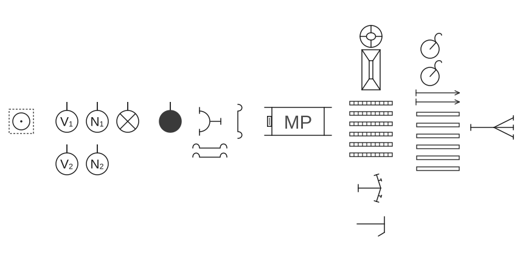
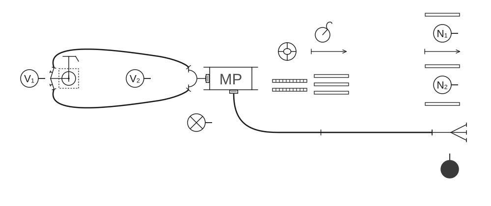
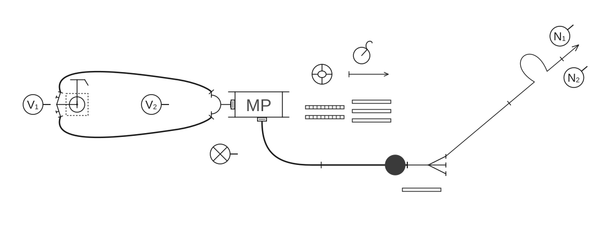
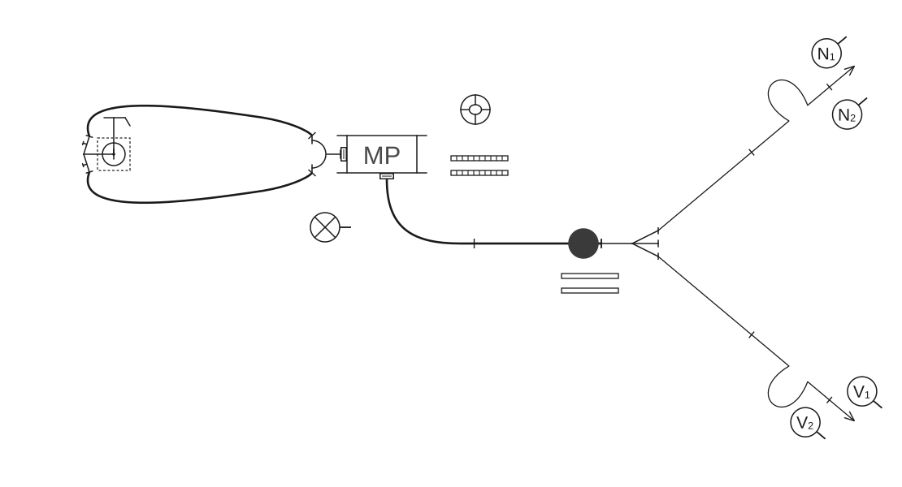
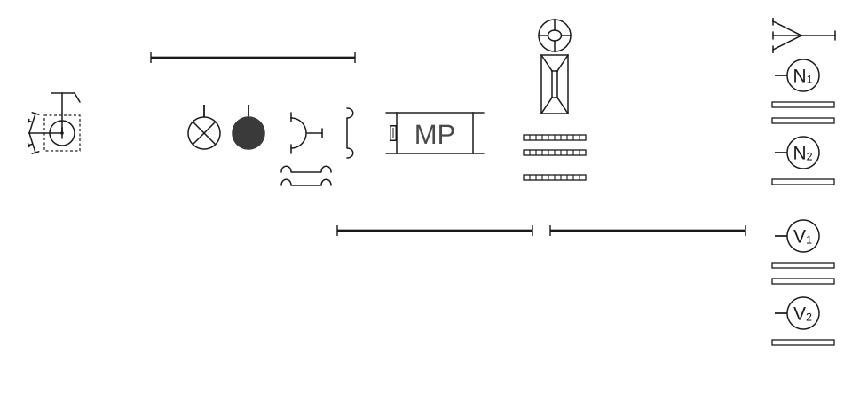

# Poligonske vježbe

### 2.5.2 Vježba 6 – Vježba s 2 „C” mlaza vode, opskrba vodom iz hidrantske mreže (6 vatrogasaca)

*Vježbu izvodi odjeljenje od 6 vatrogasaca:*

- zapovjednik (Z),
- strojar (S),
- vođa navalne grupe (N₁),
- član navalne grupe (N₂),
- vođa vodne grupe (V₁),
- član vodne grupe (V₂).

*Za izvođenje vježbe potrebna je sljedeća vatrogasna oprema:*

- 6 „B” tlačnih cijevi,
- 6 „C” tlačnih cijevi,
- 2 „C” mlaznice,
- 1 trodjelna razdjelnica,
- 1 sabirnica,
- 1 prijelaznica B/C,
- 1 dvodjelni hidrantski nastavak,
- 1 ključ za podzemni hidrant,
- 1 torbica s povezicama za cijevi,
- 2 držača za cijevi,
- 3 univerzalna ključa za spojnice.

Kada je oprema postavljena na svoje mjesto, zapovjednik postrojava odjeljenje kao u [vježbi 5](05-Vjezba-5.md) (skica 42).

**Skica 42** – *Postavljanje sprava, opreme i postrojavanje odjeljenja*

Kada je odjeljenje postrojeno, zapovjednik istupa ispred odjeljenja kao u [vježbi 1](01-Vjezba-1.md), i izdaje zapovijed koja glasi: **„Požar pravac … voda – hidrant, s dvije „B” cijevi do razdjelnice, za navalu – pripremi!”**

Nakon izdane zapovijedi obavljaju se sljedeće radnje:

#### Polaganje cijevnog voda od hidranta do motorne pumpe

Strojar uzima sabirnicu u desnu ruku, spaja je na usisni otvor motorne pumpe i zateže ključem, koji se nalazio ispod usisnog otvora motorne pumpe.

Vođa vodne grupe (V₁) uzima jedan univerzalni ključ koji stavlja za opasač, u desnu ruku uzima hidrantski nastavak, a u lijevu ruku ključ za hidrant. Tako opremljen odlazi do hidranta, odlaže hidrantski nastavak na zemlju, ključem skida poklopac hidranta, stavlja hidrantski nastavak na hidrant i postavlja ključ za hidrant.

Član vodne grupe (V₂) uzima jedan univerzalni ključ koji stavlja za opasač i torbicu s povezicama za cijevi koju stavlja preko lijevog ramena. Zatim uzima dvije „B” cijevi, u svaku ruku po jednu. Tako opremljen odlazi do usisnog otvora motorne pumpe, skida nosače sa cijevi i priprema ih za polaganje. Spaja na svaki otvor sabirnice donju spojnicu „B” cijevi, u svaku ruku uzima po jednu gornju spojnicu „B” cijevi i istovremeno ih razvlači u pravcu hidranta, gdje ih priključuje na svaki izlazni otvor hidrantskog nastavka. Ako je potrebno, V₂ će poravnati obje „B” cijevi. Vođa vodne grupe (V₁) ostaje kod hidranta, a član vodne grupe (V₂) vrši nadzor nad cijevnim vodom od hidranta do motorne pumpe i na tim mjestima ostaju sve do zapovijedi zapovjednika za drugi mlaz. Strojar, kada je cijevni vod položen od motorne pumpe do hidranta, okreće se prema vođi vodne grupe (V₁) koji se nalazi na hidrantu, diže desnu ruku i zapovijeda: **„Vodu daj!”**. Na tu zapovijed V₁ diže desnu ruku kao znak da je primio zapovijed i otvara hidrant i ventile na izlaznim otvorima hidrantskog nastavka.

#### Polaganje „B” cijevnog voda u cijevnom sektoru

„B” cijevni vod polaže navalna grupa (N₁ i N₂) kao u [vježbi 5](05-Vjezba-5.md#polaganje-b-cijevnog-voda-u-cijevnom-sektoru) (skica 43).

**Skica 43** – *Položaj odjeljenja, sprava i opreme nakon izdane zapovijedi: „Za navalu pripremi!”*

#### Polaganje prvog mlaza u navalnom sektoru

Prvi mlaz polaže navalna grupa (N₁ i N₂) kao u [vježbi 1](01-Vjezba-1.md#polaganje-prvog-mlaza-u-navalnom-sektoru). Odmah nakon izdane zapovijedi za 1. mlaz, zapovjednik preuzima posluživanje razdjelnice kao i u vježbi 1 (skica 44).

**Skica 44** – *Položaj odjeljenja, sprava i opreme nakon izdane zapovijedi za prvi mlaz*

#### Polaganje drugog mlaza u navalnom sektoru

Drugi mlaz polaže vodna grupa kao u [vježbi 1](01-Vjezba-1.md#polaganje-drugog-mlaza-u-navalnom-sektoru) (skica 45).

**Skica 45** – *Položaj odjeljenja, sprava i opreme nakon izdane zapovijedi za drugi mlaz*

#### Pospremanje opreme

Zapovijedi zapovjednika i posprema prvog i drugog cijevnog voda, te posprema „B” cijevnog voda isti su kao u [vježbi 5](05-Vjezba-5.md#pospremanje-opreme). Strojar na zapovijed **„Posprema”** rastavlja „B” tlačni vod od motorne pumpe, odlazi do hidranta, zatvara vodu na hidrantu, rastavlja spojnice „B” cijevi s izlaznih otvora na hidrantskom nastavku, rastavlja spojnice sa sabirnice, skida sabirnicu s pumpe i posprema jednu od „B” cijevi cijevnog voda od hidranta do motorne pumpe, s time da je namata prema motornoj pumpi (skica 46).

**Skica 46** – *Položaj odjeljenja, sprava i opreme nakon izdane zapovijedi: „Posprema!”*

Vodna grupa, nakon što je odložila opremu od pospremljenog drugog mlaza, obavlja sljedeće radnje:

- Vođa vodne grupe (V₁) skida hidrantski nastavak i ključ za hidrant, stavlja poklopac na otvor hidranta, uzima hidrantski nastavak u desnu, a hidrantski ključ u lijevu ruku i odnosi ovu opremu na mjesto gdje je stajala prije izvođenja vježbe,
- Član vodne grupe (V₂) posprema „B” cijev koja je ostala od hidranta do motorne pumpe u smjeru namatanja prema motornoj pumpi.

„B” cijevni vod posprema navalna grupa kao u vježbi 5.

Kada odlože opremu, vatrogasci odlaze u stroj i postupaju kao u [vježbi 1](01-Vjezba-1.md).
