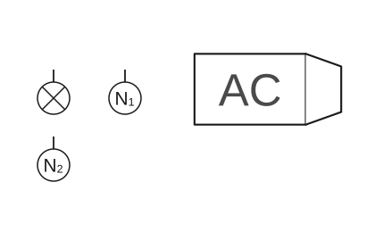
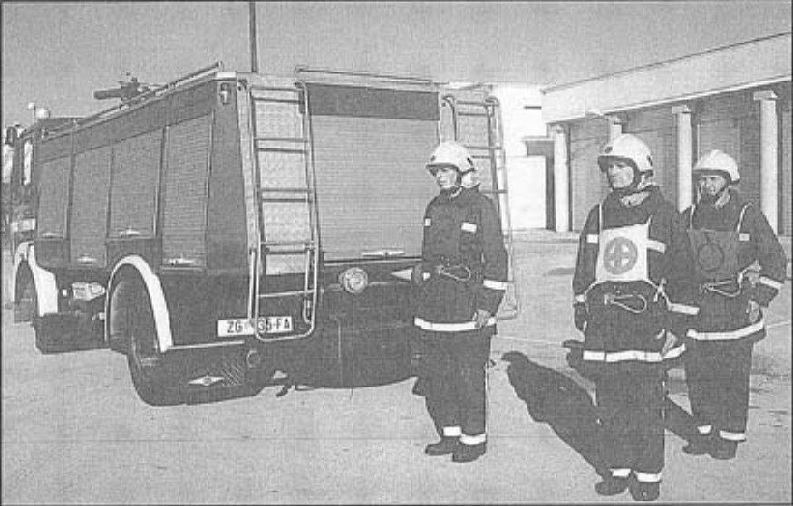
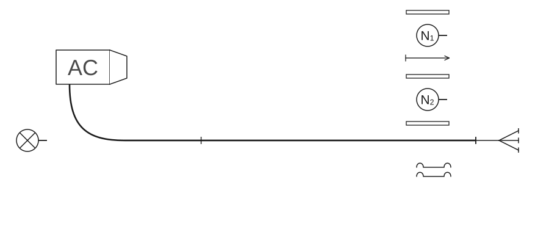
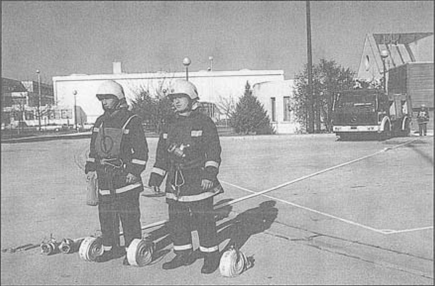
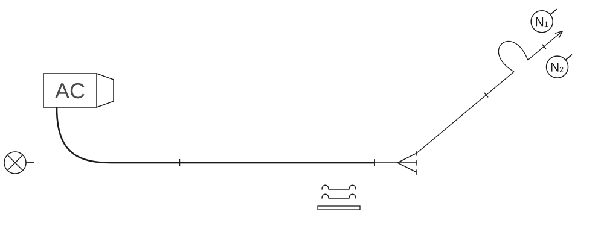
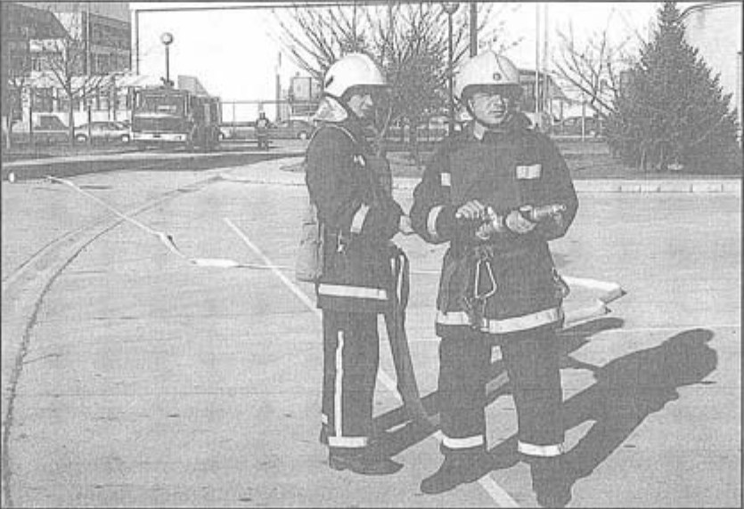
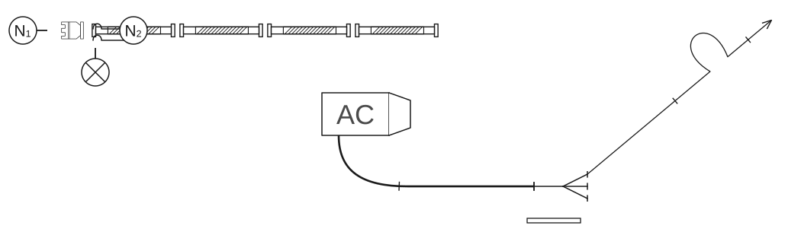
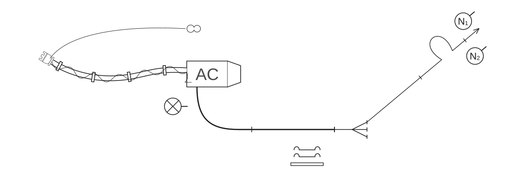

# Poligonske vježbe

## 2.6 Vježbe s autocisternom

### 2.6.1 Vježba 7 – Vježba s 1 „C” mlazom vode, opskrba vodom iz otvorenog nalazišta (3 vatrogasca)

*Vježbu izvodi odjeljenje od 3 vatrogasca:*

- vođa navalne grupe (N₁),
- član navalne grupe (N₂),
- strojar (S).

*Za izvođenje vježbe potrebna je sljedeća oprema koja je smještena u spremnicima vozila:*

- 4 usisne cijevi,
- 1 usisna sitka,
- 3 „B” tlačne cijevi,
- 3 „C” tlačne cijevi,
- 1 „C” mlaznica,
- 1 trodjelna razdjelnica,
- 1 uže sa torbicom za vezivanje usisnog voda,
- 1 uže sa torbicom za vezivanje ventila na usisnoj sitki,
- 1 torbica sa povezicama za cijevi,
- 1 prijelaznica B/C,
- 1 držač cijevi,
- 3 univerzalna ključa za spojnice.

Kada je vozilo postavljeno na određeno mjesto kod crpilišta, vođa navalne grupe (N₁) staje dva koraka iza vozila, podiže lijevu ruku i postrojava odjeljenje kao u [vježbi 2](02-Vjezba-2.md) (skica 47, slika 35).

**Skica 47** – *Postrojavanje odjeljenja autocisterne*

**Slika 35** – *Postrojavanje odjeljenja autocisterne*

Vođa navalne grupe (N₁) istupa kao u vježbi 2 i zapovijeda: **„Požar pravac … voda … sa 2 „B” cijevi do razdjelnice za navalu pripremi!”**.

Nakon izdane zapovijedi obavljaju se sljedeće radnje:

#### Polaganje „B” cijevnog voda u cijevnom sektoru

Na zapovijed vođe navalne grupe (N₁), „B” cijevni vod, od AC do razdjelnice, polaže navalna grupa kao u [vježbi 2](02-Vjezba-2.md#polaganje-b-cijevnog-voda-u-cijevnom-sektoru-rada), s tom razlikom što član navalne grupe (N₂) spaja svoju „B” cijev na tlačni izlaz iz pumpe na AC (skica 48, slika 36).

**Skica 48** – *Položaj odjeljenja, sprava i opreme nakon izdane zapovijedi: „Za navalu pripremi!”*

**Slika 36** – *Položaj odjeljenja, sprava i opreme nakon izdane zapovijedi: „Za navalu pripremi!”*

#### Polaganje prvog mlaza u navalnom sektoru

Kada je „B” cijevni vod položen, navalna grupa se lijevom stranom vraća po opremu za polaganje prvog mlaza kao u [vježbi 2](02-Vjezba-2.md#polaganje-prvog-mlaza-u-navalnom-sektoru). Prvi cijevni vod polaže navalna grupa kao u vježbi 2 (skica 49, slika 37).

**Skica 49** – *Položaj odjeljenja, sprava i opreme nakon izdane zapovijedi za prvi mlaz*

**Slika 37** – *Položaj odjeljenja, sprava i opreme nakon izdane zapovijedi za prvi mlaz*

#### Polaganje usisnog voda

Pošto se spremnik za vodu na AC isprazni, a zadatak nije izvršen, strojar se okreće licem prema navalnoj grupi i izdaje zapovijed: **„Četiri usisne cijevi!”**. N₁ daje znak da je zapovijed razumio, odlažu mlaznicu na zemlju i odlaze do AC za polaganje usisnog voda. Kod razdjelnice uzimaju ključeve za spojnice.

Strojar za polaganje usisnog voda uzima istu opremu kao u [vježbi 4](04-Vjezba-4.md) (osim ključeva koje navalna grupa ima kod sebe). Navalna grupa prva polaže usisne cijevi iz lijevog spremnika, tako da član grupe (N₂) svoju usisnu cijev polaže prvi, a vođa grupe (N₁) polaže svoju cijev iza već položene usisne cijevi (prema crpilištu). Zajedno odlaze do desne strane vozila, uzimaju dvije usisne cijevi iz desnog spremnika i zajedno ih odnose i polažu kao u vježbi 4 prema crpilištu (skica 50).

**Skica 50** – *Položaj odjeljenja, sprava i opreme nakon izdane zapovijedi: „Četiri usisne cijevi!”*

Spajanje, vezanje i prenošenje usisnog voda, navalna grupa obavlja kao u [vježbi 4](04-Vjezba-4.md).

Nakon zapovijedi strojara: **„Gotovo!”**, navalna grupa odlazi lijevom stranom „B” cijevnog voda do razdjelnice, odlažu ključeve s desne strane razdjelnice i odlaze do mlaznice gdje N₁ ponovo zapovijeda: **„Za prvi mlaz vodu daj!”**. Strojar daje znak da je zapovijed razumio i pušta vodu (skica 51).

**Skica 51** – *Položaj odjeljenja, sprava i opreme nakon izdane zapovijedi: „Gotovo!”*

#### Pospremanje opreme

Za završetak rada i pospremu, vođa grupe (N₁) izdaje zapovijedi kao u [vježbi 2](02-Vjezba-2.md#pospremanje-opreme). Pospremu prvog mlaza obavlja navalna grupa kao u vježbi 2, uz sljedeću razliku, kada dođu ispred vozila, N₁ izdaje zapovijed: **„Stoj!”**, **„Opremu odloži!”**. Nakon izdanih zapovijedi, N₁ i N₂ opremu odlažu u spremnike vozila. Pospremu „B” cijevnog voda obavlja navalna grupa kao u vježbi 2.

Kada je „B” cijevni vod pospremljen, strojar zapovijeda: **„Usisni vod iz vode”**. Na tu zapovijed navalna grupa i strojar obavljaju prenošenje usisnog voda, odvezivanje i rastavljanje kao u [vježbi 4](04-Vjezba-4.md). Nošenje i pospremanje rastavljenih usisnih cijevi navalna grupa obavlja kao u vježbi 4, s razlikom što treću usisnu cijev posprema vođa grupe (N₁) u spremnik, a četvrtu član navalne grupe (N₂).

Kada odlože opremu, vatrogasci odlaze u stroj i postupaju kao u vježbi 2.
