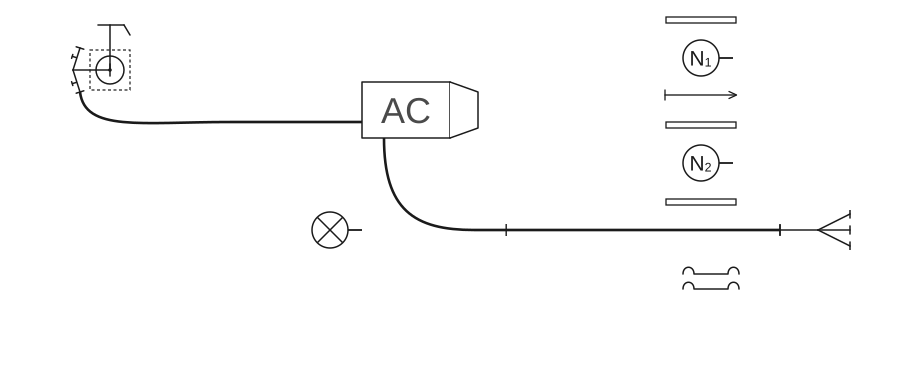
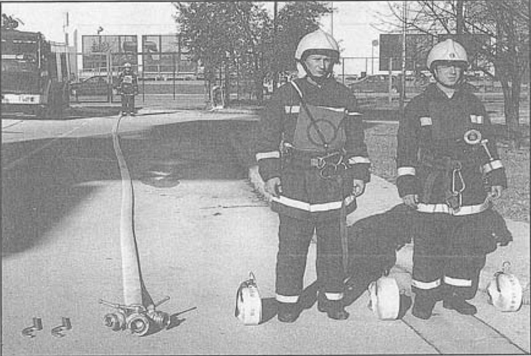
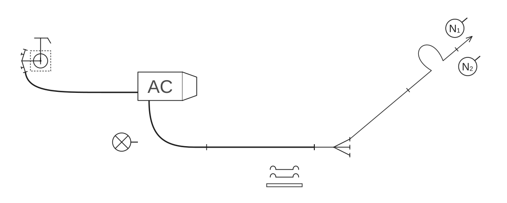
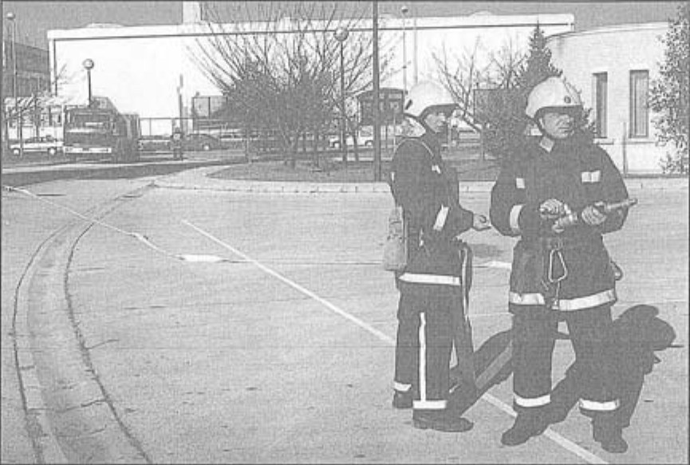

# Poligonske vježbe

### 2.6.2 Vježba 8 – Vježba s 1 „C” mlazom vode, opskrba vodom iz hidrantske mreže (3 vatrogasca)

*Vježbu izvodi odjeljenje od 3 vatrogasca:*

- vođa navalne grupe (N₁),
- član navalne grupe (N₂),
- strojar (S).

*Za izvođenje vježbe potrebna je sljedeća vatrogasna oprema smještena u spremnicima vozila:*

- 3 „B” tlačne cijevi,
- 3 „C” tlačne cijevi,
- 1 „C” mlaznica,
- 1 trodjelna razdjelnica,
- 1 dvodjelni hidrantski nastavak,
- 1 ključ za podzemni hidrant,
- 1 torbica s povezicama za cijevi,
- 1 držač cijevi,
- 3 univerzalna ključa za spojnicu.

Vatrogasci se postrojavaju iza vozila i postupaju kao u [vježbi 7](07-Vjezba-7.md). Vođa navalne grupe (N₁) izdaje zapovijed: **„Požar pravac … voda – hidrant, sa dvije „B” cijevi do razdjelnice za navalu pripremi!”**.

Nakon izdane zapovijedi obavljaju se sljedeće radnje:

#### Polaganje cijevnog voda od hidranta do vozila

Nakon izdane zapovijedi, strojar uzima u desnu ruku hidrantski nastavak, a u lijevu hidrantski ključ, te univerzalni ključ za spojnice koji stavlja za opasač, odlazi do podzemnog hidranta i postavlja ga kao u [vježbi 1](01-Vjezba-1.md#postavljanje-hidrantskog-nastavka). Vraća se do vozila i uzima jednu „B” cijev. Donju spojnicu „B” cijevi spaja na otvor za punjenje rezervoara na vozilu, a gornju spojnicu „B” cijevi priključuje na jedan izlazni otvor hidrantskog nastavka. Nakon toga, po potrebi, otvara hidrant i ventil hidrantskog nastavka i odlazi do pumpe vozila gdje čeka zapovijed za puštanje vode za prvi mlaz.

#### Polaganje „B” cijevnog voda

„B” cijevni vod polaže navalna grupa kao u [vježbi 7](07-Vjezba-7.md#polaganje-b-cijevnog-voda-u-cijevnom-sektoru) (skica 52, slika 38).

**Skica 52** – *Položaj odjeljenja, sprava i opreme nakon izdane zapovijedi: „Za navalu pripremi!”*

**Slika 38** – *Položaj odjeljenja, sprava i opreme nakon izdane zapovijedi: „Za navalu pripremi!”*

#### Polaganje prvog mlaza u navalnom sektoru

Navalna grupa polaže prvi mlaz kao u [vježbi 7](07-Vjezba-7.md#polaganje-prvog-mlaza-u-navalnom-sektoru) (skica 53, slika 39).

**Skica 53** – *Položaj odjeljenja, sprava i opreme nakon izdane zapovijedi za prvi mlaz*

**Slika 39** – *Položaj odjeljenja, sprava i opreme nakon izdane zapovijedi za prvi mlaz*

#### Posprema opreme

Za završetak rada i pospremu, vođa navalne grupe (N₁) izdaje zapovijedi kao u [vježbi 7](07-Vjezba-7.md#pospremanje-opreme). Pospremu prvog mlaza i „B” cijevnog voda obavlja navalna grupa kao u vježbi 7.

Strojar, na zapovijed **„Posprema”**, rastavlja „B” cijevni vod sa pumpe, odlazi do hidranta, zatvara vodu na hidrantu i ventil na hidrantskom nastavku, zatim rastavlja „B” cijev cijevnog voda od hidranta do vozila. Posprema hidrantski ključ, hidrantski nastavak i „B” cijev.

Navalna grupa obavlja pospremu prvog mlaza i „B” cijevnog voda kao u vježbi 7.

Kada odlože opremu, vatrogasci odlaze u stroj i postupaju kao u vježbi 7.
