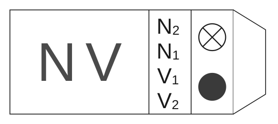
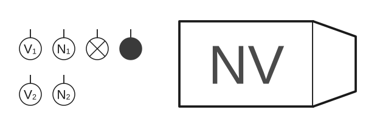
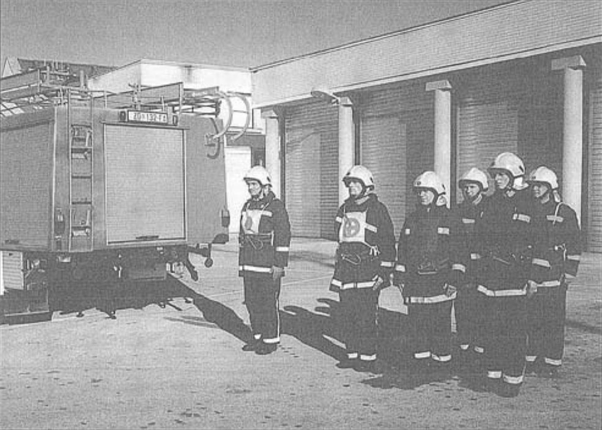
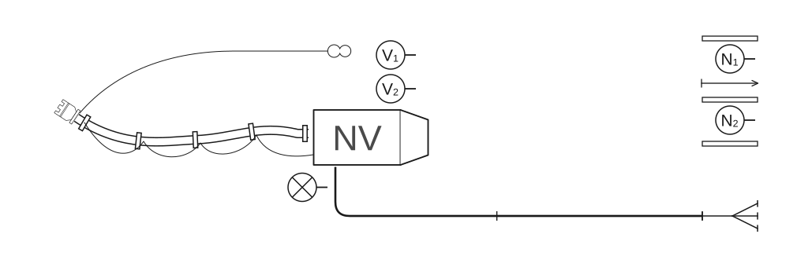
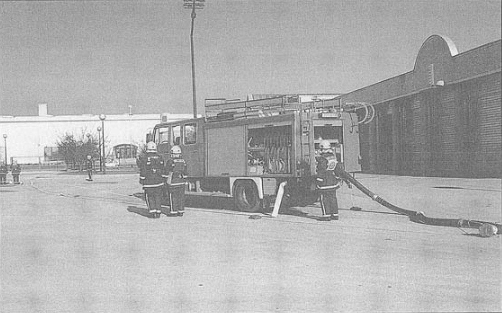
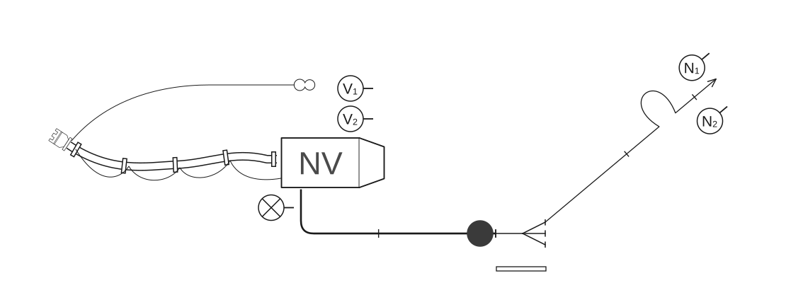
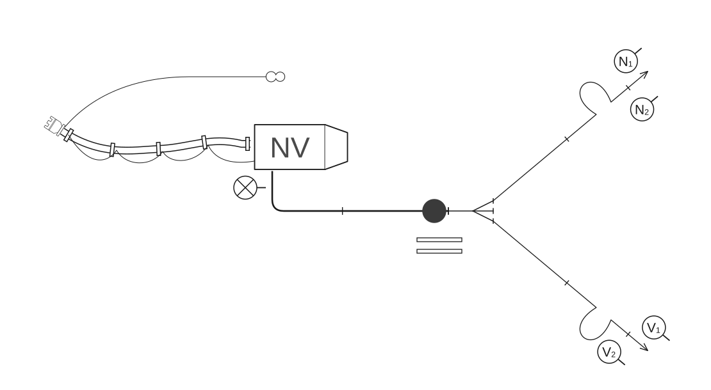

# Poligonske vježbe

## 2.7 Vježbe s navalnim vozilom

### 2.7.1 Vježba 9 – Vježba s 2 „C” mlaza vode, opskrba vodom iz otvorenog nalazišta (6 vatrogasaca)

*Vježbu izvodi odjeljenje od 6 vatrogasaca:*

- zapovjednik (Z),
- strojar (S),
- vođa navalne grupe (N₁),
- član navalne grupe (N₂),
- vođa vodne grupe (V₁),
- član vodne grupe (V₂).

**Skica 54** – *Raspored mjesta vatrogasaca u navalnom vozilu*

Za izvođenje vježbe potrebna je vatrogasna oprema smještena u spremnicima navalnog vozila. Kada je vozilo postavljeno na svoje mjesto, zapovjednik staje dva koraka iza vozila, podiže lijevu ruku i zapovijeda kao u [vježbi 5](05-Vjezba-5.md) (skica 55, slika 40).

**Skica 55** – *Postrojavanje odjeljenja navalnog vozila*

**Slika 40** – *Postrojavanje odjeljenja navalnog vozila*

Nakon izdane zapovijedi obavljaju se sljedeće radnje:

#### Postavljanje usisnog voda

Nakon izdane zapovijedi zapovjednika: **„Požar pravac…voda…sa dvije „B” cijevi do razdjelnice za navalu pripremi”**, strojar zapovijeda: **„Četiri usisne cijevi”**. Kod te vježbe, spajanje usisnog voda, vezanje usisnog voda i nepovratnog ventila usisne sitke i prenošenje usisnog voda do crpilišta, obavlja vodna grupa i strojar kao što je to obavljala navalna grupa sa strojarem u [vježbi 7](07-Vjezba-7.md). Na zapovijed strojara **„Gotovo”**, član grupe (V₂) uzima torbicu s povezicama i zajedno s vođom grupe (V₁) ostaje kod vozila do zapovijedi zapovjednika za drugi mlaz.

#### Polaganje „B” cijevnog voda u cijevnom sektoru

Navalna grupa polaže „B” cijevni vod kao u [vježbi 5](05-Vjezba-5.md) (skica 56, slika 41).

**Skica 56** – *Položaj odjeljenja, sprava i opreme nakon izdane zapovijedi: „Za navalu pripremi!”*

**Slika 41** – *Položaj odjeljenja, sprava i opreme nakon izdane zapovijedi: „Za navalu pripremi!”*

#### Polaganje prvog mlaza u navalnom sektoru

Navalna grupa polaže prvi mlaz kao u [vježbi 5](05-Vjezba-5.md).

Zapovjednik postupa isto kao u [vježbi 5](05-Vjezba-5.md) (skica 57).

**Skica 57** – *Položaj odjeljenja, sprava i opreme nakon izdane zapovijedi za prvi mlaz*

#### Polaganje drugog mlaza u navalnom sektoru

Vodna grupa polaže drugi mlaz kao u [vježbi 5](05-Vjezba-5.md) (skica 58).

**Skica 58** – *Položaj odjeljenja, sprava i opreme nakon izdane zapovijedi za drugi mlaz*

#### Pospremanje opreme

Zapovijedi i radnje zapovjednika iste su kao u [vježbi 5](05-Vjezba-5.md), samo što torbicu s povezicama i ključeve zapovjednik odlaže u vozilo na mjesta gdje su stajali prije izvođenja vježbe. Posprema prvog i drugog cijevnog voda i posprema „B” cijevnog voda ista je kao u [vježbi 5](05-Vjezba-5.md), sa sljedećom razlikom: kada navalna i vodna grupa s opremom prvog i drugog „C” mlaza dođu ispred vozila, postupaju kao navalna grupa u [vježbi 7](07-Vjezba-7.md). Usisni vod posprema vodna grupa i strojar, kao što je to pospremala navalna grupa sa strojarem u [vježbi 7](07-Vjezba-7.md).

Kad odlože opremu, vatrogasci odlaze u stroj i postupaju kao u [vježbi 1](01-Vjezba-1.md).
