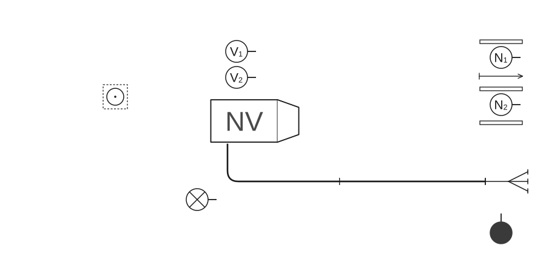
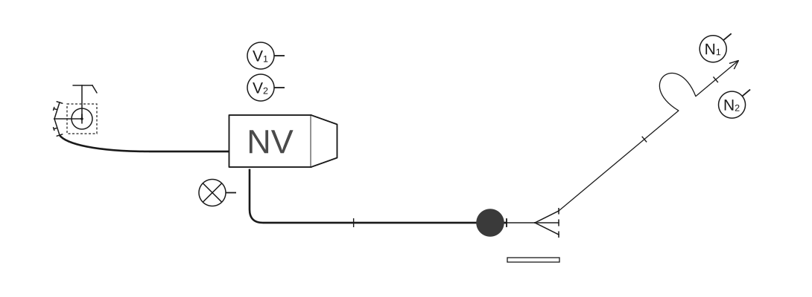
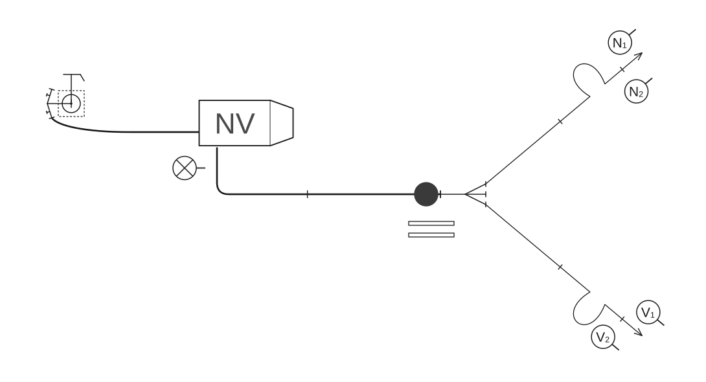

# Poligonske vježbe

### 2.7.2 Vježba 10 – Vježba s 2 „C” mlaza vode, opskrba vodom iz hidrantske mreže (6 vatrogasaca)

*Vježbu izvodi odjeljenje od 6 vatrogasaca:*

- zapovjednik (Z),
- strojar (S),
- vođa navalne grupe (N₁),
- član navalne grupe (N₂),
- vođa vodne grupe (V₁),
- član vodne grupe (V₂).

Raspored mjesta vatrogasaca u navalnom vozilu isti je kao u [vježbi 9](09-Vjezba-9.md).

Oprema je smještena u spremnicima navalnog vozila. Kada je vozilo postavljeno na svoje mjesto, zapovjednik stane dva koraka iza vozila, podiže lijevu ruku i zapovijeda kao u [vježbi 6](06-Vjezba-6.md).

Nakon izdane zapovijedi obavljaju se sljedeće radnje:

#### Polaganje „B” cijevnog voda u cijevnom sektoru

Po izdanoj zapovijedi zapovjednika: **„Za navalu pripremi”**, vodna grupa, navalna grupa i zapovjednik postupaju kao u [vježbi 1](01-Vjezba-1.md) (skica 59).

**Skica 59** – *Položaj odjeljenja, sprava i opreme nakon izdane zapovijedi: „Za navalu pripremi!”*

#### Polaganje prvog mlaza u navalnom sektoru

Prvi mlaz polaže navalna grupa kao u [vježbi 1](01-Vjezba-1.md).

#### Polaganje cijevnog voda od hidranta do vozila

Strojar, kada je od člana navalne grupe (N₂), koji je spojio „B” cijevni vod s razdjelnicom, primio zapovijed: **„Vodu daj”**, pušta vodu do razdjelnice i odlazi na polaganje cijevnog voda od hidranta do vozila kao u [vježbi 8](08-Vjezba-8.md) (skica 60).

**Skica 60** – *Položaj odjeljenja, sprava i opreme nakon izdane zapovijedi za prvi mlaz*

#### Polaganje drugog mlaza u navalnom sektoru

Drugi mlaz polaže vodna grupa kao u [vježbi 1](01-Vjezba-1.md) (skica 61).

**Skica 61** – *Položaj odjeljenja, sprava i opreme nakon izdane zapovijedi za drugi mlaz*

#### Pospremanje opreme

Zapovjednik obavlja pospremu kao u [vježbi 9](09-Vjezba-9.md).

Navalna i vodna grupa obavljaju pospremu navalnog sektora kao u [vježbi 9](09-Vjezba-9.md), dok cijevni sektor posprema vodna grupa, kao što to posprema navalna grupa u [vježbi 9](09-Vjezba-9.md). Strojar, na zapovijed **„Posprema!”**, postupa kao u [vježbi 8](08-Vjezba-8.md).

Kada odlože opremu, vatrogasci odlaze u stroj i postupaju kao u [vježbi 1](01-Vjezba-1.md).
