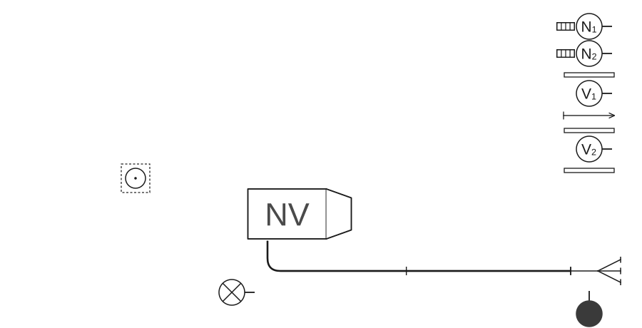
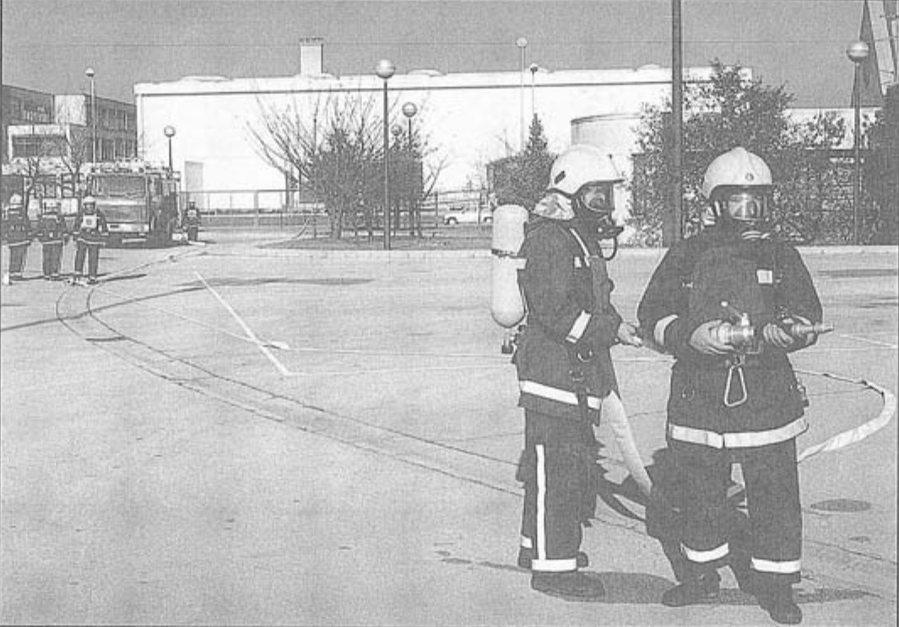
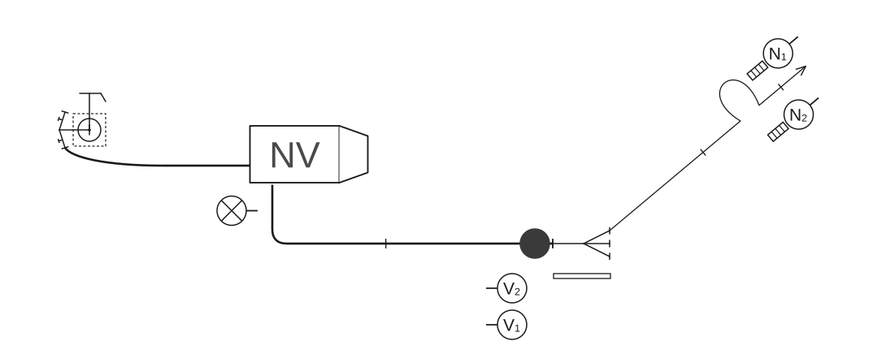
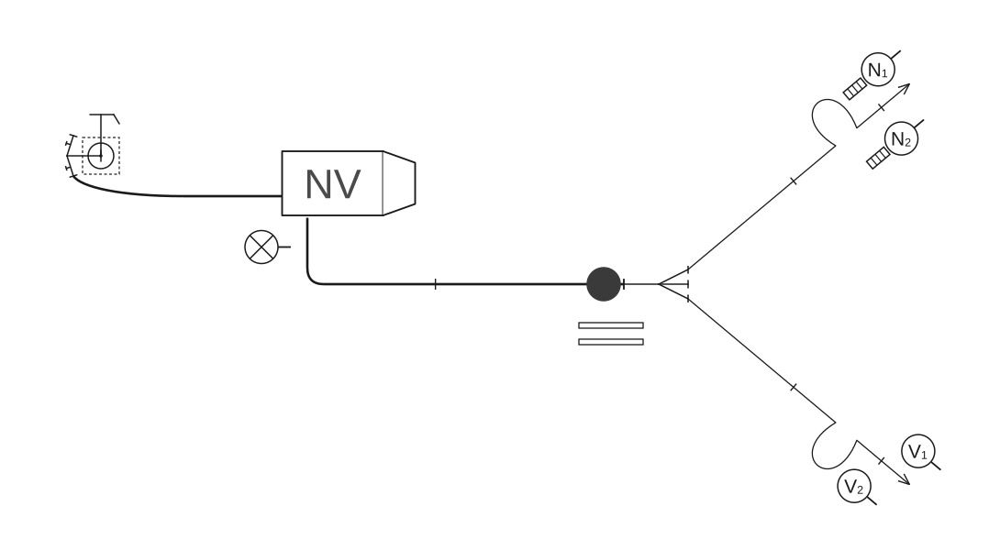

# Poligonske vježbe

### 2.7.3 Vježba 11 – Vježba s 2 „C” mlaza vode, navalna grupa oprema se izolacijskim aparatima, opskrba vodom iz hidrantske mreže (6 vatrogasaca)

*Vježbu izvodi odjeljenje od 6 vatrogasaca:*

- zapovjednik (Z),
- strojar (S),
- vođa navalne grupe (N₁),
- član navalne grupe (N₂),
- vođa vodne grupe (V₁),
- član vodne grupe (V₂).

Raspored mjesta vatrogasaca u navalnom vozilu isti je kao u [vježbi 9](09-Vjezba-9.md). Oprema je smještena u spremnicima navalnog vozila.

Kada je vozilo postavljeno na svoje mjesto, zapovjednik postrojava odjeljenje kao u [vježbi 9](09-Vjezba-9.md).

Zapovjednik istupa ispred odjeljenja kao u [vježbi 1](01-Vjezba-1.md) i zapovijeda: **„Požar pravac…voda – hidrant, s dvije „B” cijevi do razdjelnice, navalna grupa se oprema izolacijskim aparatima, za navalu pripremi!”**.

Nakon izdane zapovijedi obavljaju se sljedeće radnje:

#### Polaganje „B” cijevnog voda u cijevnom sektoru

Vodna grupa polaže „B” cijevni vod kao u [vježbi 1](01-Vjezba-1.md). Kada su položili „B” cijevni vod, vraćaju se i opremaju za polaganje prvog mlaza. Za prvi mlaz uzimaju istu opremu i postupaju kao navalna grupa u [vježbi 1](01-Vjezba-1.md).

Na zapovijed zapovjednika: **„…za navalu pripremi”**, navalna grupa se uz pomoć zapovjednika oprema izolacijskim aparatima. Nakon opremanja, vođa navalne grupe s članom navalne grupe, koji se nalazi s njegove desne strane, odlazi do razdjelnice s lijeve strane „B” cijevnog voda i staje na lijevo od vodne grupe koja se već tamo nalazi.

Zapovjednik, nakon što pomogne navalnoj grupi u opremanju s izolacijskim aparatima, odlazi do razdjelnice kao u [vježbi 1](01-Vjezba-1.md) (skica 62).

**Skica 62** – *Položaj odjeljenja, sprava i opreme nakon izdane zapovijedi: „Za navalu pripremi!”*

#### Polaganje prvog mlaza u navalnom sektoru

Kada je puštena voda do razdjelnice, zapovjednik zapovijeda: **„Za prvi mlaz s dvije „C” cijevi, navalna grupa s izolacijskim aparatima, pravac…naprijed”**. Članovi vodne grupe polažu prvi mlaz kao navalna grupa u [vježbi 1](01-Vjezba-1.md).

Navalna grupa, nakon izdane zapovijedi zapovjednika za polaganje prvog mlaza, odlazi zajedno s vodnom grupom. Vođa vodne grupe (V₁), nakon što je spojio mlaznicu na drugu „C” cijev prvog mlaza, mlaznicu i držač cijevi predaje vođi navalne grupe (N₁) koji od poslužitelja na razdjelnici (zapovjednika) traži vodu, tj. zapovijeda: **„Za prvi mlaz – vodu daj”**.

Zapovjednik obavlja radnje kao u [vježbi 1](01-Vjezba-1.md) (slika 42).

**Slika 42** – *Položaj odjeljenja, sprava i opreme nakon izdane zapovijedi za prvi mlaz*

#### Polaganje cijevnog voda od hidranta do vozila

Strojar, kada je od člana vodne grupe (V₂) primio zapovijed: **„Vodu daj”**, pušta vodu do razdjelnice i odlazi na polaganje cijevnog voda od hidranta do vozila kao u [vježbi 8](08-Vjezba-8.md) (skica 63).

**Skica 63** – *Položaj odjeljenja, sprava i opreme nakon izdane zapovijedi za prvi mlaz*

#### Polaganje drugog mlaza u navalnom sektoru

Nakon izdane zapovijedi N₁: **„Za prvi mlaz vodu daj”**, zapovjednik zapovijeda: **„Za drugi mlaz, sa dvije „C” cijevi, pravac…naprijed”**. Članovi vodne grupe predaju ključeve i torbicu s povezicama za cijevi zapovjedniku koji se nalazi na razdjelnici i odlaze lijevom stranom „B” cijevnog voda po opremu za drugi mlaz. Drugi mlaz polažu kao u [vježbi 1](01-Vjezba-1.md) (skica 64).

**Skica 64** – *Položaj odjeljenja, sprava i opreme nakon izdane zapovijedi za drugi mlaz*

#### Pospremanje opreme

Zapovijedi i radnje zapovjednika iste su kao u [vježbi 1](01-Vjezba-1.md), a nakon odložene opreme pomaže navalnoj grupi u skidanju izolacijskih aparata. Vođa navalne grupe (N₁) na zapovijed **„Posprema!”**, uzima mlaznicu i držač cijevi i zajedno sa članom (N₂) odlazi na skidanje izolacijskih aparata.

Vodna grupa na zapovijed **„Posprema!”** posprema drugi mlaz, odlažu opremu drugog mlaza, krećući se lijevom stranom „B” cijevnog voda, vraćaju se lijevom stranom „B” cijevnog voda i pospremaju prvi mlaz, odlažu opremu prvog mlaza, krećući se desnom stranom „B” cijevnog voda i pospremaju „B” cijevni vod. Vođa vodne grupe (V₁) za odnošenje i odlaganje opreme prvog i drugog mlaza zapovijeda kao vođa navalne grupe (N₁) u [vježbi 7](07-Vjezba-7.md).

Strojar na zapovijed **„Posprema”** postupa kao u [vježbi 8](08-Vjezba-8.md).

Kada odlože opremu, vatrogasci odlaze u stroj i postupaju kao u [vježbi 1](01-Vjezba-1.md).
