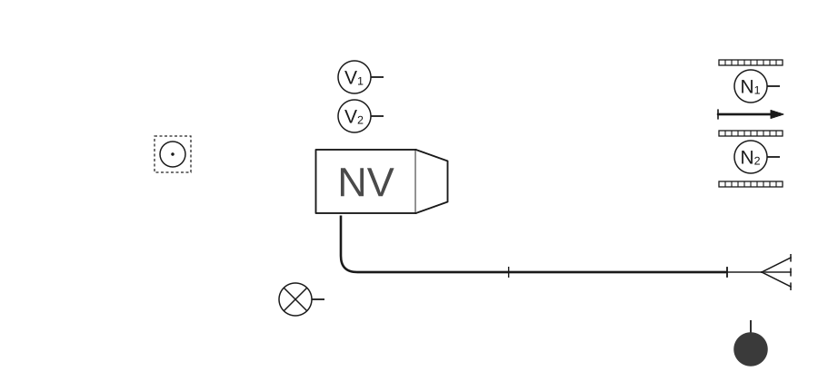
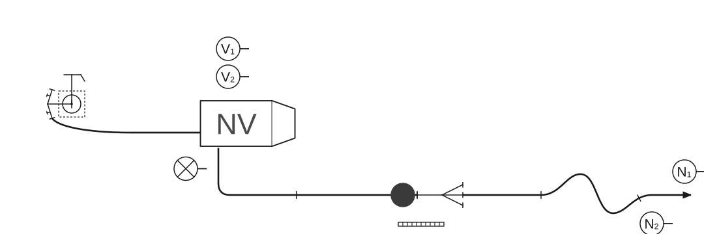
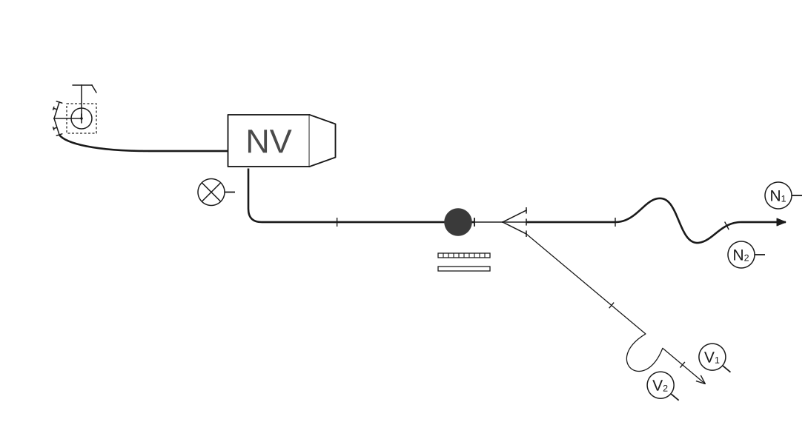

# Poligonske vježbe

### 2.7.4 Vježba 12 – Vježba s 1 „B” i 1 „C” mlazom vode, opskrba vodom iz hidrantske mreže (6 vatrogasaca)

*Vježbu izvodi odjeljenje od 6 vatrogasaca:*

- zapovjednik (Z),
- strojar (S),
- vođa navalne grupe (N₁),
- član navalne grupe (N₂),
- vođa vodne grupe (V₁),
- član vodne grupe (V₂).

Raspored mjesta vatrogasaca u navalnom vozilu isti je kao u [vježbi 9](09-Vjezba-9.md). Oprema je smještena u spremnicima navalnog vozila.

Kada je vozilo postavljeno na svoje mjesto, zapovjednik postrojava odjeljenje kao u [vježbi 9](09-Vjezba-9.md).

Zapovjednik istupa ispred odjeljenja kao u [vježbi 1](01-Vjezba-1.md) i zapovijeda: **„Požar pravac…voda – hidrant, s dvije „B” cijevi do razdjelnice, za „B” mlaz, za navalu pripremi!”**.

Nakon izdane zapovijedi obavljaju se sljedeće radnje:

#### Polaganje „B” cijevnog voda u cijevnom sektoru

Vodna grupa polaže „B” cijevni vod kao u [vježbi 1](01-Vjezba-1.md) (skica 65).

**Skica 65** – *Položaj odjeljenja, sprava i opreme nakon izdane zapovijedi „Za navalu pripremi!”*

#### Polaganje prvog mlaza u navalnom sektoru

Navalna grupa se oprema za polaganje prvog „B” mlaza i uzima sljedeću opremu: vođa grupe (N₁) uzima držač cijevi, „B” mlaznicu s ublaživačem reakcije mlaza i stavlja je za opasač, u desnu ruku uzima razdjelnicu, a u lijevu ruku jednu „B” cijev, a član grupe (N₂) u svaku ruku po jednu „B” cijev. Tako opremljeni kreću se lijevom stranom „B” cijevnog voda i postupaju kao u [vježbi 1](01-Vjezba-1.md). Zapovijed za prvi mlaz glasi: **„Za prvi „B” mlaz, s dvije „B” cijevi pravac…naprijed”**. Prvi „B” mlaz polaže se na srednji otvor razdjelnice. Postupci spajanja i polaganja cijevi prvog mlaza isti su kao u [vježbi 1](01-Vjezba-1.md), s razlikom što član grupe (N₂) drugu „B” cijev izbacuje u lijevu i desnu stranu, tako da cijev dobije manji luk i pravi oblik slova „S”.

#### Polaganje cijevnog voda od hidranta do vozila

Strojar polaže cijevni vod od hidranta do vozila kao u [vježbi 10](10-Vjezba-10.md) (skica 66).

**Skica 66** – *Položaj odjeljenja, sprava i opreme nakon izdane zapovijedi za prvi mlaz*

#### Polaganje drugog mlaza u navalnom sektoru

Drugi mlaz polaže vodna grupa kao u [vježbi 1](01-Vjezba-1.md) (skica 67).

**Skica 67** – *Položaj odjeljenja, sprava i opreme nakon izdane zapovijedi za drugi mlaz*

#### Pospremanje opreme

Zapovjednik zapovijeda: **„Prvi „B” mlaz i drugi mlaz – vodom stoj”**. Ostale zapovijedi i radnje zapovjednika iste su kao u [vježbi 1](01-Vjezba-1.md).

Na tu zapovijed zapovjednika, N₁ izdaje zapovijed: **„Prvi „B” mlaz – vodom stoj!”**, a preostale zapovijedi i radnje za pospremu prvog i drugog cijevnog voda u navalnom sektoru i posprema „B” cijevnog voda iste su kao u [vježbi 10](10-Vjezba-10.md).

Strojar na zapovijed: **„Posprema”** postupa kao u [vježbi 8](08-Vjezba-8.md).

Kad odlože opremu, vatrogasci odlaze u stroj i postupaju kao u [vježbi 1](01-Vjezba-1.md).
