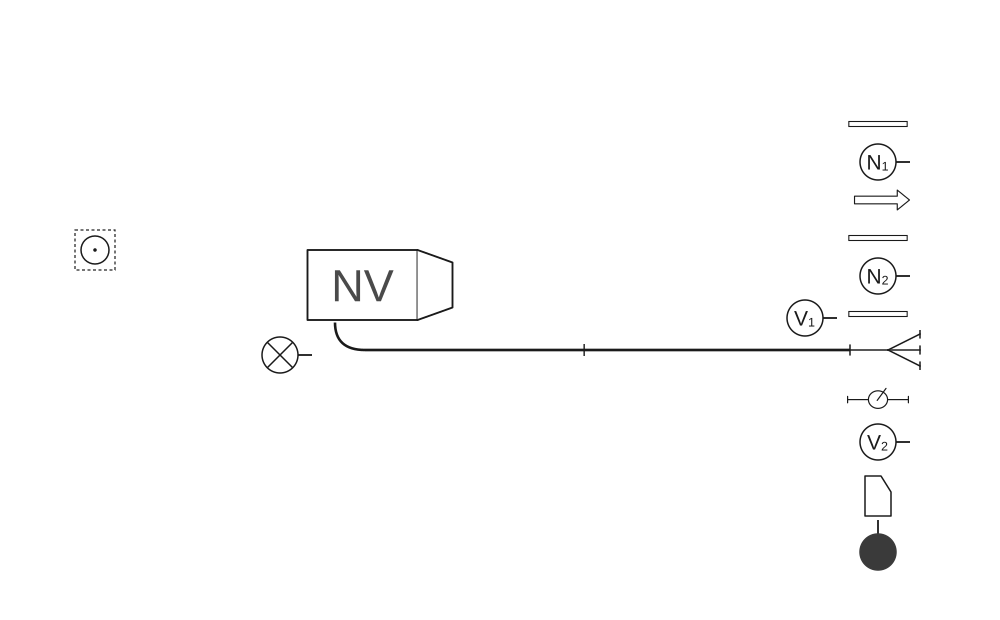
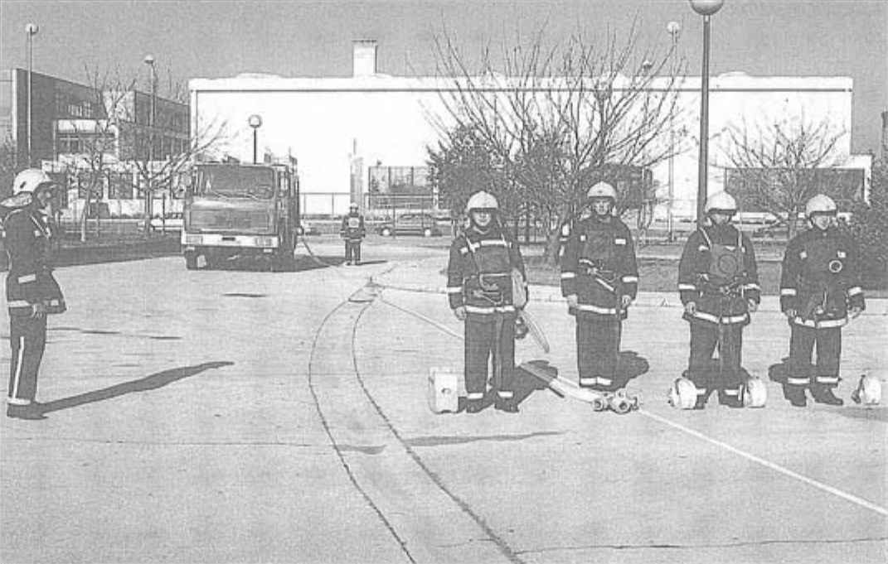
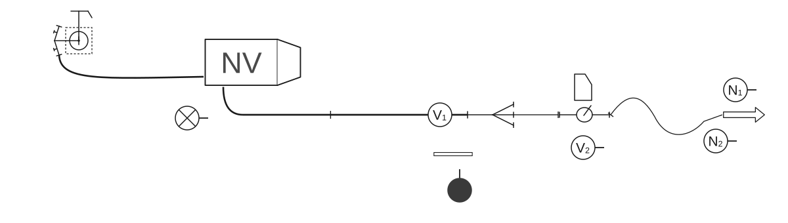
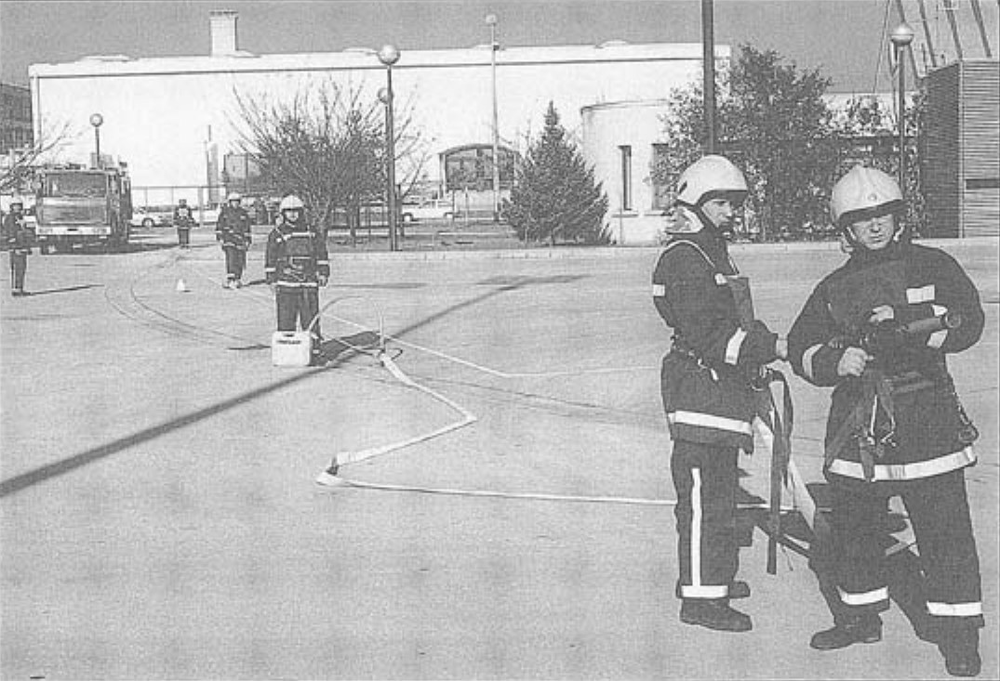
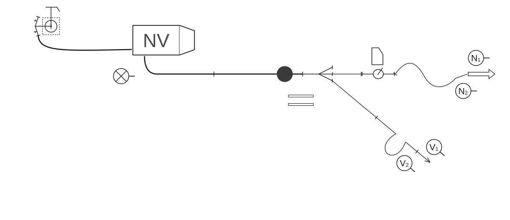
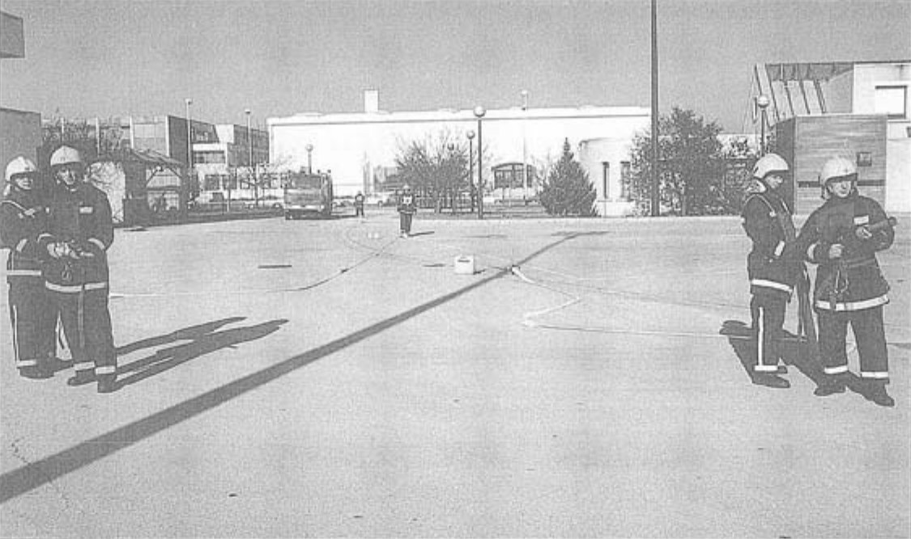

# Poligonske vježbe

### 2.7.5 Vježba 13 – Vježba s 1 mlazom pjene i 1 „C” mlazom vode, opskrba vodom iz hidrantske mreže (6 vatrogasaca)

*Vježbu izvodi odjeljenje od 6 vatrogasaca:*

- zapovjednik (Z),
- strojar (S),
- vođa navalne grupe (N₁),
- član navalne grupe (N₂),
- vođa vodne grupe (V₁),
- član vodne grupe (V₂).

Raspored mjesta vatrogasaca u navalnom vozilu isti je kao u [vježbi 9](09-Vjezba-9.md). Oprema je smještena u spremnicima navalnog vozila.

Kada je vozilo postavljeno na svoje mjesto, zapovjednik postrojava odjeljenje kao u [vježbi 9](09-Vjezba-9.md).

Zapovjednik istupa ispred odjeljenja kao u [vježbi 1](01-Vjezba-1.md) i zapovijeda:

**„Požar pravac….voda – hidrant, s dvije „B” cijevi do razdjelnice, prvi mlaz s pjenom, za navalu pripremi”**.

Nakon izdane zapovijedi obavljaju se sljedeće radnje:

#### Polaganje „B” cijevnog voda u cijevnom sektoru

Vodna grupa polaže „B” cijevni vod kao u [vježbi 1](01-Vjezba-1.md) (skica 68, slika 43).

**Skica 68** – *Položaj odjeljenja, sprava i opreme nakon izdane zapovijedi: „Za navalu pripremi!”*

**Slika 43** – *Položaj odjeljenja, sprava i opreme nakon izdane zapovijedi: „Za navalu pripremi!”*

#### Polaganje prvog mlaza pjene u navalnom sektoru

Navalna grupa se oprema za polaganje prvog mlaza i uzimaju sljedeću opremu: vođa grupe (N₁) uzima u lijevu ruku mlaznicu za pjenu, jednu „C” cijev i držač cijevi u desnu ruku, razdjelnicu s prijelaznom spojnicom B/C na srednjem otvoru, a član grupe (N₂) uzima u svaku ruku po jednu „C” cijev. Tako opremljeni kreću se lijevom stranom „B” voda i postupaju kao u [vježbi 1](01-Vjezba-1.md). Vodna grupa, nakon polaganja „B” cijevnog voda, pomaže polagati prvi mlaz, tako da vođa vodne grupe (V₁) ide na razdjelnicu, a član vodne (V₂) odlazi do vozila i u lijevu ruku uzima međumješalicu s usisnom cijevi za pjenilo, a u desnu ruku posudu s pjenilom. Kreće se desnom stranom „B” cijevnog voda, staje s desne strane razdjelnice i čeka zapovijed za prvi mlaz. Zapovjednik postupa kao u [vježbi 1](01-Vjezba-1.md). Kada je član vodne grupe (V₂) stigao do razdjelnice, zapovjednik zapovijeda: **„Za prvi mlaz pjenom, sa dvije „C” cijevi, međumješalica poslije prve „C” cijevi, pravac...naprijed”**.

Navalna grupa počinje polaganje prvog mlaza na srednji otvor razdjelnice kao u [vježbi 12](12-Vjezba-12.md). Član vodne grupe (V₂) nosi međumješalicu i posudu s pjenilom do kraja prve razvučene „C” cijevi, odlaže međumješalicu i sačeka da vođa navalne grupe (N₁) spoji međumješalicu sa spojnicama prve i druge „C” cijevi. Nakon spojene međumješalice vođa navalne grupe (N₁) polaže drugu „C” cijev, kao u [vježbi 1](01-Vjezba-1.md), spaja mlaznicu za pjenu, diže desnu ruku i zapovijeda: **„Za prvi mlaz – pjenu daj!”**.

Član navalne grupe (N₂) izbacuje drugu „C” cijev kao u [vježbi 12](12-Vjezba-12.md). Vođa vodne grupe (V₁) poslužuje razdjelnicu, a član vodne grupe (V₂) poslužuje međumješalicu i na tim mjestima ostaju sve do zapovijedi za drugi mlaz.

#### Polaganje cijevnog voda od hidranta do vozila

Strojar polaže cijevni vod od hidranta do vozila kao u [vježbi 10](10-Vjezba-10.md) (skica 69, slika 44).

**Skica 69** – *Položaj odjeljenja, sprava i opreme nakon izdane zapovijedi za prvi mlaz*

**Slika 44** – *Položaj odjeljenja, sprava i opreme nakon izdane zapovijedi za prvi mlaz*

#### Polaganje drugog mlaza u navalnom sektoru

Nakon izdane zapovijedi za drugi mlaz, koja je ista kao u [vježbi 1](01-Vjezba-1.md), vodna grupa predaje ključeve i torbicu s povezicama zapovjedniku, koji preuzima nadzor nad razdjelnicom, a istovremeno kontrolira i međumješalicu. Vodna grupa se oprema i polaže drugi mlaz kao u [vježbi 1](01-Vjezba-1.md) (skica 70, slika 45).

**Skica 70** – *Položaj odjeljenja, sprava i opreme nakon izdane zapovijedi za drugi mlaz*

**Slika 45** – *Položaj odjeljenja, sprava i opreme nakon izdane zapovijedi za drugi mlaz*

#### Pospremanje opreme

Zapovjednik zapovijeda: **„Prvi mlaz pjenom i drugi mlaz – vodom stoj!”**.

Tada N₁ izdaje zapovijed: **„Prvi mlaz – pjenom stoj!”**.

Na tu zapovijed zapovjednik odlazi do međumješalice, vadi usisnu cijev za pjenilo iz posude s pjenilom, vraća se do razdjelnice i zatvara vodu za prvi mlaz. Tek nakon zatvorenog prvog mlaza, vođa vodne grupe (V₁) izdaje zapovijed: **„Drugi mlaz – vodom stoj!”** Na zapovijed zapovjednika **„Posprema!”**, navalna grupa posprema prvi mlaz, s time da međumješalicu i posudu sa pjenilom ostave na zemlji gdje ih je donio član vodne grupe (V₂).

Vodna grupa posprema drugi mlaz kao u [vježbi 1](01-Vjezba-1.md).

Zapovjednik kod otpajanja tlačnih cijevi od razdjelnice, postupa kao u [vježbi 1](01-Vjezba-1.md), a poslije toga odlazi do međumješalice i posude s pjenilom. U desnu ruku uzima posudu s pjenilom, a u lijevu ruku međumješalicu s usisnom cijevi. Kreće se lijevom stranom „B” cijevnog voda do spoja prve i druge „B” cijevi u cijevnom sektoru, spušta opremu na zemlju, rastavlja spoj „B” cijevi kao u [vježbi 1](01-Vjezba-1.md) i uzima i odnosi opremu u vozilo. Navalna i vodna grupa odlažu opremu prvog i drugog mlaza kao u [vježbi 10](10-Vjezba-10.md).

„B” cijevnu prugu posprema vodna grupa.

Strojar na zapovijed **„Posprema”** postupa kao u [vježbi 8](08-Vjezba-8.md).

Kad odlože opremu, vatrogasci odlaze u stroj i postupaju kao u [vježbi 1](01-Vjezba-1.md).
