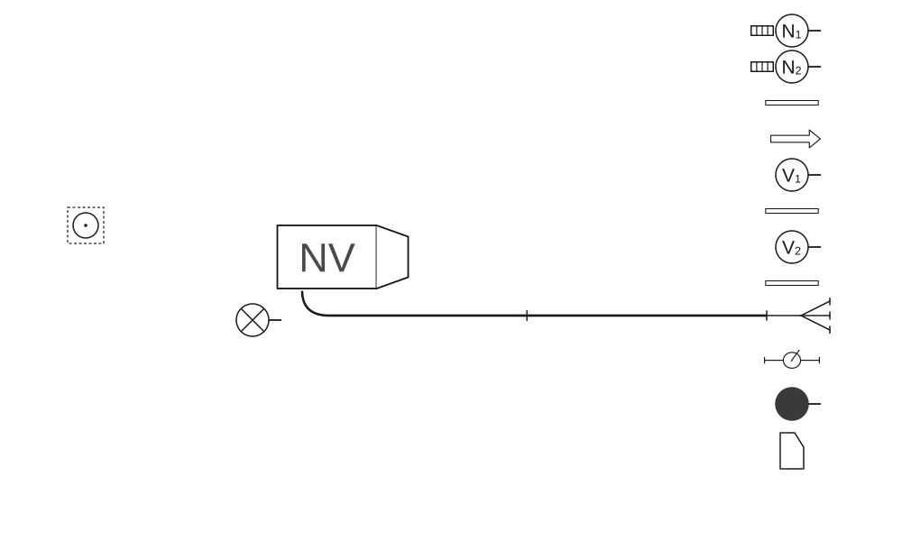
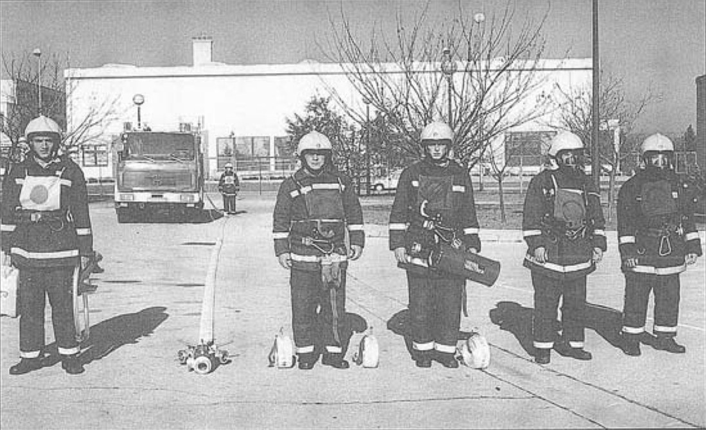
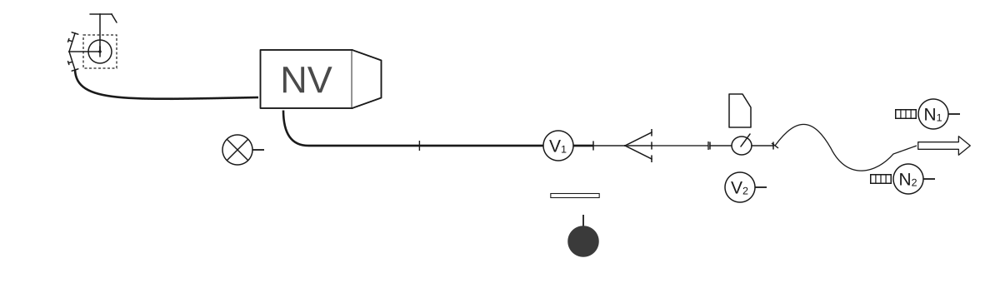
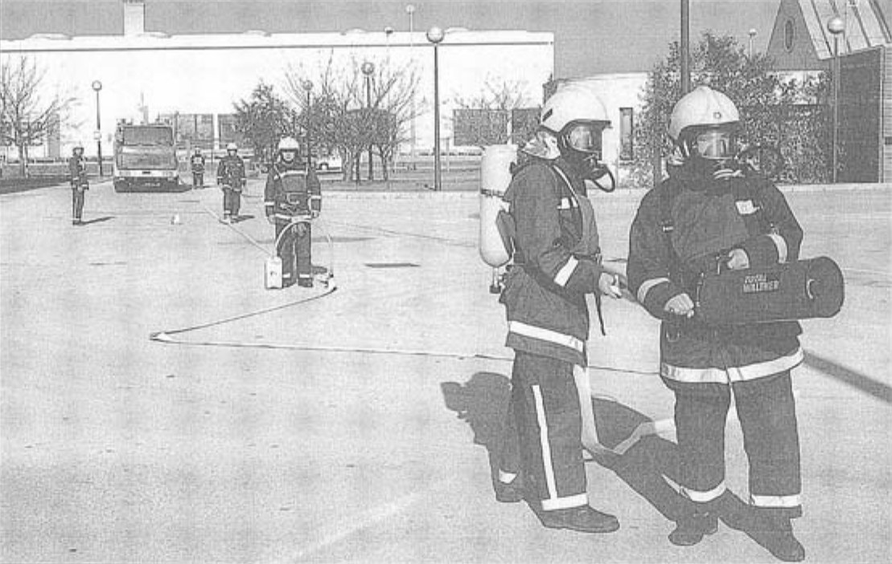
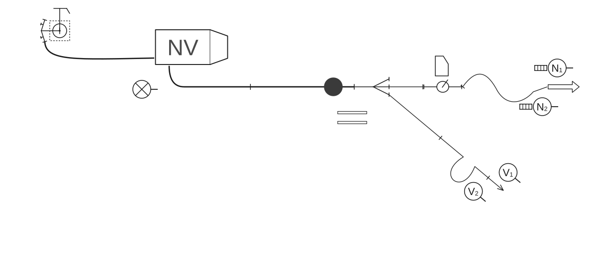
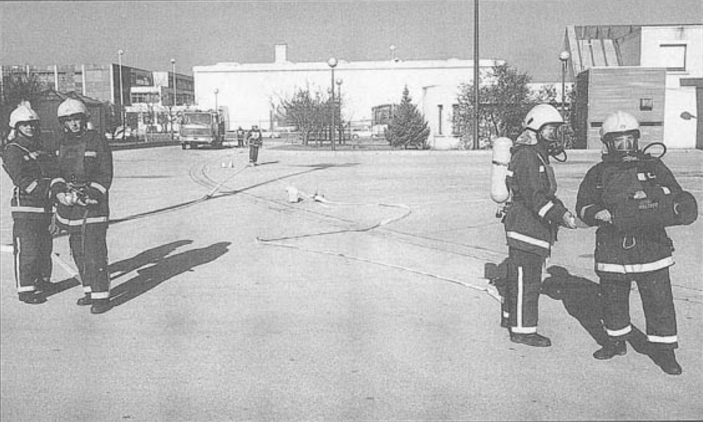

# Poligonske vježbe

### 2.7.6 Vježba 14 – Vježba s 1 mlazom pjene, 1 mlazom vode, navalna grupa oprema se izolacijskim aparatima i opskrba vodom iz hidrantske mreže (6 vatrogasaca)

*Vježbu izvodi odjeljenje od 6 vatrogasaca:*

- zapovjednik (Z),
- strojar (S),
- vođa navalne grupe (N₁),
- član navalne grupe (N₂),
- vođa vodne grupe (V₁),
- član vodne grupe (V₂).

Raspored mjesta vatrogasaca u navalnom vozilu isti je kao u [vježbi 9](09-Vjezba-9.md).

Oprema je smještena u spremnicima navalnog vozila. Kada je vozilo postavljeno na svoje mjesto, zapovjednik postrojava odjeljenje kao u [vježbi 9](09-Vjezba-9.md).

Zapovjednik istupa ispred odjeljenja kao u [vježbi 1](01-Vjezba-1.md) i zapovijeda:

**„Požar pravac...voda – hidrant, sa dvije „B” cijevi do razdjelnice, prvi mlaz pjenom, navalna grupa se oprema izolacijskim aparatima – za navalu pripremi!”**.

Nakon izdane zapovijedi obavljaju se sljedeće radnje:

#### Polaganje „B” cijevnog voda u cijevnom sektoru

Vodna grupa polaže „B” cijevni vod kao u [vježbi 1](01-Vjezba-1.md). Kada su položili „B” cijevni vod vraćaju se do vozila i opremaju za polaganje prvog mlaza pjene. Uzimaju istu opremu kao navalna grupa u [vježbi 13](13-Vjezba-13.md).

Na zapovijed zapovjednika: **„Za navalu – pripremi”**, navalna grupa se uz pomoć zapovjednika oprema izolacijskim aparatima. Nakon opremanja, navalna grupa postupa kao u [vježbi 11](11-Vjezba-11.md), a zapovjednik uzima međumješalicu sa usisnom cijevi za pjenilo u lijevu ruku, a posudu s pjenilom u desnu, kreće se desnom stranom „B” cijevnog voda do razdjelnice gdje staje s njezine desne strane i odlaže opremu pored sebe na zemlju (skica 71, slika 46).

**Skica 71** – *Položaj odjeljenja, sprava i opreme nakon izdane zapovijedi „Za navalu pripremi!”*

**Slika 46** – *Položaj odjeljenja, sprava i opreme nakon izdane zapovijedi „Za navalu pripremi!”*

#### Polaganje prvog mlaza pjene u navalnom sektoru

Nakon što je član vodne grupe (V₂) dobio vodu do razdjelnice, zapovjednik zapovijeda: **„Za prvi mlaz pjenom, sa dvije „C” cijevi, međumješalica poslije prve „C” cijevi, navalna grupa s izolacijskim aparatima, pravac...naprijed”**.

Vodna grupa i zapovjednik polažu prvi mlaz na srednji otvor razdjelnice.

Prvi mlaz polažu kao navalna grupa (N₁ i N₂) s članom vodne grupe (V₂) kao u [vježbi 13](13-Vjezba-13.md), s razlikom što zapovjednik odlaže međumješalicu i posudu s pjenilom poslije prve „C” cijevi, vraća se lijevom stranom „C” cijevi i staje tri koraka desno od razdjelnice, okrenut prema razdjelnici.

Navalna grupa se kreće lijevom stranom do završetka cijevnog voda za prvi mlaz, gdje vođa vodne grupe (V₁) predaje mlaznicu i držač cijevi vođi navalne grupe (N₁). Član vodne grupe (V₂) odlazi na međumješalicu, a vođa (V₁) na razdjelnicu, gdje ostaju do zapovijedi za drugi mlaz.

#### Polaganje cijevnog voda od hidranta do vozila

Strojar polaže cijevni vod od hidranta do vozila kao u [vježbi 10](10-Vjezba-10.md) (skica 72, slika 47).

**Skica 72** – *Položaj odjeljenja, sprava i opreme nakon izdane zapovijedi za prvi mlaz*

**Slika 47** – *Položaj odjeljenja, sprava i opreme nakon izdane zapovijedi za prvi mlaz*

#### Polaganje drugog mlaza u navalnom sektoru

Vodna grupa polaže drugi mlaz kao u [vježbi 13](13-Vjezba-13.md) (skica 73, slika 48).

**Skica 73** – *Položaj odjeljenja, sprava i opreme nakon izdane zapovijedi za prvi mlaz*

**Slika 48** – *Položaj odjeljenja, sprava i opreme nakon izdane zapovijedi za drugi mlaz*

#### Pospremanje opreme

Zapovjednik zapovijeda: **„Prvi mlaz pjenom i drugi mlaz – vodom stoj!”**. Na zapovijed: **„Prvi mlaz – pjenom stoj!”** N₁ obavlja radnje kao u [vježbi 13](13-Vjezba-13.md).

Tek nakon zatvorenog prvog mlaza vođa vodne grupe (V₁) izdaje zapovijed:

**„Drugi mlaz – vodom stoj!”**. Nakon izdane zapovijedi zapovjednika **„Posprema!”**, zapovjednik rastavlja cijevi s razdjelnice kao u [vježbi 1](01-Vjezba-1.md), rastavlja i uzima međumješalicu i posudu s pjenilom kao u [vježbi 13](13-Vjezba-13.md). Kreće se lijevom stranom „B” cijevnog voda do spoja prve i druge „B” cijevi, spušta opremu na zemlju, rastavlja spojnice i uzima i odnosi opremu u vozilo. Kada je odložio opremu, pomaže navalnoj grupi u skidanju izolacijskih aparata.

Vodna grupa postupa kao u [vježbi 11](11-Vjezba-11.md).

Strojar na zapovijed: **„Posprema!”** postupa kao u [vježbi 8](08-Vjezba-8.md).

Kad odlože opremu, vatrogasci odlaze u stroj i postupaju kao u [vježbi 1](01-Vjezba-1.md).
