# Poligonske vježbe

## 2.8 Vježba 15 – Natjecateljska vježba

*Vježbu izvodi odjeljenje od 9 vatrogasaca:*

- zapovjednik (Z),
- strojar (S),
- vođa navalne grupe (N₁),
- član navalne grupe (N₂),
- vođa vodne grupe (V₁),
- član vodne grupe (V₂),
- vođa cijevne grupe (C₁),
- član cijevne grupe (C₂),
- teklić.

*Za izvođenje vježbe potrebna je sljedeća vatrogasna oprema:*

- prijenosna vatrogasna motorna pumpa,
- 4 usisne cijevi „A”,
- 1 usisna sitka,
- 3 univerzalna ključa za spojnice,
- 1 uže s torbicom za vezanje usisnog voda,
- 1 uže s torbicom za vezanje ventila na usisnoj sitki,
- 3 „B” tlačne cijevi,
- 6 „C” tlačnih cijevi,
- 1 trodijelna razdjelnica,
- 2 „C” mlaznice,
- 2 držača za cijevi,
- 1 torbica sa povezicama za cijevi.

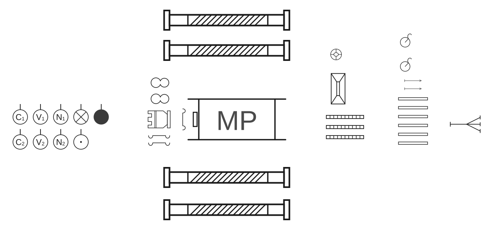

**Skica 74** – *Postavljanje sprava i opreme i postrojavanje odjeljenja*

Kada je oprema postavljena na određeno mjesto, zapovjednik staje na dva koraka od usisnog otvora motorne pumpe, podiže lijevu ruku i zapovijeda: **„Odjeljenje – zbor”**. Na tu zapovijed vatrogasci se postrojavaju u dvije vrste (skica 74, slika 49, 50, 51).

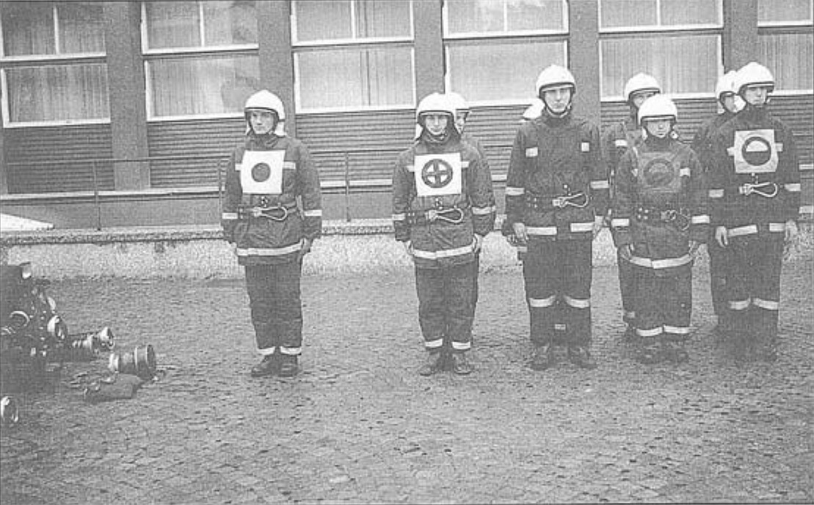

**Slika 49** – *Postrojavanje odjeljenja za izvođenje vježbe*

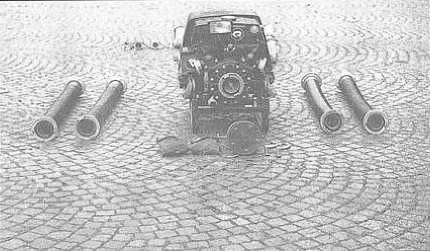

**Slika 50** – *Položaj opreme za izvođenje vježbe*

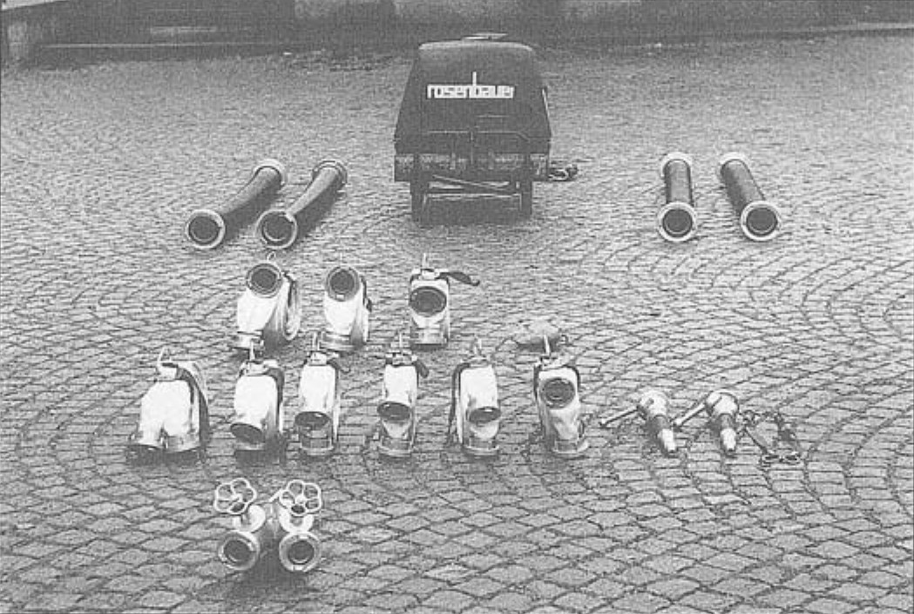

**Slika 51** – *Položaj opreme za izvođenje vježbe*

Kada je odjeljenje postrojeno zapovjednik istupa pet koraka naprijed, okreće se (čelom nazad) prema odjeljenju i izdaje zapovijed: **„Požar pravac...voda..., sa dvije „B” cijevi do razdjelnice i sa dvije „C” cijevi za prvi i drugi mlaz pravac... naprijed!”**

Nakon zapovijedi zapovjednika, strojar zapovijeda: **„Četiri usisne cijevi!”** i odjeljenje kreće na izvođenje vježbe.

#### Polaganje usisnog voda

##### Polaganje usisnih cijevi (slika 52, 53)

Strojar uzima dvije torbice s užadima pod lijevu ruku, dva ključa koja leže kraj usisne sitke u lijevu ruku i usisnu sitku u desnu ruku. Tako opremljen kreće prema mjestu gdje će se spajati usisna sitka s usisnim cijevima.

Vodna grupa (V₁ i V₂) uzima usisne cijevi koje leže s desne strane motorne pumpe. Prilikom uzimanja usisnih cijevi, okrenuti su licem prema crpilištu vode i stoje između usisnih cijevi tako da je vođa grupe (V₁) ispred člana grupe (V₂). Polažu usisne cijevi prema crpilištu vode, jedna iza druge. Pritom vođa grupe (V₁) ide naprijed, a član grupe (V₂) iza njega i svaki od njih drži po jednu spojnicu usisne cijevi u svakoj ruci. Polažu cijevi u produžetku usisne cijevi koja je ostala na zemlji pokraj motorne pumpe s lijeve strane.

Prvo polažu usisnu cijev koju nose u lijevoj ruci, zatim odlažu drugu usisnu cijev koju nose u desnoj ruci iza prethodno odložene cijevi, krećući se prema crpilištu.

Cijevna grupa (C₁ i C₂) diže samo onu cijev koja je položena bliže motornoj pumpi s lijeve strane i polaže je prema požaru u produžetku usisne cijevi koja je ostala na zemlji. Član grupe (C₂) nosi cijev lijevom ili desnom rukom i povlači se natraške za duljinu cijevi, a vođa grupe (C₁) ga slijedi, držeći svoj kraj cijevi desnom rukom. Prilikom polaganja okrenuti su licem u lice.

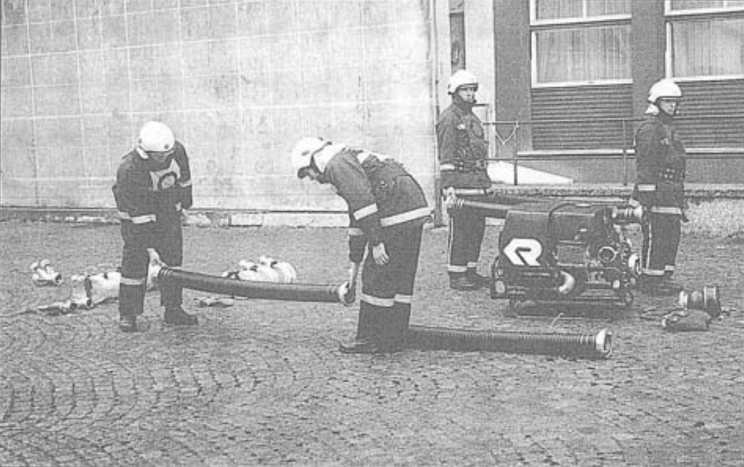

**Slika 52** – *Položaj grupa tijekom polaganja usisnih cijevi*

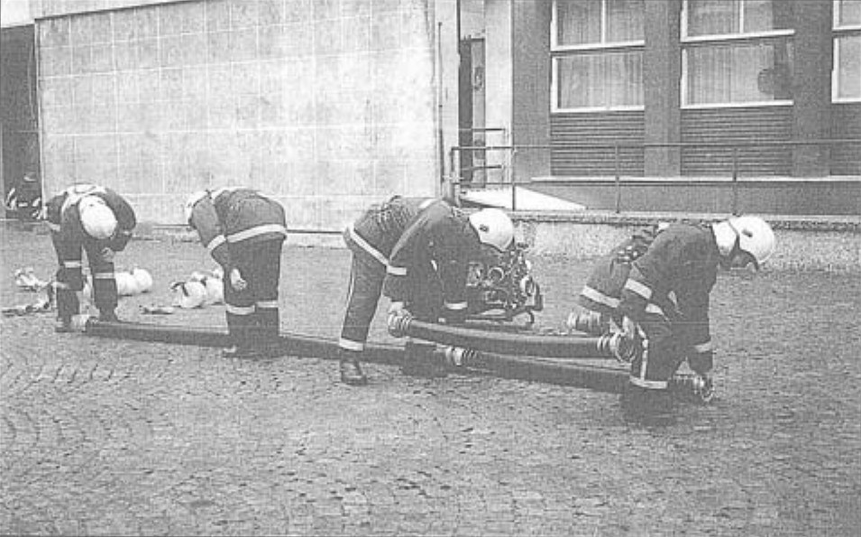

**Slika 53** – *Položaj grupa tijekom polaganja usisnih cijevi*

##### Spajanje usisnog voda (slika 54, 55, 56, 57)

Spajanje usisnih cijevi obavlja vodna i cijevna grupa počevši od usisne sitke. V₁ i C₁ spajaju spojnice usisnih cijevi, a V₂ i C₂ pridržavaju usisne cijevi koje se spajaju. Spajanje usisnih cijevi smije se obavljati na bilo kojoj visini iznad tla, ali tako da cijevi koje se spajaju niti jednim dijelom ne smiju dodirivati tlo. Cijevi se moraju najprije podići, zatim uzubiti-spojiti i zategnuti ključevima. Niti jedna od tih radnji ne smije se obaviti na zemlji. Kada su sve usisne cijevi položene, spajanje se obavlja na sljedeći način: C₁ i C₂ odlaze do prve usisne cijevi najbliže crpilištu. Istovremeno prekorače usisnu cijev, gledajući prema crpilištu, pri čemu C₁ stoji bliže, a C₂ dalje od crpilišta. Tako postavljeni podignu usisnu cijev.

Istovremeno V₁ uzima od strojara usisnu sitku i postavi se nasuprot C₁, gledajući prema požaru. V₁ i C₁ tako postavljeni spajaju usisnu sitku i usisnu cijev rukama. Tada strojar predaje V₁ i C₁ po jedan ključ. Strojar stoji s desne strane prve cijevi, gledajući prema usisnim cijevima.

Spojenu usisnu sitku i prvu cijev odlažu na tlo, a ključeve zadržavaju kod sebe. V₂ u međuvremenu preuzima torbice s užetima od strojara i odlaže ih lijevo i desno nedaleko od usisne sitke, te se postavi iza V₁.

Nakon prvog spajanja i odlaganja cijevi na tlo, cijevna grupa iskoračuje korak u lijevo i na lijevoj nozi čine okret čelom nazad.

Vodna grupa iskorači u desno od usisnog voda i obje grupe kreću do sljedećih spojnica. Tu vodna grupa načini korak u lijevo i lijevom nogom prekorači cijev, a cijevna grupa na lijevoj nozi ponovo čini okret čelom nazad i desnom nogom prekorači drugu usisnu cijev.

Tako postavljena vodna i cijevna grupa, jedna nasuprot druge, podižu usisne cijevi do visine na kojoj ih spajaju, V₁ i C₁ ponove radnju spajanja, a V₂ i C₂ za to vrijeme pridržavaju samo one cijevi koje se spajaju.

Kod spajanja, vodna i cijevna grupa mora biti u raskoraku iznad usisnih cijevi. C₂ prilikom pridržavanja mora barem jednom nogom stajati u ravnini spojnice usisne cijevi koja se spaja.

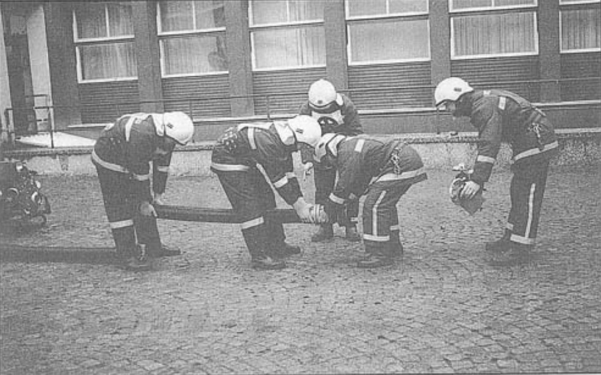

**Slika 54** – *Spajanje usisnog voda*

C₂ je dopušteno namještati spojnicu na cijevi koja se spaja.

C₂ ne smije dirati, niti privlačiti slijedeću usisnu cijev.

Tijekom spajanja, zatezanje spojnice obavlja se ključem u desnoj ruci. Strojar nadzire rad članova grupa, a radi postizanja ujednačenosti rada stoji s desne strane usisne cijevi i zapovijeda: **„Diži – spusti”**, sve dok se usisne cijevi ne spoje. Izdavanje tih zapovijedi nije obveza.

Ako se jedna od spojnica usisnog voda rastavi, strojar zapovijeda: **„Usisni vod, ponovo spajati”**.

Kada su sve spojnice usisnog voda spojene, V₁ predaje ključ C₂. Pri tome nije dopušteno dobacivanje ili ispuštanje ključa na tlo. C₁ nakon završetka spajanja usisnog voda zadržava ključ kod sebe.

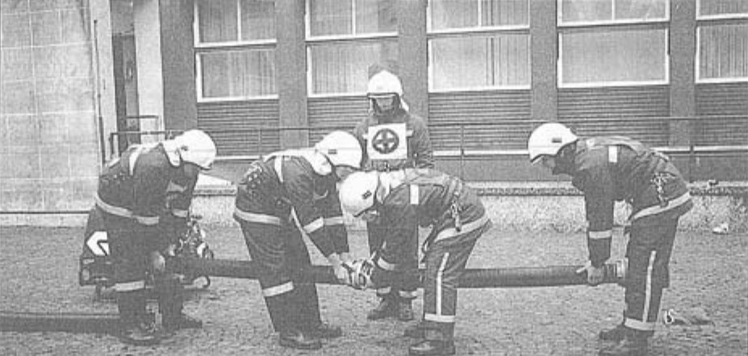

**Slika 55** – *Spajanje usisnog voda*

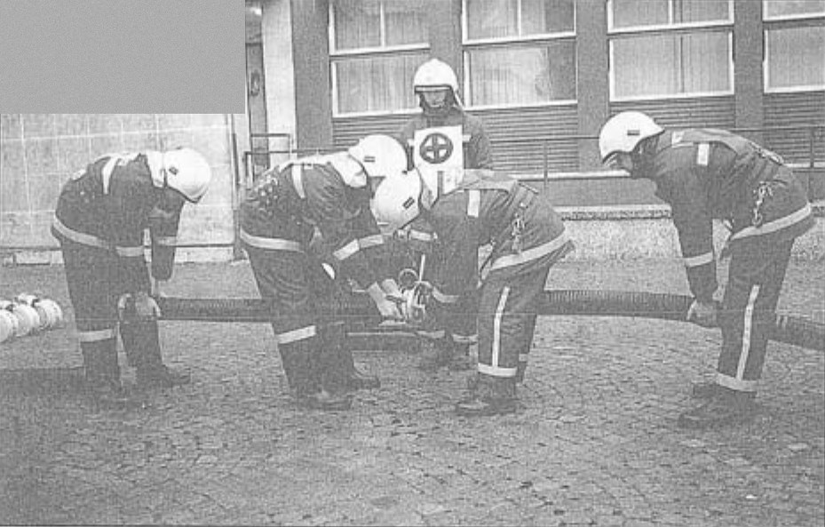

**Slika 56** – *Spajanje usisnog voda*

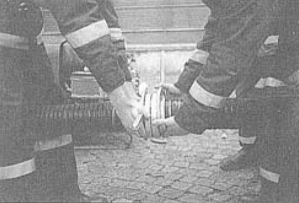

**Slika 57** – *Spajanje usisnog voda*

##### Vezanje usisnog voda (slika 58)

Kada je usisni vod potpuno spojen, strojar izdaje zapovijed: **„Užetom veži!”**.

C₁ odlazi do usisne sitke, podiže je i uzima torbicu s užetom koju zakvači na kariku nepovratnog ventila. C₁ nema obvezu podići usisnu sitku kod kvačenja užeta usisnog voda od strane V₁.

V₂ prelazi na lijevu stranu usisnog voda i umjereno podigne na sredini drugu cijev usisnog voda, gledajući prema izvorištu.

Strojar uhvati za zadnju slobodnu spojnicu i umjereno je podigne. V₁ odlazi po desnoj strani usisnog voda do usisne sitke, uzima torbicu s užetom za vezanje usisnog voda i stavlja karabin na kariku usisne sitke, a zatim pravi omču ispred (oko 10 cm) svake spojnice, tako da usisni vod stvara blagu liniju u obliku slova „S”. Omča ne smije biti preko spojnica, ne smije dodirivati sljedeću spojnicu i ne smije biti vezan na udaljenosti većoj od pola cijevi od spojnice.

C₂ tijekom vezivanja usisnog voda ne obavlja nikakve radnje stojeći između C₁ i V₂ s lijeve strane usisnog voda.

C₁ mora zakvačiti uže za kariku nepovratnog ventila. Tijekom vezivanja usisnog voda, članovi koji drže usisni vod ne smiju se micati prema crpilištu.

C₁ može kvačiti uže na kariku nepovratnog ventila i nakon zapovijedi strojara: **„Gotovo!”**.

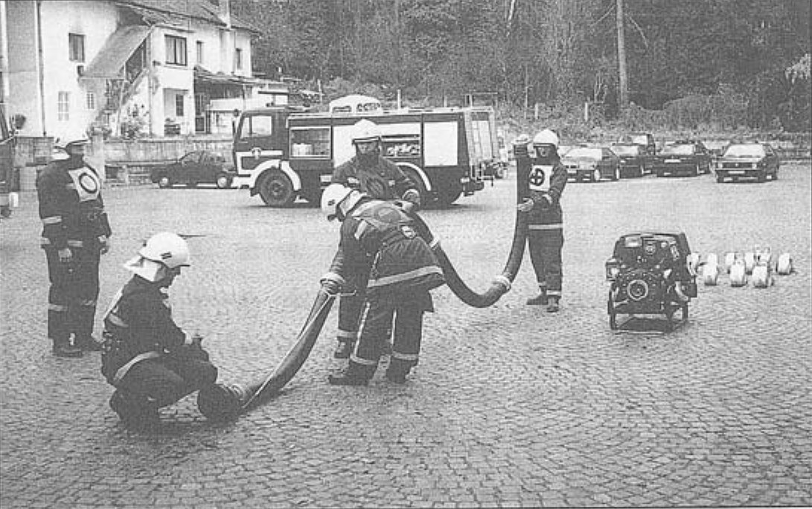

**Slika 58** – *Vezivanje usisnog voda*

##### Prenošenje usisnog voda (slika 59)

Nakon što je V₁ vezao omču kod zadnjeg spoja usisnog voda, strojar izdaje zapovijed: **„Usisni vod u vodu!”**.

Prilikom prenošenja usisnog voda, strojar ostaje na kraju zadnje, četvrte usisne cijevi i drži najmanje jednom rukom za spojnicu. V₁ prima spojnice između treće i četvrte usisne cijevi, barem jednom rukom i drži uže kojim je vezao usisni vod.

V₂ s obje ruke prima spoj između druge i treće usisne cijevi, C₂ s obje ruke prima spoj između prve i druge usisne cijevi, a C₁ s obje ruke prima za spoj usisne sitke i prve cijevi i drži uže kojim je vezao nepovratni ventil. Tako strojar, vodna i cijevna grupa nose spojeni usisni vod u vodu, odnosno do ravnine usisnog otvora motorne pumpe.

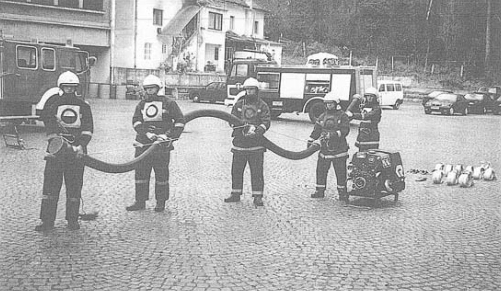

**Slika 59** – *Prenošenje usisnog voda*

V₁ istovremeno sa spajanjem usisnog voda na motornu pumpu postavlja uže ispod tlačnog „B” cijevnog voda i veže ga za prvu desnu ručicu motorne pumpe (slika 60).

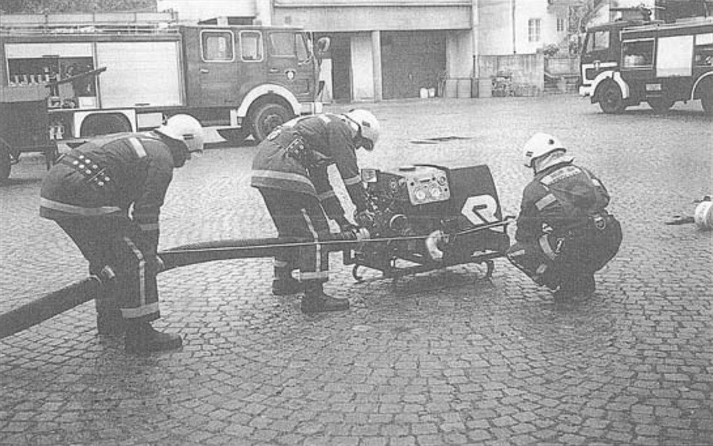

**Slika 60** – *Spajanje usisnog voda na motornu pumpu*

C₁, pošto je položio usisnu sitku u crpilište, vuče uže iz torbice koje je vezao za nepovratni ventil do ravnine motorne pumpe (slika 61, 62).

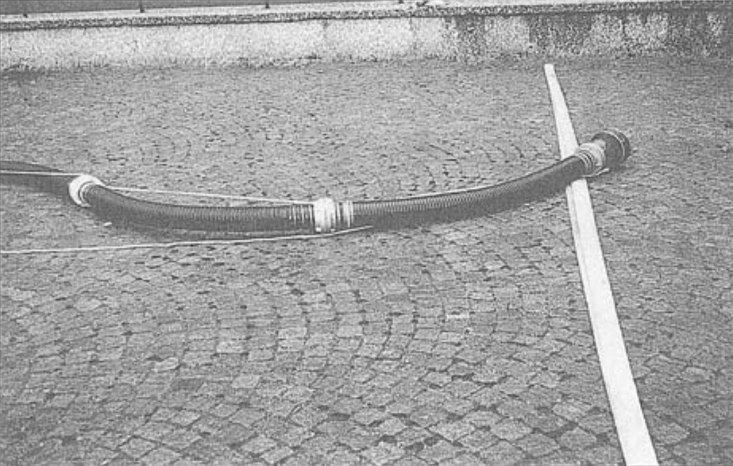

**Slika 61** – *Položaj usisne sitke*

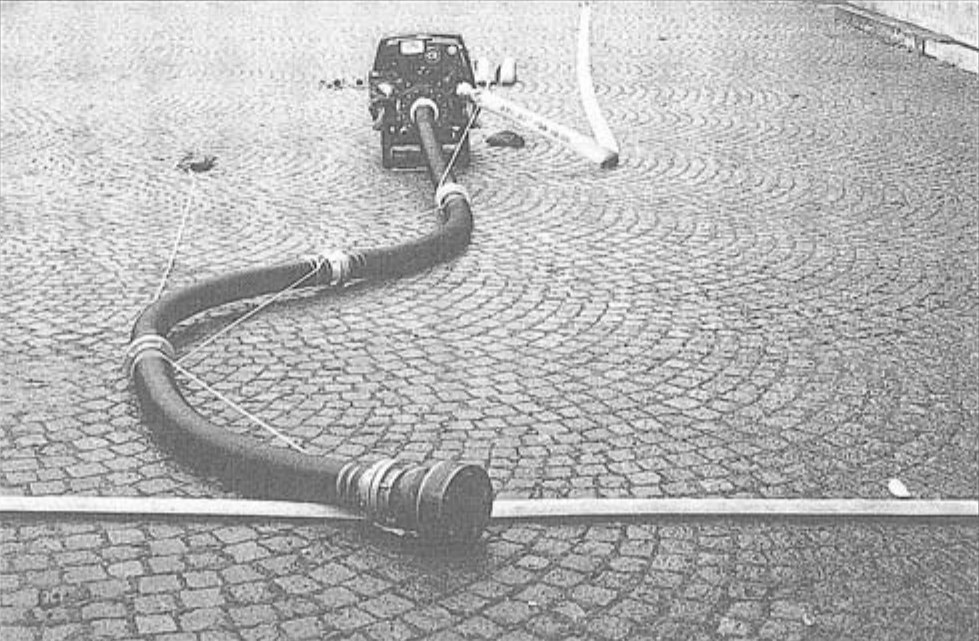

**Slika 62** – *Položaj užeta vezanog za nepovratni ventil usisne sitke*

Čim je strojar usisni vod spojio na motornu pumpu i stavio ključ na spojnicu, zapovijeda: **„Gotovo!”**. Ključ kojim je zatezao spoj može ostaviti kod sebe ili ga odložiti nazad na tlo.

Prije zapovijedi: **„Gotovo!”**, niti jedan član vodne i cijevne grupe ne smije prijeći ispred motorne pumpe, osim V₁ koji veže uže na prednju ručicu i jednom nogom može prekoračiti ispred linije motorne pumpe. Na zapovijed strojara: **„Gotovo!”**, C₂ odlaže usisni vod, uzima torbicu s povezicama i odlazi do spoja prve i druge „B” cijevi, staje korak lijevo od spoja okrenut licem prema požaru. Vođa cijevne grupe (C₁) odlazi na posluživanje razdjelnice.

#### Polaganje „B” cijevnog voda u cijevnom sektoru (slika 63)

Nakon početne zapovijedi zapovjednika, navalna grupa (N₁ i N₂) uzimaju po jednu „B” cijev. Član navalne grupe (N₂) skida nosač „B” cijevi, donju spojnicu priključuje na tlačni otvor motorne pumpe, a gornju spojnicu predaje vođi navalne grupe (N₁) koji povlači cijev prema požaru. Prilikom razvlačenja, član grupe (N₂) pazi da „B” cijev ne dobije oštar luk kod motorne pumpe. Ispravan je onaj luk koji nije veći od 2 m ili nije oštro prelomljen. Kada je vođa grupe (N₁) razvukao prvu „B” cijev, skida nosač sa svoje cijevi i spaja donju spojnicu na spojnicu već razvučene cijevi. Član navalne grupe (N₂), koji je u međuvremenu stigao lijevom stranom, prihvaća slobodni kraj druge „B” cijevi i povlači je u smjeru požara, sve dok ona ne bude ravno položena. Položene cijevi ne smiju biti uvijene. (skica 75).

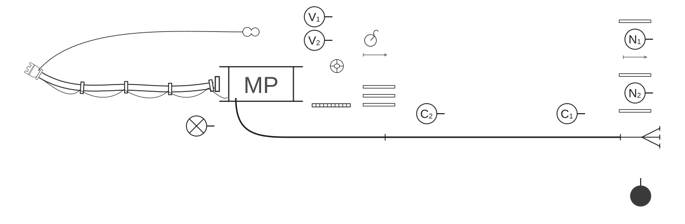

**Skica 75** – *Polaganje „B” cijevnog voda u cijevnom sektoru*

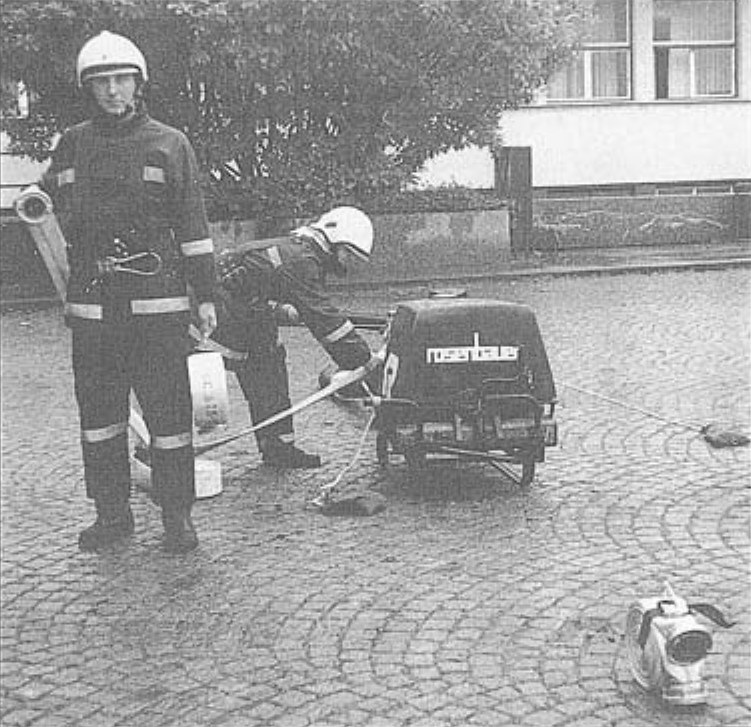

**Slika 63** – *Polaganje „B” cijevnog voda u cijevnom sektoru*

#### Polaganje prvog mlaza u navalnom sektoru

Nakon položenog „B” cijevnog voda članovi navalne grupe (N₁ i N₂) opremaju se za polaganje prvog cijevnog voda za gašenje. Vođa grupe (N₁) uzima „C” cijev, razdjelnicu, držač cijevi i mlaznicu, a član grupe (N₂) uzima 2 „C” cijevi. Tako opremljeni kreću se prema požaru gdje N₁ na kraju „B” cijevnog voda odlaže razdjelnicu, a N₂ odlaže desno od razdjelnice rezervnu „C” cijev, ali ne na veću udaljenost od 2 m. Kada je odložio rezervnu cijev, N₂ skida nosač s druge „C” cijevi, gornju spojnicu predaje vođi grupe (N₁) koji razvlači cijev u pravcu požara. N₂ spaja B i C cijev na razdjelnicu bez propisanog redoslijeda. Vođa grupe (N₁) odlaže spojnicu razvučene C cijevi, skida nosač sa svoje „C” cijevi i spaja cijevi međusobno, a zatim spaja mlaznicu. Čim je spojio mlaznicu N₁ izdaje zapovijed: **„Prvi mlaz vodu daj!”** i čeka dolazak N₂. Član grupe (N₂), dolaskom do vođe grupe (N₁), izbacuje odloženu nerazmotanu „C” cijev u pravilnom luku u bilo kojem smjeru. Mlaznica ne mora biti spojena prije izbacivanja druge „C” cijevi. Vođa grupe (N₁) može izdati zapovijed: **„Prvi mlaz vodu daj!”**, prije nego što član grupe (N₂) dođe do njega. Kada je obavio potrebne radnje, N₂ stane desno od N₁ i okrenuti su u pravcu požara (skica 76).

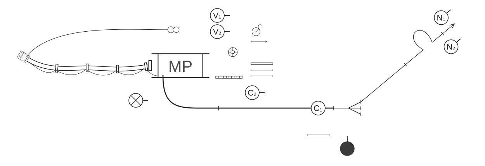

**Skica 76** – *Položaj odjeljenja, sprava i opreme nakon položenog prvog mlaza*

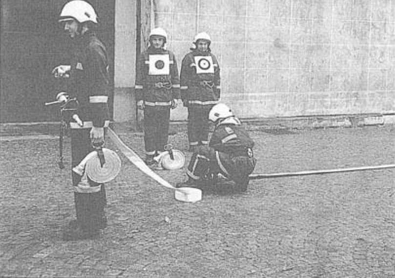

**Slika 64** – *Položaj odjeljenja, sprava i opreme tijekom polaganja prvog mlaza*

#### Posluživanje razdjelnice

Zapovjednik odjeljenja, odmah nakon izdane zapovijedi, zajedno s teklićem odlazi do mjesta gdje će se postaviti razdjelnica. Staje na desnoj strani licem okrenut prema razdjelnici, udaljen 3 koraka od nje, a teklić staje lijevo od zapovjednika, jedan korak iza njega.

Do dolaska vođe cijevne grupe (C₁), razdjelnicu može posluživati teklić. Nakon što je „B” cijevni vod spojen na razdjelnicu, teklić ili C₁ podignu ruku iznad glave i izdaju zapovijed strojaru: **„Vodu daj!”**. Strojar, dizanjem ruke iznad glave, označava da je razumio zapovijed i otvara tlačni ventil na motornoj pumpi. Na zapovijed: **„Prvi mlaz vodu daj!”**, C₁ ili teklić moraju podići ruku iznad glave, čime označuju da su razumjeli zapovijed i otvaraju lijevi ventil (zasun) na razdjelnici. Ako je razdjelnicu posluživao teklić, mora je napustiti čim stigne C₁.

#### Polaganje drugog mlaza u navalnom sektoru

Nakon zapovijedi strojara: **„Gotovo”**, vodna grupa (V₁ i V₂) opremaju se za polaganje drugog mlaza. Vođa grupe (V₁) uzima mlaznicu, držač cijevi i jednu „C” cijev, a član grupe (V₂) uzima dvije „C” cijevi. Tako opremljeni odlaze do razdjelnice gdje V₂ odlaže rezervnu „C” cijev s desne strane od razdjelnice, s druge cijevi skida nosač i gornju spojnicu predaje vođi grupe (V₁) koji je razvlači u pravcu napada, a donju spojnicu član grupe (V₂) spaja na desni izlazni otvor na razdjelnici.

Vođa grupe (V₁) odlaže spojnicu razvučene „C” cijevi, skida nosač sa svoje „C” cijevi i spaja cijevi međusobno, a zatim spaja mlaznicu. Nakon što su „C” cijevi i mlaznica spojeni (V₁) digne ruku iznad glave i zapovijeda: **„Drugi mlaz vodu daj!”**. Vođa cijevne grupe (C₁) diže ruku iznad glave kao znak da je primio i razumio zapovijed, otvara desni ventil na razdjelnici i odmah ustaje. Član vodne grupe (V₂), nakon spajanja prve „C” cijevi na razdjelnicu, dolazi do (V₁), uzima odloženu nerazmotanu drugu cijev, izbacuje je u pravilnom luku u bilo kojem smjeru i staje s desne strane od vođe grupe (V₁). Mlaznica ne mora biti spojena prije izbacivanja druge „C” cijevi.

Nakon završetka vježbe svi članovi odjeljenja moraju ostati na svojim mjestima, okrenuti u pravcu požara, a zapovjednik i teklić prema razdjelnici (skica 77).

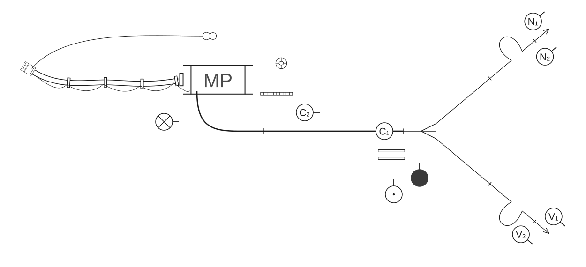

**Skica 77** – *Položaj odjeljenja, sprava i opreme nakon položenog drugog mlaza*

#### Pospremanje opreme

Navalni sektor rada posprema navalna i vodna grupa kao u [vježbi 5](05-Vjezba-5.md). Cijevni sektor rada posprema cijevna grupa kao što je to radila navalna grupa u [vježbi 5](05-Vjezba-5.md). Usisni sektor rada posprema vodna i cijevna grupa uz pomoć strojara kao u [vježbi 3](03-Vjezba-3.md).
