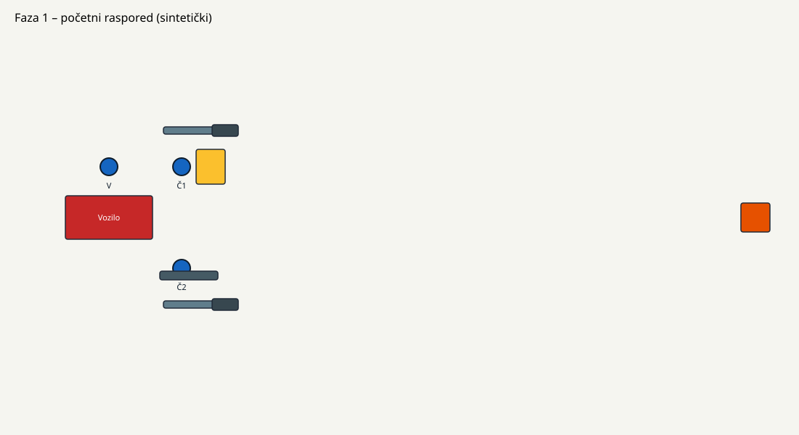

# Sintetička vježba 01 – Postavljanje sintetičkog voda s dvije mlaznice

> **SINTETIČKI PRIMJER.** Ovaj dokument izrađen je isključivo za testiranje simulatora.
> Ne opisuje stvarni vatrogasni postupak, doktrinu ni sigurnosna pravila i ne smije se koristiti u obuci.

## Svrha

Provjera rada simulatora: kretanje osoblja, nošenje i odlaganje opreme, spajanje priključaka,
proceduralne radnje i redoslijed koraka u dvije faze.

## Sudionici i uloge

- **Voditelj** – daje znak za početak i znak za otvaranje mlaznica.
- **Član 1** – postavlja razdjelnik i prvu granu s mlaznicom.
- **Član 2** – polaže veliku cijev i postavlja drugu granu s mlaznicom.

## Oprema

- Vozilo (sintetičko) s dva izlazna priključka
- Cijev s velikim spojem (1 kom)
- Razdjelnik (1 kom)
- Cijev s malim spojem (2 kom)
- Mlaznica (2 kom)
- Oznaka cilja

## Tijek vježbe

Raspored po fazama prikazan je na crtežu:

### Faza 1 – Postavljanje razdjelnika i velike cijevi

1. Voditelj daje znak za početak vježbe.
2. Član 1 uzima razdjelnik i postavlja ga na označeno mjesto razdjelnika.
3. Član 2 uzima cijev s velikim spojem, polaže je i spaja na prvi izlaz vozila.
4. Član 2 spaja slobodni kraj velike cijevi na ulaz razdjelnika.

### Faza 2 – Postavljanje mlaznica

5. Član 1 uzima cijev s malim spojem i mlaznicu, spaja cijev na razdjelnik i postavlja mlaznicu u ciljno područje.
6. Član 2 uzima drugu cijev s malim spojem i mlaznicu, spaja cijev na razdjelnik i postavlja mlaznicu u ciljno područje.
7. Član 1 ili Član 2 javlja spremnost voditelju.
8. Voditelj daje znak za otvaranje, a članovi otvaraju mlaznice.

Koraci 5. i 6. mogu se izvoditi istodobno ili bilo kojim redoslijedom.

## Napomene

- Mjesto razdjelnika i ciljno područje označeni su na crtežu faza.
- Sve vrijednosti udaljenosti u simulatoru tehničke su pretpostavke, a ne propisi.
